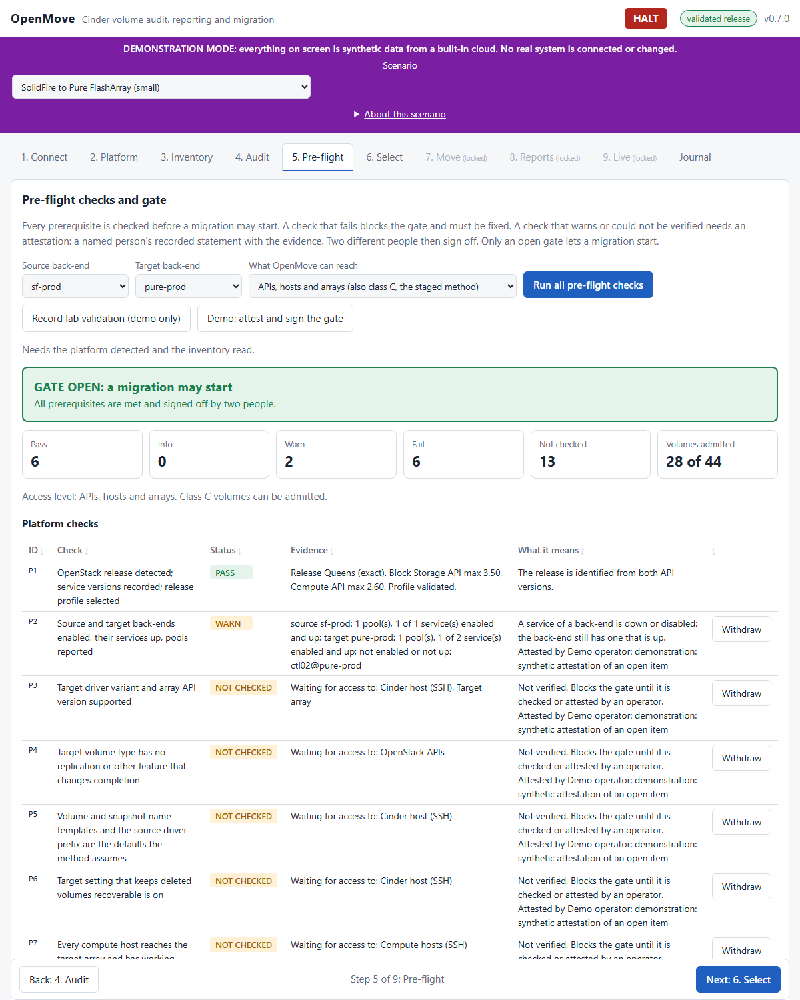

# OpenMove — OpenStack Cinder Volume Automation

OpenMove is a GUI-driven tool that automates the audit, reporting and migration of OpenStack Cinder volumes. It connects directly to an OpenStack cloud and does its work by calling OpenStack's own services and clients, so every action is one the cloud already supports and records.

> **Status:** version 0.7.0, in development. It reads a cloud, classifies its volumes, runs a pre-flight with a gate, builds Word reports and moves class A and class B volumes with Cinder's retype using only the OpenStack APIs. The move engine has run against a real OpenStack lab on a development machine (detached, attached and boot volumes, and the way back); it has **never run against a customer cloud**, and no customer release is validated, so the tool is read only until people record a lab validation. Class C (long-lived snapshots) needs a data mover and is **not built**. 275 automated tests pass. See `docs/ARCHITECTURE.md` for how it is built and `docs/OPERATIONS.md` for how to run it.

## Table of Contents

1. [What It Does](#1-what-it-does)
2. [How It Works](#2-how-it-works)
3. [Getting Started](#3-getting-started)
4. [Repository Layout](#4-repository-layout)
5. [Documentation](#5-documentation)
6. [Development](#6-development)
7. [Data Handling](#7-data-handling)
8. [License and Ownership](#8-license-and-ownership)

---

## 1. What It Does

| Area | Purpose |
|---|---|
| **Audit** | Inventory Cinder volumes across projects and backends, and report their state, attachment, type, size and placement. |
| **Reporting** | Verbose, enterprise-standard reports: every pre-migration check, the volumes to be moved, and progress and update reports for the operations team. |
| **Migration** | Plan and run volume moves between back-ends, with checks before and after each move and rollback of every action. Volumes are chosen one by one or by group; a volume that hosts a workload that may break is not moved until two people clear it; a volume that is not migrated is explained in a report. Class A and B move with Cinder's retype using only the OpenStack APIs; class C needs a data mover and is not built yet (`docs/PLAYBOOK_TRACE.md`). |
| **Lab** | A real OpenStack (DevStack) on a Windows machine, with seeded test volumes, so the real engine can be run and tested without a customer cloud (`docs/LAB.md`). |

Back-end support is broad by design, with a focus on moves to and from NetApp SolidFire, NetApp ONTAP and Pure Storage. Each back-end pair is listed in a support matrix with its migration method and verification status.

The detailed behaviour of each area is defined by the specification in `docs/`.

## 2. How It Works

- **GUI first.** Every function is reachable from the interface; nothing needs a command line.
- **Direct OpenStack integration.** OpenMove authenticates against Keystone and drives Cinder (and the services it depends on) directly. It does not keep its own copy of cloud state beyond what a report or a running job needs.
- **Standalone and on site.** One self-contained application that runs without internet access and contacts OpenStack only.
- **Platform independent.** Runs on Windows, macOS and Linux, as a packaged application, a container or from source. Work that needs Linux block-device tools runs on the remote migration host through a helper OpenMove ships and starts there.
- **Containerised, and controlled entirely from the tool.** Runs as a container, or from its own Linux image where needed. The operator points it at a migration host and does every step, from preparing the arrays and the host to the last report, from the interface. No terminal is required.
- **Version aware.** It detects the OpenStack release and the versions of the services around it, and follows the procedure that release needs. A release it has not been validated against is read only.
- **Safe by design.** Reading code cannot change a cloud: the client refuses every change without a permit that is checked again for each change. Until the cutover the source volume is only read. The order is fixed (pre-check, validate, copy, keep in sync, recheck twice, cutover) and a person can halt everything at once. Every change is journaled with its undo. See `docs/SAFETY.md`.
- **Read before write.** Audit and reporting are read-only. Migration is the only function that changes the cloud, and it shows what it will do before it does it.

## 3. Getting Started

**Nothing needs installing.** The packaged program (`OpenMove.exe`) is one file with everything inside it. From source you need Python 3.9 or later; OpenMove uses the standard library only.

| Start | How |
|---|---|
| Windows | Double-click `OpenMove.bat` (the real tool) or `OpenMove-Demo.bat` (the demonstration). |
| macOS, Linux | `./openmove.sh` or `./openmove.sh --demo` |
| From source | `python -m openmove` or `python -m openmove --demo` |
| The lab (Windows, needs the lab installed) | Double-click `OpenMove-Lab.bat`; stop it with `OpenMove-Lab-Stop.bat` (`docs/LAB.md`) |
| Build the standalone program | `python -m pip install pyinstaller`, then `python tools/build/build_exe.py`; the result is in `dist/` |

OpenMove starts a web server that only this machine can reach, prints a link with a one-time access token and opens it in your browser.

**Demonstration mode** needs no cloud: a built-in cloud with made-up data, three scenarios (SolidFire to Pure, SolidFire to NetApp ONTAP, and a large enterprise cloud on Mirantis Cloud Platform), a simulated migration with a live progress view, and a temporary data folder. Every screen and report says so.

**On a real cloud**, give the address of the OpenStack identity (Keystone) API and an administrator account. That is enough to audit, take the inventory, run the pre-flight and build reports. Moving class A and B volumes needs nothing more than that account, plus a recorded lab validation of the release, an approved gate and a second person's signature for each volume. Class C needs more access (Cinder database, hosts, arrays); see `docs/USER_GUIDE.md` and `docs/OPERATIONS.md`.

1. **Connect:** the password stays in memory and is never written to disk, the journal or a report.
2. **Platform:** the OpenStack release, API versions, back-ends, Cinder services and compute hosts.
3. **Inventory:** volumes by class (A to E).
4. **Audit:** the whole environment, with findings.
5. **Pre-flight:** every check, attestations, two sign-offs, and the gate.
6. **Select:** which volumes move, and the settings.
7. **Move:** the dry run, the run, the second person's signatures, the way back.
8. **Reports**, then **Live:** progress, the order every volume follows, the gate, the halt and the event feed.

The wizard is **gated**: a step opens only when every step before it is done (a locked step says what is missing, and the server enforces it, so a link or a reload cannot skip a step). A real run is refused until a dry run has covered the same volumes, and a changed selection or a new pre-flight closes the later steps again.

The red **HALT** button in the header stops all changes at once. The whole process with screenshots and diagrams is `docs/WALKTHROUGH.md`; every option and setting is in `docs/OPTIONS.md`; the full guide, with the demonstration script, troubleshooting and a glossary, is `docs/USER_GUIDE.md`.

## 4. Repository Layout

| Path | Contents |
|---|---|
| `README.md` | This file: what the project is and how to use it. |
| `CONTEXT.md` | Architecture, file inventory, what is complete, partial and not started. |
| `CHANGELOG.md` | Release history. |
| `version.json` | Current version. |
| `LICENSE` | Proprietary software licence. |
| `LEGAL.md` | Ownership and intellectual property declaration. |
| `THIRD_PARTY_NOTICES.md` | Licences of third-party components and trademark notices. |
| `openmove/` | The application (Python, standard library only). |
| `OpenMove.bat`, `OpenMove-Demo.bat`, `openmove.sh` | Launchers. |
| `OpenMove-Lab.bat`, `OpenMove-Lab-Stop.bat` | Start OpenMove against the lab; stop the lab gracefully. |
| `tests/` | Automated tests and a mock OpenStack cloud. |
| `docs/` | Specification, design and operating documents. See `docs/README.md`. |
| `tools/` | Repository tooling, including the sensitive-data guard. |
| `tools/dev/` | Developer helpers (release bump, documentation screenshots). |
| `tools/lab/` | The lab: setup, start, stop, seed (`tools/lab/README.md`). |
| `tools/build/` | Builds the standalone program. |
| `.githooks/` | Git hooks that enforce the rules in section 7. |
| `data/` | Local runtime data. Never committed. |

## 5. Documentation

Everything in the project is documented, and the documentation changes in the same commit as the code it describes.

| Document | Describes |
|---|---|
| `README.md` | Purpose, usage and layout. |
| `CONTEXT.md` | Architecture and project state. |
| `CHANGELOG.md` | What changed in each version. |
| `docs/` | The documentation set: `WALKTHROUGH.md` (the process, step by step, with screenshots and diagrams; start here), `OPTIONS.md` (every option and setting), `ARCHITECTURE.md` (how it is built), `INSTALL.md` (installation), `OPERATIONS.md` (step-by-step operation), `USER_GUIDE.md`, `PROCESS.md`, `API_CALLS.md`, `SAFETY.md`, `LAB.md`, and the specification and trace documents. Index: `docs/README.md`. |

## 6. Development

See `docs/DEVELOPMENT.md` for the workflow: hooks, the guard, versioning and the release helper.

## 7. Data Handling

OpenMove works with real cloud data (project names, host names, addresses, volume identifiers). None of it may reach this repository. Credential files, exports and reports stay on the machine that produced them, the git hooks and `tools/guard_sensitive.py` block them at commit and push, and examples in documents and tests use placeholders only.

The sole author of this repository is its owner.

## 8. License and Ownership

OpenMove is proprietary software. Copyright © 2026 Eugene Beauzec and Obi1 - FZCO. All Rights Reserved. Personal and non-commercial use is free; commercial use, redistribution and derivative works need the owners' prior written consent. See [LICENSE](LICENSE), [LEGAL.md](LEGAL.md) and [THIRD_PARTY_NOTICES.md](THIRD_PARTY_NOTICES.md).
