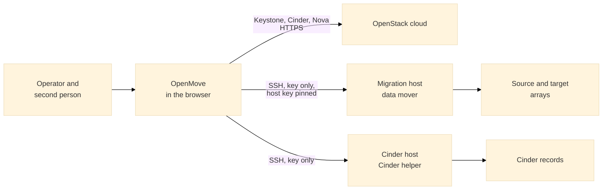
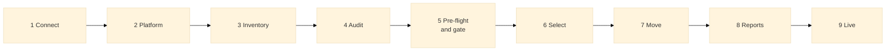
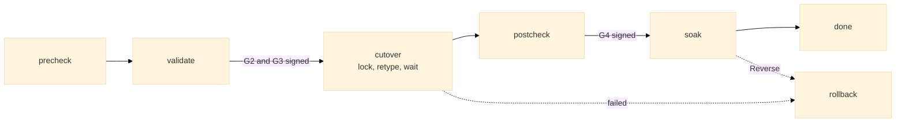
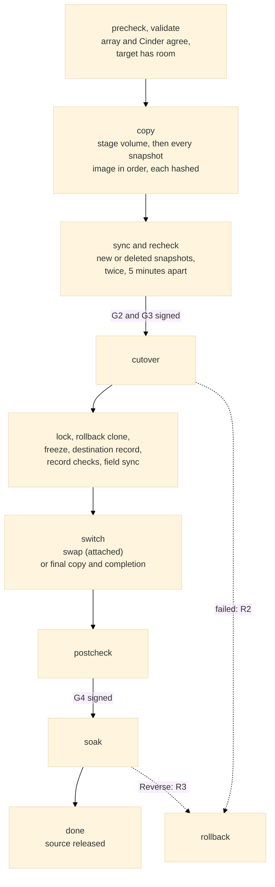

# OpenMove — OpenStack Cinder Volume Automation

OpenMove is a GUI-driven tool that audits, reports on and migrates OpenStack Cinder volumes between storage back-ends (for example NetApp SolidFire to Pure Storage FlashArray). It connects directly to an OpenStack cloud and does its work by calling OpenStack's own services, so every action is one the cloud already supports and records. Where the cloud cannot move a volume (a volume with snapshots), OpenMove copies it through a **data mover** on a migration host and then lets Cinder and Nova switch the volume over.

> **Status:** version 0.9.0 in preparation (0.8.0 is the last release). It reads a cloud, classifies its volumes, runs a pre-flight with a gate, builds Word and Excel reports, moves class A and B volumes with Cinder's retype using only the OpenStack APIs, and moves class C volumes (long-lived snapshots) with the **staged method** through a migration host. The retype engine has run against a real OpenStack lab on a development machine; the staged engine is tested against a fake migration host and, step by step, against the lab's two LVM back-ends. **Nothing has run against a customer cloud**, no release is validated for a customer until people record a lab validation, and the SolidFire and FlashArray array adapters are **not built** (they need those arrays). `docs/COVERAGE.md` is the honest list of what is and is not done.

## Table of Contents

1. [What It Does](#1-what-it-does)
2. [How It Works](#2-how-it-works)
3. [Getting Started](#3-getting-started)
4. [The Process, Step by Step](#4-the-process-step-by-step)
5. [The Operations: What Happens to a Volume](#5-the-operations-what-happens-to-a-volume)
6. [When Something Goes Wrong](#6-when-something-goes-wrong)
7. [Commands and Settings](#7-commands-and-settings)
8. [Repository Layout](#8-repository-layout)
9. [Documentation](#9-documentation)
10. [Development](#10-development)
11. [Data Handling](#11-data-handling)
12. [License and Ownership](#12-license-and-ownership)

---

## 1. What It Does

| Area | Purpose | Read more |
|---|---|---|
| **Audit** | Inventory Cinder volumes across projects and back-ends, and report their state, attachment, type, size and placement. Read only. | [WALKTHROUGH](docs/WALKTHROUGH.md), [CLASSES](docs/CLASSES.md) |
| **Pre-flight and gate** | Every check before a move (P, V, S, C and X catalogue), attestations, and two sign-offs by two different people. Nothing moves until the gate is approved. | [MIGRATION_METHOD](docs/MIGRATION_METHOD.md), [SAFETY](docs/SAFETY.md) |
| **Reporting** | Verbose reports: audit, before, progress, after and update (Word), and the volume list (Excel and CSV). Every volume that was not migrated is explained. | [USER_GUIDE](docs/USER_GUIDE.md) |
| **Migration, class A and B** | Volumes with no snapshots, or snapshots that rotate away, are moved by Cinder's own retype with on-demand migration, using only the OpenStack APIs. | [PROCESS](docs/PROCESS.md) |
| **Migration, class C** | Volumes whose snapshots stay: OpenMove rebuilds the volume and every snapshot on the target through the data mover, proves each image identical, and switches the volume with Nova's volume swap or Cinder's completion. | [MOVER](docs/MOVER.md), [MIGRATION_METHOD](docs/MIGRATION_METHOD.md) |
| **Hosts** | Set up a new migration host or Cinder host from an address and an administrator login (OpenMove installs its key, prepares the host, sets up the iSCSI or Fibre Channel paths and registers it; the password is never kept), a registry of hosts reached by SSH with OpenMove's own key, readiness checks, and automatic placement and removal of the data mover. | [DEPLOYMENT](docs/DEPLOYMENT.md) | What to install where for class A, B and C in production; the host setup script; the rights; the network; the checklist. |
| [MOVER](docs/MOVER.md) |
| **Diagnostics** | A call trace, a log and a **support bundle** with complete debug data, redacted so that no customer data leaves the site. Made for dark sites. | [DIAGNOSTICS](docs/DIAGNOSTICS.md) |
| **Lab** | A real OpenStack (DevStack) on a Windows machine with seeded test volumes, so the real engine can be run and tested without a customer cloud. | [LAB](docs/LAB.md) |

Back-end support is broad by design, with a focus on moves to and from NetApp SolidFire, NetApp ONTAP and Pure Storage. Each back-end pair is listed in a support matrix with its migration method and verification status ([SUPPORT_MATRIX](docs/SUPPORT_MATRIX.md)).

## 2. How It Works

- **GUI first.** Every function is reachable from the interface; nothing needs a command line.
- **Direct OpenStack integration.** OpenMove authenticates against Keystone and drives Cinder and Nova directly. It keeps no copy of cloud state beyond what a report or a running job needs.
- **Standalone and on site.** One self-contained application that runs without internet access. Its only network destinations are the cloud and the hosts you register ([NETWORK](docs/NETWORK.md)).
- **Platform independent.** Windows, macOS and Linux, as a packaged program, a container or from source. Work that needs Linux block-device tools runs on the migration host through a small helper OpenMove places there over SSH and removes again.
- **Version aware.** It detects the OpenStack release and follows the profile that release needs. A release it has not been validated against is read only.
- **Safe by design.** Reading code cannot change a cloud: the client refuses every change without a permit that is checked again for each change. Until the switch the source volume is only read. The order is fixed, two people sign each volume's gates, a person can **halt** everything at once, and every change is journaled with its undo ([SAFETY](docs/SAFETY.md)).
- **Everything leaves evidence.** The journal records each phase, each step with its intent and result, and each sign-off. Before and after states and every call and its answer are kept per volume ([ARCHITECTURE](docs/ARCHITECTURE.md)).
- **Built for dark sites.** If anything goes wrong, the full debug data is in one portable bundle, with an option to redact it (see [section 6](#6-when-something-goes-wrong)).

## 3. Getting Started

**Nothing needs installing.** The packaged program (`OpenMove.exe`) is one file with everything inside it. From source you need Python 3.9 or later; OpenMove uses the standard library only. The migration host needs Python 3.6 or later and the Linux tools for its back-end family (LVM, or iSCSI and multipath). SSH uses the system's OpenSSH client.

| Start | How |
|---|---|
| Windows | Double-click `OpenMove.bat` (the real tool) or `OpenMove-Demo.bat` (the demonstration). |
| macOS, Linux | `./openmove.sh` or `./openmove.sh --demo` |
| From source | `python -m openmove` or `python -m openmove --demo` |
| The lab (Windows, lab installed) | `OpenMove-Lab.bat`; stop it with `OpenMove-Lab-Stop.bat` ([LAB](docs/LAB.md)) |
| Build the standalone program | `python -m pip install pyinstaller`, then `python tools/build/build_exe.py`; the result is in `dist/` |

OpenMove starts a web server that only this machine can reach, prints a link with a one-time access token and opens it in your browser. Installation details are in [INSTALL](docs/INSTALL.md); the full tour of the screens is in [USER_GUIDE](docs/USER_GUIDE.md).

**Demonstration mode** needs no cloud: a built-in cloud with made-up data, three scenarios (SolidFire to Pure, SolidFire to NetApp ONTAP, and a large enterprise cloud), a simulated migration with a live progress view, and a temporary data folder. Every screen and report says so.

**On a real cloud**, give the address of the identity (Keystone) API and an administrator account. That is enough to audit, take the inventory, run the pre-flight and build reports, and to move class A and B volumes (plus a recorded lab validation of the release, an approved gate and a second person's signature for each volume). **Class C** needs more: register a migration host and a Cinder host under **Hosts** (an SSH user and OpenMove's public key, which the screen shows); OpenMove then places the data mover, checks readiness and takes class C volumes into the run. See [MOVER](docs/MOVER.md) and [OPERATIONS](docs/OPERATIONS.md).

## 4. The Process, Step by Step

The wizard is **gated**: a step opens only when every step before it is done, and the server enforces this, so a link or a reload cannot skip a step. The whole process with screenshots is [WALKTHROUGH](docs/WALKTHROUGH.md); every field and setting is in [OPTIONS](docs/OPTIONS.md); running it for real, with roles and checklists, is [OPERATIONS](docs/OPERATIONS.md).

| Step | What OpenMove does | What you do | Changes the cloud? |
|---|---|---|---|
| 1 **Connect** | Logs in to Keystone. The password stays in memory and is never written anywhere. | Enter the identity address and an administrator account. | No |
| 2 **Platform** | Finds the OpenStack release from the API versions, picks its profile, lists back-ends and Cinder services. | Press *Detect* and read the result. An *untested* release is read only. | No |
| 3 **Inventory** | Reads every volume, snapshot and instance and gives each volume a **class** (below). | Choose a back-end filter and the rotation window; optionally import the playbook's database exports. | No |
| 4 **Audit** | Reads types, QoS, backups, projects and quotas and builds findings with a severity. | Run it and read the findings. | No |
| 5 **Pre-flight** | Runs every check (version, services, capacity, snapshots, workload risk, hosts) and records attestations. | Attest what a tool cannot see; two different people sign. **The gate is approved** when both did. | No |
| 6 **Select** | Applies your choice of volumes (one by one or by group) and the settings. | Choose volumes, concurrency, soak days and the run window; confirm. | No |
| 7 **Move** | A dry run shows every call and its undo for every volume. The run then does the work below. | Read the dry run, record lab validation if needed, start the run, and have a second person sign each volume's gates. | **Yes** |
| 8 **Reports** | Builds the Word and Excel reports. | Download them. | No |
| 9 **Live** | Shows progress, the gate, the halt button and the event feed. | Watch; halt if needed. | No |

The volume classes decide how a volume moves ([CLASSES](docs/CLASSES.md)):

| Class | Volume | How it is handled |
|---|---|---|
| **A** | No snapshots | Cinder's retype ([PROCESS](docs/PROCESS.md)) |
| **B** | Snapshots that rotate away within your window | Wait for the rotation, then retype |
| **C** | Snapshots that stay | The staged method through the data mover ([MOVER](docs/MOVER.md)) |
| **D** | Attached to an instance that is not running | Waits until the instance runs |
| **E** | Encrypted, multi-attach, grouped, replicated, wrong state, bad provider id | Left alone, with the cause in the report |

## 5. The Operations: What Happens to a Volume

Each volume follows a fixed order. The lifecycle refuses any step that is out of order or without its evidence, and each gate needs a **second person** (not the operator). The details and the check catalogue are in [MIGRATION_METHOD](docs/MIGRATION_METHOD.md); the safety case is [SAFETY](docs/SAFETY.md).

### Class A and B: the retype

1. **precheck, validate:** the class, the state, the target type and the instance are checked from fresh reads.
2. **cutover:** lock the instance (if attached and not locked already), send one retype with on-demand migration, follow Cinder until it reports success. A retype Cinder accepts and then silently undoes is detected.
3. **postcheck:** the volume is compared with its before-state (status, size, attachments, project, user, creation time and more); a difference halts everything.
4. **soak:** the source is kept for the soak period. **Reverse** (a retype back) stays possible.

### Class C: the staged method

1. **copy:** a staging volume is created on the target and every snapshot image is copied to it in chronological order. After each copy a snapshot of the staging volume is taken under the name the target driver expects, and the image on the target is hashed and compared with the image that was read.
2. **sync, recheck:** a snapshot a tenant made since is copied the same way; one a tenant deleted is noted. The source is read again twice, at least five minutes apart, and must be unchanged.
3. **gates G2 and G3:** a second person signs that the images are identical and that the volume is ready.
4. **cutover:** lock the instance, make a rollback clone, freeze the Cinder record, create the destination record, rename the staging volume to the name Cinder expects, check the record, then switch: Nova's **volume swap** for an attached volume, or a final copy, a compare and Cinder's **completion** for a detached one.
5. **postcheck, G4, soak:** the same checks as above plus the snapshot chain on the array against Cinder.
6. **release:** after the soak the source snapshots, the old backing volume and the rollback clone are removed; a snapshot a tenant deleted is destroyed on the target.

**Rollback.** R1: before anything in Cinder changed, remove what the run created. R2: until the swap is accepted, unfreeze, delete the destination record, remove the staging volume and the clones, unlock. R3: after the switch, the same method the other way round, with a safety copy. Every one is journaled and repeatable.

**Resilience.** Every change is a journaled step with its undo and is safe to repeat. A restart carries on from the journal. An answer that is lost halts everything and is read back before anything else happens. Mover jobs run in the background on the host and survive a lost SSH connection; a job that died is started again.

## 6. When Something Goes Wrong

| Situation | What to do | Read more |
|---|---|---|
| Anything looks wrong | Press the red **HALT** button. Every change stops at once; nothing in flight is touched. A person resumes with a name and a reason. | [SAFETY](docs/SAFETY.md) |
| A volume's post-check failed | OpenMove halts and leaves the instance locked. Look first, then **Reverse** the volume. | [OPERATIONS](docs/OPERATIONS.md) |
| A step failed or a volume was given up | The note on the volume says why, with the whole error text. Rollback runs by itself where it applies. | [OPERATIONS](docs/OPERATIONS.md) |
| You need help, and the site has no internet | Create a **support bundle** from the Diagnostics panel, or `python -m openmove --bundle`. It holds the journal, every step, every call to the cloud and to the hosts with complete output, the log and what each host reported. | [DIAGNOSTICS](docs/DIAGNOSTICS.md) |
| The bundle must not carry customer data | Choose redaction **standard** (addresses, names, identifiers become tokens such as `ip-3` or `uuid-0007`) or **strict**. The same value always gets the same token, so relations stay visible. The token map stays on the site; `python -m openmove --decode uuid-0007` translates a token. | [DIAGNOSTICS](docs/DIAGNOSTICS.md) |
| A host fails its readiness checks | The Hosts panel shows each check (key, Python, rights, tools, storage visibility, Cinder helper) and what to fix. | [MOVER](docs/MOVER.md) |

OpenMove writes a bundle by itself when it halts or hits an unexpected error, so the data is there before anyone asks for it.

## 7. Commands and Settings

| Command | Purpose |
|---|---|
| `python -m openmove` | Start the tool for a real cloud. |
| `python -m openmove --demo [--scenario NAME]` | Start the demonstration; `--list-scenarios` lists them. |
| `python -m openmove --lab` | Start against the OpenMove lab ([LAB](docs/LAB.md)). |
| `python -m openmove --bundle [--redact none\|standard\|strict] [--out FOLDER]` | Write a support bundle and exit ([DIAGNOSTICS](docs/DIAGNOSTICS.md)). |
| `python -m openmove --decode TOKEN` | Translate a redaction token back, on the site that made it. |
| `python -m openmove --self-check` | Check that this installation holds everything class A, B and C need, and exit ([DEPLOYMENT](docs/DEPLOYMENT.md)). |
| `python -m openmove --host-setup mover\|cinder\|both [--out FOLDER]` | Write the host setup script and print the command that runs it on a new host, with OpenMove's key filled in. |
| `--home FOLDER`, `--host`, `--port`, `--allow-host`, `--no-browser` | Data folder and network options ([OPTIONS](docs/OPTIONS.md)). |

The settings (concurrency, soak days, hold before cutover, stop after failures, run window, recheck gap) are chosen in step 6 and listed with their defaults and limits in [OPTIONS](docs/OPTIONS.md). A setting can make the checks stricter, never looser than the process minimum.

## 8. Repository Layout

| Path | Contents |
|---|---|
| `README.md` | This file: what the project is and how to use it. |
| `CONTEXT.md` | Architecture, file inventory, what is complete, partial and not started. |
| `CHANGELOG.md` | Release history. |
| `version.json` | Current version. |
| `LICENSE`, `LEGAL.md`, `THIRD_PARTY_NOTICES.md` | Licence, ownership declaration, third-party licences and trademark notices. |
| `openmove/` | The application (Python, standard library only). |
| `openmove/engine/` | The move engines: retype (`runner.py`), staged (`staged.py`), the only code that sends changes (`actions.py`), checks and dry run (`plan.py`). |
| `openmove/arrays/` | Array adapters (the LVM adapter is built; SolidFire, FlashArray, ONTAP and Ceph are not). |
| `openmove/connectors/` | OpenStack and SSH connectors. |
| `openmove/resources/mover/` | The data mover and the Cinder helper that OpenMove places on hosts. |
| `openmove/hosts.py`, `diag.py`, `redact.py` | Host registry and readiness, diagnostics, redaction. |
| `OpenMove.bat`, `OpenMove-Demo.bat`, `openmove.sh` | Launchers. |
| `OpenMove-Lab.bat`, `OpenMove-Lab-Stop.bat` | Start OpenMove against the lab; stop the lab gracefully. |
| `tests/` | Automated tests, a mock OpenStack cloud and a fake migration host. |
| `docs/` | Specification, design and operating documents ([index](docs/README.md)). |
| `tools/` | Repository tooling, including the sensitive-data guard; `tools/dev/` (release, screenshots), `tools/lab/` (the lab), `tools/build/` (the standalone program). |
| `.githooks/` | Git hooks that enforce the rules in section 11. |
| `data/` | Local runtime data. Never committed. |

## 9. Documentation

Everything in the project is documented, and the documentation changes in the same commit as the code it describes. The full index is [docs/README.md](docs/README.md).

| Read this | To learn |
|---|---|
| [WALKTHROUGH](docs/WALKTHROUGH.md) | **Start here.** The process from the first click to the last, with screenshots and diagrams. |
| [OPERATIONS](docs/OPERATIONS.md) | How to run a migration: roles, preparation, the procedure, the way back, halting, checklists. |
| [USER_GUIDE](docs/USER_GUIDE.md) | Starting the tool, the demonstration, every screen, troubleshooting, a glossary. |
| [OPTIONS](docs/OPTIONS.md) | Every option and setting, with defaults and limits. |
| [INSTALL](docs/INSTALL.md) | Requirements, installing, upgrading, removing. |
| [PROCESS](docs/PROCESS.md), [CLASSES](docs/CLASSES.md) | The fixed order of a migration; what each class is and why a volume might not move. |
| [MIGRATION_METHOD](docs/MIGRATION_METHOD.md), [PLAYBOOK_TRACE](docs/PLAYBOOK_TRACE.md) | The method taken from the owner's playbook, and a step-by-step trace of what is covered. |
| [MOVER](docs/MOVER.md) | The data mover, the Cinder helper, SSH, hosts and readiness. |
| [DIAGNOSTICS](docs/DIAGNOSTICS.md) | The log, the call trace, the support bundle and redaction. |
| [SAFETY](docs/SAFETY.md), [WORKLOAD_RISKS](docs/WORKLOAD_RISKS.md) | The safety case; workloads that may fail a migration. |
| [ARCHITECTURE](docs/ARCHITECTURE.md), [API_CALLS](docs/API_CALLS.md), [NETWORK](docs/NETWORK.md) | How it is built; every call it makes; every network destination. |
| [LAB](docs/LAB.md), [ENGINE_PLAN](docs/ENGINE_PLAN.md) | The OpenStack lab and what it proves; the engine plan. |
| [COVERAGE](docs/COVERAGE.md), [SUPPORT_MATRIX](docs/SUPPORT_MATRIX.md), [REQUIREMENTS](docs/REQUIREMENTS.md), [DESIGN](docs/DESIGN.md) | What is met against the requirements; supported back-end pairs; the requirements; the original proposal. |
| [DEVELOPMENT](docs/DEVELOPMENT.md), [CONTEXT](CONTEXT.md), [CHANGELOG](CHANGELOG.md) | The development workflow; project state; release history. |

## 10. Development

See [docs/DEVELOPMENT.md](docs/DEVELOPMENT.md) for the workflow: hooks, the guard, versioning and the release helper. Run the tests with `python -m unittest discover -s tests -t .` from the repository root.

## 11. Data Handling

OpenMove works with real cloud data (project names, host names, addresses, volume identifiers). None of it may reach this repository. Credential files, exports, reports and support bundles stay on the machine that produced them, the git hooks and `tools/guard_sensitive.py` block them at commit and push, and examples in documents and tests use placeholders only. OpenMove never stores a password: the cloud password lives in memory, and SSH uses key files that stay on disk where the registry only records their location.

The sole author of this repository is its owner.

## 12. License and Ownership

OpenMove is proprietary software. Copyright © 2026 Eugene Beauzec and Obi1 - FZCO. All Rights Reserved. Personal and non-commercial use is free; commercial use, redistribution and derivative works need the owners' prior written consent. See [LICENSE](LICENSE), [LEGAL.md](LEGAL.md) and [THIRD_PARTY_NOTICES.md](THIRD_PARTY_NOTICES.md).
