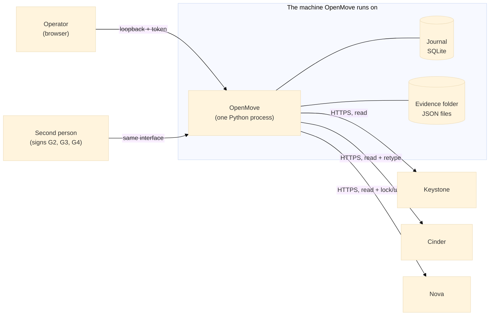
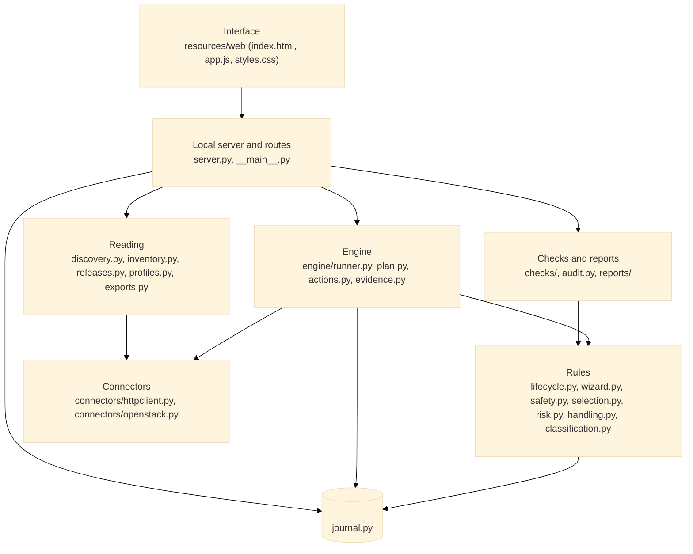
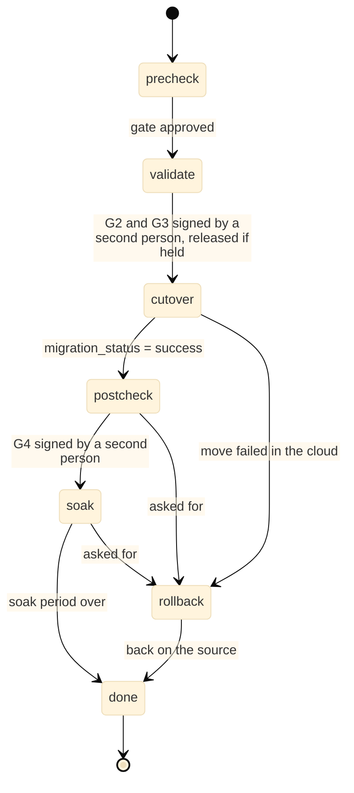
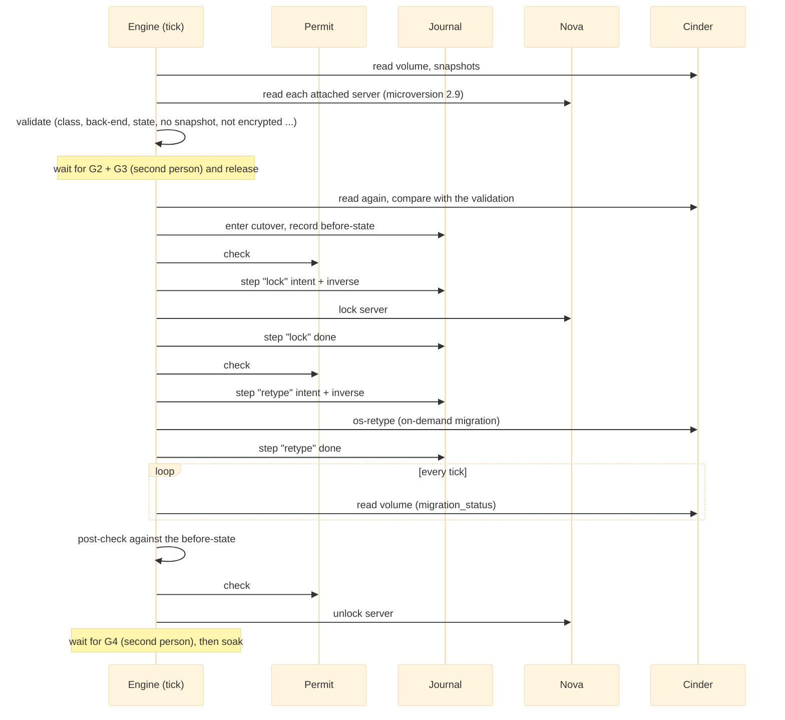
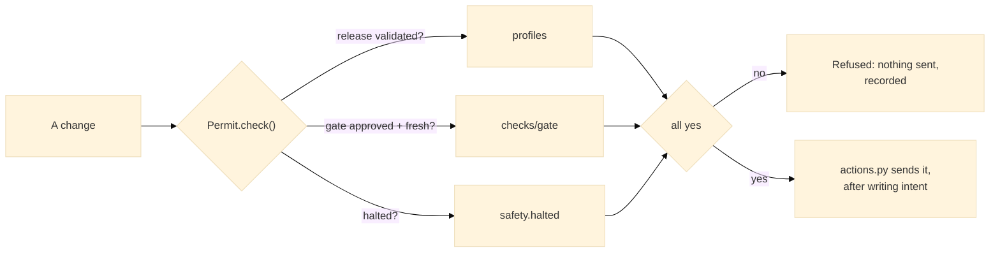
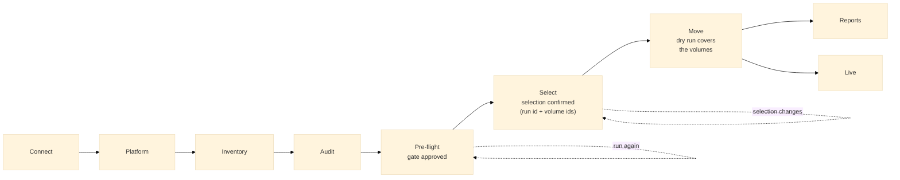

# Architecture

This is the architecture of OpenMove as it is built today (version 0.9.0). `DESIGN.md` is the earlier proposal and still describes what is planned (array adapters for SolidFire and FlashArray, a container image that exists as a Dockerfile but has not been built). This document describes what exists. Where the two differ, this one is true of the code.

## 1. Status in one paragraph

OpenMove reads an OpenStack cloud, classifies its Cinder volumes, runs a pre-flight with a gate, builds reports, and moves class A and class B volumes with Cinder's own retype. It talks to the OpenStack APIs and, for class C, to a migration host and a Cinder host over SSH (`MOVER.md`). The move engine has run against a real OpenStack lab on a development machine (a detached volume, an attached volume and a boot volume, and the way back). It has never run against a customer cloud, and no OpenStack release except the lab's own is marked validated. Class C (long-lived snapshots) is moved by the staged method (`engine/staged.py`) through a data mover on the migration host and a helper on the Cinder host. It has run against the real lab with the LVM adapter, detached and attached; it has not run against SolidFire, FlashArray, Queens or a customer cloud. Without registered hosts that pass their checks, class C volumes are held back with a cause and steps to resolve it. Every failure leaves a log and a support bundle, which can be redacted for a dark site (`DIAGNOSTICS.md`).

## 2. Context

OpenMove contacts the OpenStack service endpoints from the catalogue and nothing else. It has no database access, no SSH and no array access. Anything that would need them is reported as "not checked" and needs a named person's attestation.

## 3. Principles

| Principle | How the code holds to it |
|---|---|
| Standard library only | A test (`test_self_contained.py`) fails if any module imports a third-party package. The packaged program adds only the Python runtime. |
| Reading cannot change a cloud | The HTTP client refuses every request that is not a read unless it carries a `Permit`. Audit, inventory, checks and reports have no permit. |
| A permit is asked for again before every change | `Permit.check()` runs for every mutating call, not once per run. A gate that went stale, a withdrawn sign-off or a halt pressed a second ago stops the very next call. |
| Fail closed | Any unexpected error while asking for a permit is a refusal. There is no override and no force flag. |
| The journal comes first | A change is written down (intent and inverse) before it is sent, and completed afterwards. State lives in the journal, so a restart carries on from it. |
| An unknown outcome halts | If an answer is lost, OpenMove does not retry. It halts, and a person resumes it; the engine then reads the cloud to settle what happened. |
| The source is read before it is trusted | Everything is read again at the moment of the retype. If a volume changed since the validation, the volume is given up, not moved. |
| Text is text | The interface writes with `textContent` and `el()`; nothing from a cloud is ever inserted as markup. |

## 4. Layers and modules

| Layer | Modules | Responsibility |
|---|---|---|
| Interface | `openmove/resources/web/` | The pages. Calls the local routes with the per-run token. No cloud access of its own. |
| Server | `server.py`, `__main__.py` | A `ThreadingHTTPServer` on loopback. Holds `AppState` (what has been read: platform, inventory, checks, selection, the engine). Routes are plain functions `api_*(state, body, query)`. |
| Engine | `engine/` | `runner.py` decides what comes next for each volume; `plan.py` holds the checks and builds the dry run; `actions.py` is the only code that sends a change; `evidence.py` writes the per-volume evidence; `staged.py` runs the staged method for class C. |
| Rules | `lifecycle.py`, `wizard.py`, `safety.py`, `selection.py`, `risk.py`, `classification.py`, `handling.py`, `backends.py`, `phase0.py` | The order of a migration, the gated wizard, the permit and the halt, what is selected and with which settings, workload risk, volume classes, the cause and steps for every volume that is not moved, the back-end families and the support matrix (`resources/backends.json`), and the Phase 0 lab tests with their recorded results (`resources/phase0_tests.json`). |
| Checks and reports | `checks/`, `audit.py`, `reports/` | The check catalogue and the gate, the environment audit, the report documents (`build.py`: pre-migration, audit, not migrated, update and after), the comparison of every volume with its before-state (`after.py`), the Word writer (`docx.py`) and the Excel and CSV writer (`sheet.py`, standard library only). |
| Reading | `discovery.py`, `inventory.py`, `releases.py`, `profiles.py`, `exports.py` | Detect the release and back-ends, read volumes, snapshots and instances, import the playbook's query results when the database is not reachable. |
| Connectors | `connectors/` | Every network call goes through here. Keystone v3, the catalogue, paging, one re-authentication on a 401 (`openstack.py`); SSH to the migration host and the Cinder host with the system OpenSSH client, keys only, pinned host keys (`ssh.py`). The password lives in memory only. |
| Hosts and arrays | `hosts.py`, `server_hosts.py`, `arrays/`, `resources/mover/` | The host registry and its readiness checks; the data mover and the Cinder helper that run on the hosts; the array adapters (`lvm` only). See `MOVER.md`. |
| Diagnostics | `diag.py`, `redact.py` | The log, the trace of every host call, support bundles, redaction for dark sites. See `DIAGNOSTICS.md`. |
| Journal | `journal.py` | SQLite in WAL mode with `synchronous=FULL`. Two tables: `events` and `steps`. |
| Packaging | `Dockerfile`, `tools/build/` | The container image (standard library only, listens inside the container, data in the volume `/data`) and the Windows program. See `INSTALL.md`. |
| Demo and lab | `demo/`, `lab/` | A mock cloud with made-up data, and the link to a real OpenStack on the same machine (section 10). |

## 5. Runtime

* One process. The HTTP server runs a thread per request.
* The engine runs on one background thread. It wakes every 5 seconds and calls `tick()`. A tick looks at every active volume, reads the cloud again, and does at most one next thing for each.
* `AppState` holds what the screens need and is guarded by a lock. It can be rebuilt by reading the cloud again. Nothing the engine needs to carry on is held only in memory.
* The journal and the evidence folder live in the data folder (see `INSTALL.md`).

## 6. How one volume is moved

Class A and B volumes follow the retype order:

Class C follows the staged order (`precheck, validate, copy, sync, recheck, cutover, postcheck, soak, done`) defined in `lifecycle.py`. `engine/staged.py` runs it: the copy and the sync go to the data mover, the cutover is a fixed list of steps (lock, rollback clone, reconcile, freeze, record, verify record, sync fields, switch, wait), and rollbacks R1, R2 and R3 undo it. The per-volume state is kept in the journal, so a restart carries on from the step it stopped at.

The calls of one real move, in order:

Cinder copies the data and Nova switches the guest in one operation that OpenMove cannot pause. For that reason there is no copy, sync or recheck phase in this order: the retype is the cutover.

### What the engine decides, and what it does not

| Situation | Engine action |
|---|---|
| A call is refused (HTTP error, permit refused) | Nothing moved. The volume goes to rollback with the reason. |
| A call has no answer (lost, timed out) | Halt. After a person resumes, the engine reads the volume and closes the step with what the cloud shows. It never sends the call again on its own. |
| `migration_status` is `error` and the volume is usable | Rollback (a retype back), then check the volume is where it was. |
| The volume is in an `error` status | Halt for a person. |
| A retype runs longer than 6 hours | Halt for a person. |
| A class B volume still has snapshots | Wait, up to 72 hours, for them to rotate away; then give up. |
| The post-check differs from the before-state | Halt. The instance stays locked. A person reverses or looks. |
| Someone else locked the instance first | Leave it locked and do not unlock it. |
| The lock state is not shown in the answer | Refuse the volume. An instance is never locked blind. |
| Too many volumes failed in one run | Halt (the "stop after N failures" setting). |

## 7. Safety architecture

* **Release profile.** A release is read only until a passed lab validation (gate G0) is recorded for it. A lab profile (`"lab": true`) lets the engine run against the lab and nowhere else.
* **Gate (G1).** No failed check, every open item attested by a named person, two different people signed, and the pre-flight is fresh (24 hours).
* **Per-volume gates.** G2 and G3 before the retype, G4 before the soak. The signer must not be the operator.
* **Halt.** A button in the header. Needs a name and a reason. Any person may press it. It takes effect before the next change.
* **One sender.** `actions.py` is the only engine code that calls `session.mutate()`. Reading that one file is enough to review every change the engine can make.

* **Gated wizard.** `wizard.py` decides, on the server, which of the nine internal steps (shown as seven on the screen: Platform, Inventory and Audit are one step, Scan) is open. A step opens only when every earlier step is done; the selection must be confirmed for the exact pre-flight run and volume ids; a real run needs a dry run that covered the same volumes. The page only draws what `/api/status` says (`wizard`).

The hazards and the control for each are listed in `SAFETY.md`.

## 8. Data

### The journal

An append-only SQLite database.

| Table | Content |
|---|---|
| `events` | `id, ts, kind, subject, data` (JSON). Kinds include `phase`, `volume_gate`, `attestation`, `signoff`, `preflight`, `platform`, `inventory`, `validation`, `halt`, `resume`, `release`, `engine_*`. Every kind is listed in `API_CALLS.md`. |
| `steps` | `id, job, volume, name, intent, inverse, status, started, finished, evidence`. One row per change. Written with its intent and its inverse before the call, completed after. A row with an intent and no result is an unknown outcome. |

Values stored under a key that looks like a secret are replaced before they are written.

### The evidence folder

`<data folder>/evidence/<volume id>/`:

| File | Content |
|---|---|
| `validated.json` | What the cloud said when the volume was validated, and the checks. |
| `before.json` | The volume, its snapshots and its servers at the moment of the retype. |
| `calls.jsonl` | One line for every change sent or refused. |
| `after.json` | The volume and servers after the move, and the post-check. |
| `failed.json`, `after-reverse.json` | Written when a move failed or was reversed. |

The files hold cloud answers (ids, states, sizes). They never hold a password or a token.

## 9. The local interface

| Control | Detail |
|---|---|
| Address | `127.0.0.1` by default. Another address needs `--host` and prints a warning. |
| Token | A random token for each start, printed in the link. Every route needs it in `X-OpenMove-Token`. |
| Host check | The `Host` header must be an accepted name (`--allow-host` adds one). |
| Headers | `Content-Security-Policy` (including `frame-ancestors 'none'`), `X-Content-Type-Options: nosniff`. |
| Passwords | Sent once to `POST /api/connect`, held in memory, never written to the journal, a report or a response. |

### The gated wizard

The steps are not just tabs (nine internally, seven on the screen). `wizard.steps()` computes, from the state the server holds, which step is done and which is open, and `/api/status` returns it. The page draws it and cannot open a step the server did not open.

* A step is **done** by a fact, not a click: a session exists, a platform was read, an inventory exists, an audit exists, the gate is approved, the selection is confirmed, the dry run covered the volumes the engine would move (or a run already exists, or nothing is movable, or this is the demonstration).
* The confirmation is keyed on the pre-flight run id and the sorted volume ids. A new run or any change to the selection voids it, and every later step closes.
* `POST /api/engine/start` asks `wizard.start_refusal()` first. A restart that resumes an existing run is allowed without a new dry run.

## 10. Three modes

| | Real | Demonstration | Lab |
|---|---|---|---|
| Start | `OpenMove.bat`, `python -m openmove` | `OpenMove-Demo.bat`, `--demo` | `OpenMove-Lab.bat`, `--lab` |
| Cloud | The one you connect to | A built-in mock with made-up data | A real OpenStack (DevStack) on the same machine |
| Data folder | The user data folder | A temporary folder, deleted on exit | `C:\OpenMoveLab\openmove-home` |
| Engine | Real | Not available; a simulation on the Live tab | Real |
| Gate and sign-offs | By people | A button signs for made-up people | A button signs as "Lab operator" and "Lab reviewer" |
| Release validation | By people (G0) | Synthetic | Only for the lab's own profile |

The lab shortcuts exist in lab mode only and say so in the journal. A failed check still blocks. See `LAB.md`.

## 11. Release awareness

`releases.json` maps API microversion maxima to OpenStack releases. `discovery.py` reads the version documents, infers the release and its confidence, and `profiles.py` loads the profile for it (`release_profiles.json`). A profile is `validated` only when the journal holds a passed validation. The Queens profile carries the playbook's findings (driver behaviour, what is not verified). It is `untested` until people validate it in their own lab.

## 12. Tests

| Kind | What it proves |
|---|---|
| Unit and rule tests (`test_lifecycle`, `test_safety`, `test_selection`, `test_checks`, `test_handling`, `test_access`) | The order, the permit, the selection rules, the checks, the causes. |
| Engine tests (`test_engine`) | The retype engine against `demo/mock_cloud.py`, which answers like Cinder and Nova and can inject faults (a lost answer, a refused lock, a failed retype). |
| Cloud tests (`test_cloud`) | Discovery, inventory and the server against `tests/mock_openstack.py`. |
| Lab tests (`test_lab`) | Lab configuration and the Horizon sign-in against a fake dashboard. |
| Documentation tests (`test_docs_sync`) | Every cloud call, route and journal event in the code is in `API_CALLS.md`; the step table is in `PROCESS.md`. |
| Self-containment (`test_self_contained`) | No third-party import. |
| The real lab (`OpenMove-Lab.bat`) | The engine's calls and polling against a real Cinder and Nova. Manual. |

Run the automated tests with `python -m unittest discover -s tests -t .`. There are over 400 of them. A mock proves the logic and the safety rules; it cannot prove how a Queens cloud behaves. The lab proves behaviour against a recent release, and it already found four things the mock did not (`LAB.md`).

## 13. What is not built

| Gap | Effect |
|---|---|
| Array adapters for SolidFire and FlashArray (only `lvm` is built, `arrays/lvm.py`) | Class C moves run on LVM back-ends (the lab and the fake fabric); on a real array pair the adapter is the first thing to write, against the arrays. |
| Direct database access | The checks that need the Cinder database say "not checked" and take the playbook's query results instead; the Cinder helper uses Cinder's own object layer, not SQL. |
| Container image and own Linux image | Run from source, or the packaged program built on the target operating system. |
| Authentication and roles for the interface | Anyone with the token has full use. |

## 14. Where to start reading the code

1. `safety.py` (93 lines): the permit and the halt.
2. `lifecycle.py`: the order and the gates.
3. `engine/actions.py`: every change the engine can send.
4. `engine/runner.py`: what comes next for a volume.
5. `engine/plan.py`: the checks and the dry run.
6. `server.py`: the routes.

## Managing a host after its setup

`bootstrap.py` holds the host setup and, since 0.13.0, the later management of a registered host. The first setup uses the administrator password once (`prepare_host.sh`, then `configure_storage.sh`); `prepare_host.sh` also installs `/usr/local/sbin/openmove-hostctl` and a sudo rule for it. From then on `bootstrap.inspect` and `bootstrap.reconfigure` reach the host with OpenMove's key: they send `inspect_host.py` or `configure_storage.sh` to the control program (`install NAME SHA256`, checked on the host), then run it (`run NAME ARGS`). The request is checked by `bootstrap.clean_storage` (closed patterns and ranges); the management interface is found from the address of the connection (`--mgmt-peer`, from `SSH_CONNECTION`) and the default route and is never changed; the CHAP secret travels on standard input only. The routes are `POST /api/hosts/inspect` and `POST /api/hosts/configure` (`server_hosts.py`); the page is the Helper servers tab. A configuration is saved to the host's registry entry (without secrets) only after a change that succeeded.
