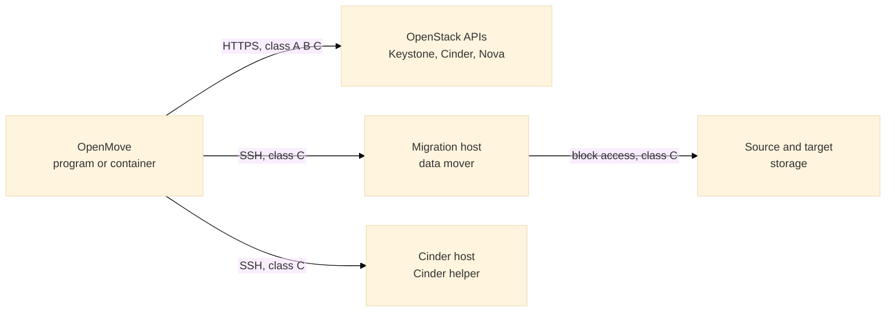

# Deployment: everything class A, B and C need

This page says what to install where, so that OpenMove can move class A, B and C volumes in production, and which parts OpenMove does for you. Read `INSTALL.md` first for the program itself, then this page for the hosts. `MOVER.md` explains how the hosts are used; `OPERATIONS.md` is the day-of procedure.

## 1. What each class needs



| Class | What moves it | What must be in place |
|---|---|---|
| A (no snapshots) | Cinder's own retype, through the APIs | OpenMove, and an OpenStack administrator account. Nothing is installed on any host. |
| B (snapshots that rotate) | The same retype, after OpenMove has waited for the rotation | The same as A. The history that tells B from C comes from the Cinder database, imported as the playbook's query results (`API_CALLS.md`). |
| C (long-lived snapshots) | The staged method: copy, sync, rechecks, cutover, soak | A **migration host** and a **Cinder host** (they may be the same machine), registered in OpenMove and passing their checks. A Nova compute service that is up for every instance that has an attached volume. Free space on the target of **size x (1 + number of snapshots)** per volume. |
| D, E | Not moved | Held back with a cause and the steps to resolve it. |

## 2. What OpenMove does by itself, and what a person does

| Task | Who | How |
|---|---|---|
| Place the data mover on the migration host | **OpenMove** | Sent over SSH, checked by its SHA-256, kept in the login user's `.openmove-mover` folder (check H3) |
| Send the Cinder helper to the Cinder host | **OpenMove** | Sent on standard input for each call; nothing is left on the host |
| Make OpenMove's SSH key | **OpenMove** | When the first host is saved, or by `--host-setup` |
| Run the host checks and say what is missing | **OpenMove** | Hosts tab: H1 to H9, C1, C2 (`MOVER.md`, section 4) |
| Remove the data mover | **OpenMove** | Hosts tab, Remove the data mover |
| Collect logs and write support bundles | **OpenMove** | `DIAGNOSTICS.md` |
| Log in with the administrator password once, prepare the host (account, packages, key, sudo rights, sshd) and register it | **OpenMove**, when a person gives the address and the login | Hosts tab, **Set up a new host from here** (section 4.1) |
| Set up the iSCSI initiator, multipath and the logins to the arrays on the migration host | **OpenMove**, from the description a person gives | `configure_storage.sh`, section 5.1 |
| The same preparation without giving OpenMove a password | **OpenMove's script, run by an administrator** | `prepare_host.sh`, section 4.2 |
| Register the host's initiator name (or FC port names) on each array, zone Fibre Channel, give the host access to the volumes it will see | **A person** | Section 5 (it depends on the arrays; OpenMove shows the name to register) |
| Install a Linux machine with `sshd` and a network leg on the storage network | **A person** | Section 4.1 |
| Compare the host key's fingerprint with the host's own and pin it | **A person** | Hosts tab, Check host key. This is never done by the tool alone |
| Open the firewall between OpenMove and the hosts | **A person** | Section 6 |
| Install the SSH client where OpenMove runs | **A person**, or the container image | Section 3 |

## 3. Where OpenMove itself runs

OpenMove needs Python 3.9 or later (the packaged program carries its own) and the **OpenSSH client** (`ssh`, `ssh-keygen`, `ssh-keyscan`). It needs no other program.

| How it runs | Install | The SSH client |
|---|---|---|
| Packaged program (Windows) | `OpenMove.exe` and its launchers | `ssh.exe` is part of Windows 10 and later (Settings, Optional features, OpenSSH Client) |
| From source (any operating system) | Python 3.9 or later, the repository folder | Linux: the `openssh-client` package. macOS: built in. Windows: as above |
| Container | `docker build -t openmove .` (`INSTALL.md`) | In the image (the `Dockerfile` installs `openssh-client`). Keep `/data` as a volume: the SSH key and the pinned host keys live in it |

After any installation run the self-check. It reads only this machine: the program's files, the data mover and the Cinder helper, the SSH client, the data folder.

```bash
python -m openmove --self-check
```

For the packaged program: `OpenMove.exe --self-check`. For the container: `docker run --rm openmove --self-check`. A `FAIL` names the class that cannot be moved. A `WARN` is something not set up yet (for example, no hosts registered).

## 4. Preparing a migration host and a Cinder host

A host is a Linux machine that OpenMove reaches by SSH. One machine may hold both roles. Use a **dedicated** machine or virtual machine for the migration host: it holds the data of every class C volume while it is copied.

**Requirements for the host**

* Linux with `sshd`, **Python 3.6 or later** (the data mover is written for 3.6 and up and uses only the standard library), and for the migration host `lvm2`, `util-linux` and `coreutils`.
* For the **Cinder host**: the machine that runs `cinder-volume` for the back-ends, and **the Python interpreter that Cinder uses** (in a virtual environment or a container this is not `/usr/bin/python3`). Give its path on the Hosts tab (field Cinder Python). The helper uses Cinder's own object layer; it needs no database password of its own.
* The login account does not have to be `root`. It needs the sudo rights in section 4.3 or to be `root`.

### 4.1 Set up a host from OpenMove (the normal way)

OpenMove sets up a new host by itself. A person prepares a plain Linux machine and gives OpenMove its address and administrator login. OpenMove then does the rest over SSH: it installs its own key, prepares the host, sets up the storage paths, registers the host and checks it. Nothing is typed on the host.

**What a person prepares first**

* A Linux machine (Ubuntu, Debian, Red Hat and its relatives, or SUSE) on the customer network. It needs a management address that the machine running OpenMove can reach on port 22, and a connection to the storage network (an iSCSI network, or Fibre Channel zoning) that reaches both arrays. Use a dedicated machine for the migration host.
* `sshd` running, and an account that OpenMove may use with a password: `root` with `PermitRootLogin yes`, or another account that has passwordless `sudo`. The password login can be switched off again after the setup.
* A way to install packages: the host's package repository, or the packages of section 8.

**What a person does in OpenMove** (Hosts tab, **Set up a new host from here**)

1. Give the host a name, its address, the administrator login and password, and its roles (migration host, Cinder host, or both).
2. **Read the host key.** Compare the fingerprint with the host's own (`ssh-keygen -lf /etc/ssh/ssh_host_ed25519_key.pub` on the host, or its console) and type what you checked, with your name. OpenMove sends the password only after the key is pinned. It refuses a key other than the one you checked.
3. Describe the storage paths when the host needs them (section 5.1): the iSCSI portals, the initiator name, CHAP, the array types. Choose **none** when the host already sees its storage.
4. **Check only** reports what the host is missing and changes nothing. **Set up the host** does the work.

**What OpenMove does.** Each step is shown with its complete output. The host is registered only when every step has passed.

| Step | What happens |
|---|---|
| S1 | Logs in with the password. Reads the operating system and the account. A login that is not `root` must have passwordless `sudo`; OpenMove then runs the scripts through it. |
| S2 | Sends `prepare_host.sh` (section 4.2) to a private temporary folder and runs it: packages, the service account `openmove` with a locked password, OpenMove's key (limited to `--from` when given), the narrow sudo rights, `sshd`. |
| S3 | On a Cinder host: reads the interpreter Cinder uses from the first line of the `cinder-volume` program. A value typed in the form wins. |
| S4 | When storage paths were asked for: sends `configure_storage.sh` (section 5.1) and runs it. |
| S5 | Logs in again as the service account with OpenMove's key only. This proves that the password is not needed any more. |

After S5 OpenMove saves the host (login `openmove`, `sudo` on for a migration host), and runs the host checks H1 to H7 on it. H8 and H9 need the pair of back-ends from the pre-flight and run on the **Check the hosts** button.

**The password.** It is used for steps S1 to S4 and then dropped. It is read from the request, held in memory, and given to `ssh` through the environment of that process and a small helper (`SSH_ASKPASS`). It is not in a command line, a file, the journal, a log, the call trace, a support bundle or an answer. It is not left on the host. The CHAP secret is handled the same way: it goes to the script on standard input and is written only into `iscsid.conf` on the host, readable by root. The registry (`hosts.json`) keeps the storage description without the secret. Change the administrator password after the setup if it was a temporary one.

**Running it again.** Both scripts look before they change anything, so a failed setup is repaired by correcting the cause and pressing **Set up the host** again. To change a host's storage paths, run it again with the new description (the password is asked again; OpenMove does not keep it).

**If it does not work**

| What the step says | Cause and fix |
|---|---|
| "did not accept the password" | Wrong password, a locked account, or `sshd` does not allow it. Check `PermitRootLogin` and `PasswordAuthentication` in `sshd_config`, or use an account that is allowed. |
| "is not root and has no passwordless sudo" | Give the account `NOPASSWD` sudo for the setup, or log in as `root`. |
| "the host key ... is not pinned" | Read the host key and type the fingerprint you checked. The password is not sent before that. |
| S2 "could not install" | No package repository: install the packages of section 8 from the site's media and press the button again. |
| S2 `MISSING sshd` | `sshd` is not running or does not allow key login (the output says which). |
| S4 "iscsid did not start", "multipathd did not start" | The output names the reason: a container or a taken socket, a missing kernel module. Run the setup on a real machine or virtual machine, not in a container. |
| S4 "discovery ... found no target" | The initiator name is not yet registered on the array. Register it (section 5.1) and run again. |

**Status.** Proven in the lab twice. (1) On a bare WSL host that had only `sshd` and the `root` password: S1, S2 and S5 passed, the host was registered and H1 to H7 passed. (2) On a **real virtual machine with its own kernel** (Ubuntu 24.04, kernel 6.8, QEMU with KVM; `LAB.md`, "A real virtual machine for the storage paths"), through the interface: the setup logged in with the password, prepared the host, set the initiator name, set CHAP, logged in to **two iSCSI portals**, and showed **2 sessions and 1 multipath device with 2 paths**; H1 to H7 passed (H7 checked `iscsiadm` and `multipath`). On that machine data written through the multipath device read back identical; with one path logged out the device stayed up on the other and read the same data, and the path came back when logged in again; after a reboot both sessions and the map came back by themselves and the data was identical; running the setup again changed nothing. **Not proven:** the target in the lab is the Linux target (LIO), not a FlashArray or SolidFire, so the Pure and SolidFire multipath settings were written but not exercised against those arrays; Fibre Channel was not tried; the registration of the initiator on a real array is a person's step. The WSL hosts of the lab share one kernel with the Cinder host, so `iscsid` cannot start in a second distro and `multipathd` refuses to start inside a container; step S4 reports exactly these reasons if the setup is tried there.

### 4.2 The script, by hand or from the Hosts tab

OpenMove writes the script and the command, with its own public key filled in:

```bash
python -m openmove --host-setup both --out .
```

The same is on the Hosts tab: **Prepare a host (script)**, with a button to show the command and a button to download `prepare_host.sh`. Choose the role (`mover`, `cinder` or `both`) and, as a protection, the address of the machine that runs OpenMove. Copy `prepare_host.sh` to the host and run the command as an administrator:

```bash
sudo bash prepare_host.sh --role both --user openmove --key 'ssh-ed25519 AAAA... openmove' --from 192.0.2.5
```

| Option | Meaning |
|---|---|
| `--role mover\|cinder\|both` | What the host does. A mover needs LVM tools and sudo rights to run the data mover. A Cinder host needs the right to run commands as the Cinder service user. |
| `--key` or `--key-file` | OpenMove's public key (shown on the Hosts tab). |
| `--user` | The service account (default `openmove`). It has no password. |
| `--cinder-user` | The Cinder service user (default `cinder`). |
| `--from` | Only this address may log in with the key (written as `from="..."` in `authorized_keys`). Recommended. |
| `--python` | The interpreter to check (default `python3`). |
| `--check` | Report what is missing; change nothing. Use it before and after. |

The script is safe to run again. It does these steps, and each step looks before it changes anything:

1. Installs `python3`, `sshd` and, for a mover, `lvm2`, `util-linux`, `coreutils` from the host's own package repository (`apt-get`, `dnf`, `yum` or `zypper`). On a host without access to a repository it stops and names what to install by hand (see section 8, dark sites).
2. Creates the service account with a locked password.
3. Adds OpenMove's key to the account's `authorized_keys`, with no port, agent or X11 forwarding.
4. Writes the sudo rights to `/etc/sudoers.d/openmove` (checked with `visudo`).
5. Makes sure `sshd` runs and allows key login.
6. Prints a report that lines up with the host checks.

The script never touches storage, volumes or OpenStack.

### 4.3 The rights, exactly

| Role | Sudo right (no password) | Why |
|---|---|---|
| Migration host | `(root) /usr/bin/env OPENMOVE_MOVER_HOME=* * */.openmove-mover/mover-*.py *` | The data mover must administer logical volumes and block devices as root. |
| Cinder host | `(cinder) ALL` | The helper must run as the user that can read `cinder.conf`. It never runs as root. |

**Security note.** OpenMove places the data mover in the service account's own folder, so a person who controls that account can run a program of their own as root on the migration host. Treat the account as root on that machine: a dedicated host, key login only, the key restricted with `--from`, and no other use of the machine. The data mover itself writes only to volumes that carry its tag and to files in its own folder, and it checks every name and path (`MOVER.md`, section 5, hazard 47 in `SAFETY.md`). If the policy of the site does not allow this, log in as `root` with a key restricted to the OpenMove address instead; the checks accept both.

### 4.4 By hand

The script is a convenience. An administrator can do the same by hand:

1. Install the packages in section 4.2, step 1.
2. `useradd --create-home openmove && passwd -l openmove`.
3. Append the line to `/home/openmove/.ssh/authorized_keys` (mode 700 on the folder, 600 on the file).
4. Write the rights of section 4.3 to `/etc/sudoers.d/openmove` and check them with `visudo -cf`.
5. `systemctl enable --now sshd`.

## 5. Storage access for the migration host

OpenMove sets up the host's side (section 5.1). A person does the array's side and the network: that depends on the arrays and OpenMove does not change an array.

The migration host copies from the source storage to the target storage, so it must **see the block devices of both back-ends at the same time**. Check H8 verifies this for the pair you choose.

| Back-end | What the host needs |
|---|---|
| LVM back-ends (the lab, and any site that uses the Cinder LVM driver) | Both volume groups visible on the host (`vgs`). In the lab both are on the same machine. At a site, the host usually sits on the same storage network as the storage nodes. |
| SolidFire and FlashArray | The host must reach both arrays by iSCSI or Fibre Channel (initiators logged in, multipath running, a host entry on each array with access to the volumes it will see). **The array adapters are not written yet** (`COVERAGE.md`): until they are, class C moves run on LVM only. This section says what the adapter work needs. |

Preparing the arrays (host entries, access groups, quotas, the type that maps to each back-end) is done by the storage administrators with the arrays' own tools; OpenMove does not change an array.

### 5.1 Storage paths that OpenMove sets up (iSCSI and Fibre Channel)

The form of section 4.1 takes this description. `configure_storage.sh` (in `openmove/resources/deploy`, also usable by hand: `bash configure_storage.sh --help`) applies it. It never creates, maps, formats or deletes a volume.

| Field | Meaning |
|---|---|
| Protocol | `none` (the host sees its storage already, as in the lab), `iscsi` or `fc` |
| Array portals | One address per line, `IP` or `IP:port` (default port 3260). Use at least two for a second path |
| Initiator name | Empty keeps the name the host has. A name given (`iqn.`, `eui.` or `naa.`) is set, but not while sessions are open |
| CHAP user and secret | For arrays that need CHAP. The secret goes in on standard input and is not kept by OpenMove |
| Array types | Ready-made multipath settings for Pure FlashArray and for SolidFire. They are starting values taken from the vendors' guides: check them against the current guide of the array before production |
| Path replacement timeout | Seconds before iSCSI gives up a path (default 15; the system default of 120 makes a path failure slow) |
| Extra multipath text | Added to OpenMove's drop-in file |

What the script does on the host, each step only when it differs:

1. Installs `open-iscsi` (iSCSI) and `multipath-tools` from the host's package repository (`iscsi-initiator-utils` and `device-mapper-multipath` on Red Hat).
2. Sets `node.startup = automatic` and the replacement timeout in `/etc/iscsi/iscsid.conf`, and CHAP when given. The original file is kept once as `iscsid.conf.openmove-orig`.
3. Sets the initiator name when one is given.
4. Writes `/etc/multipath/conf.d/openmove.conf` (a drop-in). It leaves an existing `/etc/multipath.conf` as it is; when the host has none, it makes a small one with `find_multipaths yes` so that local disks are left alone.
5. Loads `dm_multipath` (and `iscsi_tcp`) and keeps them loaded at boot (`/etc/modules-load.d/openmove-storage.conf`), starts `iscsid` and `multipathd`.
6. For each portal: discovers the targets, makes the login automatic at boot, logs in, rescans, and reloads multipath.
7. Reports the sessions, the multipath devices and the paths per device. A device with one path is a warning. For Fibre Channel it prints the host's port names.

**What a person does with the answer.** The result shows the **initiator name** (or the **FC port names**). Register it on each array: a host entry (FlashArray) or an access group (SolidFire), and give it the volumes it will see. For Fibre Channel, zone the ports. Then press **Set up the host** again: the script finds the targets and logs in. Open the firewall for iSCSI (port 3260) between the host and the arrays.

## 6. Network

| From | To | Port | Why |
|---|---|---|---|
| The machine that runs OpenMove | Keystone, Cinder, Nova | 443 or the catalogue's ports | All classes |
| The machine that runs OpenMove | Migration host, Cinder host | 22, or the port on the host's entry | Class C |
| The migration host | Source and target storage | iSCSI 3260 or Fibre Channel | Class C copy |
| The Cinder host | The message queue and the database that Cinder itself uses | As Cinder already does | The helper runs inside Cinder's own configuration |

OpenMove never opens a connection from the hosts back to itself, and the interface listens on `127.0.0.1` by default. `NETWORK.md` lists every connection OpenMove can open.

If the hosts are reached through a jump host, set it on the host's entry (field `jump`).

## 7. The first connection

1. Hosts tab: **Set up a new host from here** (section 4.1). It reads the host key, takes your check of the fingerprint, logs in with the password once, prepares and registers the host and sets up its storage paths. If the administrator password cannot be given to OpenMove, use **Prepare a host (script)** (section 4.2) and then **Add or change a host**, **Check host key** and **Trust**.
2. Register the host's initiator name on the arrays (section 5.1) and run the setup again.
3. The host is saved with the service account. Check that the key was pinned: OpenMove then refuses any other key for that address.
4. **Run the checks.** The data mover is placed by check H3. Every row must pass; a failed row says what to do.
5. Run the pre-flight. Class C volumes are admitted only when the checks pass.

## 8. Dark sites and air-gapped hosts

* The program, the data mover and the Cinder helper travel inside one installation; nothing is downloaded when a move runs.
* The container image or the packaged program is carried in. The image needs a registry or `docker load`.
* A host with no package repository needs `python3`, `lvm2`, `util-linux`, `coreutils` and `openssh-server` installed from the site's own media; the script then runs the remaining steps and reports `ok` for the packages.
* Everything that goes wrong leaves a log and a support bundle that can be carried out with customer data replaced by tokens (`DIAGNOSTICS.md`).

## 9. Upgrading and removing

* **Upgrade OpenMove:** replace the program or the image. The data mover on the hosts is replaced by the check that places it (the file name carries a hash, so the old file is never reused by mistake). No host needs a manual step.
* **Remove from a host:** Hosts tab, **Remove the data mover** (it removes the folder `.openmove-mover` and everything in it). Then delete the account and `/etc/sudoers.d/openmove` by hand, or run `userdel -r openmove`.
* **A volume that stops half-way** leaves only objects that carry the tag `openmove` (staging volumes, clones); the rollbacks remove them, and `MOVER.md` lists the cleanup if a person must.

## 10. A checklist for the day before

| # | Check | Where |
|---|---|---|
| 1 | `--self-check` shows no FAIL | The machine that runs OpenMove |
| 2 | The setup with **Check only** (or `prepare_host.sh --check`) shows no MISSING | Each host |
| 3 | Host keys compared and pinned | Hosts tab |
| 4 | H1 to H9 and C1, C2 pass for the pair of back-ends | Hosts tab |
| 5 | Free space on the target: size x (1 + snapshots) per class C volume | Arrays or `vgs` |
| 6 | Compute services up for every instance with an attached volume | `openstack compute service list` |
| 7 | A support bundle can be written and carried out (`--bundle --redact standard`) | `DIAGNOSTICS.md` |
| 8 | A two-person sign-off is arranged for G2, G3 and G4 | `OPERATIONS.md` |
