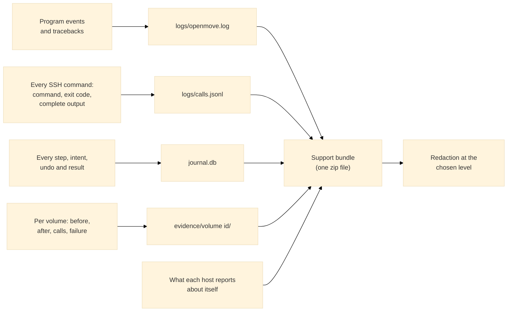

# Diagnostics, support bundles and redaction

OpenMove is used on dark sites: machines with no internet, where the developer cannot log in. If anything goes wrong, **everything needed to find and fix the fault must already be on the machine, and must be easy to carry out**. This page describes what OpenMove records, the **support bundle** that packs it, and the **redaction** that keeps customer data out of the bundle while leaving enough for a developer to work.

Rules the code follows (and tests check, `tests/test_diag.py`, `tests/test_redact.py`):

* **Never shorten an error.** The full text of every failure goes into the journal, the log and the evidence file, whatever its length.
* **Never swallow an error.** An exception that is caught is logged with its traceback; a failure to collect something is itself recorded in the bundle (`collection-notes.txt`, `hosts/<name>.<role>.error.txt`).
* **A full disk or a failed log never stops a migration.** The journal is the record; the log is the aid.
* **Nothing is sent anywhere.** A bundle is a file in the data folder. A person carries it out (`NETWORK.md`).

## 1. What is recorded all the time



All of this is in the data folder (`INSTALL.md`; the folder given with `--home` otherwise).

| What | Where | Content |
|---|---|---|
| The log | `logs/openmove.log` | One JSON line per event the program thinks matters: start, a run, a stage, a refusal, a halt, a surprise, every traceback. The 500 message on the screen points here. |
| The call trace | `logs/calls.jsonl` | One JSON line per command run on any host over SSH (mover and Cinder helper verbs too): the command, the arguments, how long, the exit code and the **complete** output. |
| The journal | `journal.db` | Every event and every step with its intent, its undo and its result (`API_CALLS.md`, section 5). The state of the staged method is in events of kind `stage`. |
| The evidence | `evidence/<volume id>/` | Per volume: `validated.json`, `before.json`, `after.json`, `calls.jsonl` and, after a failure, `failed.json` with the complete error. |

Logs rotate at 20 MiB, five files kept (`openmove.log.1` to `.5`). The log can itself be redacted as it is written (section 4).

## 2. The support bundle

One zip file, `bundles/openmove-support-<time>-<level>.zip` in the data folder. Built:

* on the **Diagnostics** tab (**Create a support bundle**, then **Download**), or
* on the command line, without a server: `python -m openmove --bundle [--redact none|standard|strict] [--no-remote] [--out FOLDER] [--home FOLDER]`, also when the program is stopped, or
* **automatically** when a run halts or an unexpected error occurs: a light bundle (no collection from hosts) is written by itself, once per distinct reason, at most eight per run, so the data exists before anyone asks.

| File | Content |
|---|---|
| `README.txt` | What the bundle is, its contents, the redaction level and how to turn a token back |
| `manifest.json` | OpenMove version, time, reason, level, tokens by kind, and the **SHA-256 of every file** |
| `environment.json` | Versions of OpenMove, Python and the SSH client; the clock; free disk; the command line |
| `settings.json` | The diagnostics settings |
| `journal/events.jsonl`, `journal/steps.jsonl` | Every event and step, oldest first |
| `state/*.json` | What the screen showed: inventory summary and volumes (id, class, size, status, back-end, type, snapshots, cause), platform, pre-flight, the engine's view, the hosts and their last readiness |
| `evidence/…` | The evidence of every volume |
| `logs/…` | The log and the call trace, with their rotated files |
| `hosts/<name>.mover.json` | What the migration host reports (read-only commands): kernel and OS, disks, logical volumes with tags and origins, device mapper, iSCSI sessions, multipath, the mover's jobs with status and log tail, the mover's files and hashes, the last kernel messages |
| `hosts/<name>.cinder.json` | What the Cinder host reports: package versions, the **sanitised** `cinder.conf` (every option whose name suggests a secret is removed), the services, the volumes and destination records of the run as Cinder sees them, and the Cinder log lines that mention them |
| `collection-notes.txt`, `hosts/…error.txt` | What could not be collected, and why |

Collection from a host runs read-only commands (`mover diag`, `cinder diag`) and is skipped with `--no-remote` or `remote: false`. A host that does not answer is recorded as an error file; the bundle is still written.

## 3. Redaction levels

Redaction runs **when the bundle is built**, so a site can keep complete logs on its own disk and still send a bundle that holds no customer data.

The principle: values are not blanked; they are replaced by **stable tokens**. The same address is always `ip-3`, the same volume always `uuid-0007`, the same server name `name-12`. Structure, counts, sizes, times, states, error texts and the order of events stay, so a developer sees *this* volume's snapshot failed on *that* host, without knowing which.

| Level | What is replaced | What stays |
|---|---|---|
| **none** | Nothing | Everything. For a site that may share all of it. |
| **standard** (default) | IP addresses (v4 and v6), host names and domain names, URLs' hosts, e-mail addresses, UUIDs and 32-character ids, checksums (equal checksums stay equal), names of people, projects, volumes, servers and hosts (by key and wherever a learned name appears in free text), user names in paths, long token-like strings, and **every secret**: any value under a key such as password, token, key, secret, authorization, and any `password=…`, `Authorization: Bearer …` written into free text | Back-end names, volume type names, driver names and versions, sizes, counts, times, states, ports, paths, error texts, file and module names |
| **strict** | Everything above, and back-end, pool, volume type, availability zone and domain names (`host@backend#pool` strings too), and free-text fields cut to 60 characters | Structure, counts, sizes, times, states and the order of events |

### What a developer can still do

| Question | Answer from a redacted bundle |
|---|---|
| Which step failed, and why? | Yes: the step name, the error text (tokens for names and addresses) and the exit code stay |
| Is it one volume or many? Which hosts? | Yes: tokens are stable across every file |
| What does the Cinder log say around the failure? | Yes, with the same tokens |
| What did the array or the host return? | Yes, as far as it holds no secret |
| Which customer? Which address? | No. At the site: `python -m openmove --decode ip-3` |

### Where the map is

The map from token to original is kept only in the data folder (`diag/redaction-map.json`). It is **never put in a bundle** and never sent. A developer who needs to know what `name-12` is asks the person at the site, who runs:

```bash
python -m openmove --decode name-12
```

or uses **Decode** on the Diagnostics tab. Secrets are never stored in the map.

### Limits to be honest about

Redaction recognises what it can describe: addresses, names it was told or finds under a name-like key, identifiers, secrets. It cannot recognise a customer's name in a sentence a person typed into a free-text field unless that name appears elsewhere as a name, and it cannot know that a number is an account number. Strict cuts free text for this reason. **Look at a bundle before it leaves the site**: it is a zip of text files, and `manifest.json` lists them. Tests (`tests/test_diag.py`) check that a seeded set of addresses, names, e-mail addresses, host names and passwords is gone from every file at both levels.

## 4. The Diagnostics tab and the settings

| Control | Effect |
|---|---|
| **Redaction in the bundle** | `none`, `standard` (default) or `strict`; the level of the bundle made with the button. Automatic bundles use the saved setting |
| **Log redaction** (**Save**) | `none` (default) or a level: the log is redacted as it is written. The call trace follows the same setting. Choose this where the log itself must not hold customer data |
| **Create a support bundle** | Builds one now (with **also collect from the registered hosts** ticked or not) and lists it |
| **Download** | Saves a bundle through the browser (only names OpenMove made are served) |
| **Token**, **Decode** | Turns `ip-3`, `uuid-0007` and the like back, at the site only |
| The log files and bundles listed | Names and sizes; the folder is shown |

The settings are saved in `diag/diag.json`. Every change is logged.

## 5. What to send when something goes wrong

1. Press **Halt** if a run is in progress (`SAFETY.md`). Do not resume until the cause is understood.
2. Create a support bundle (Diagnostics tab or `python -m openmove --bundle`) at **standard**, or **strict** if the site's rules say so. If a halt or an error already wrote one, it is in `bundles/` and is enough to start.
3. Look inside if the site requires it; carry the zip out by the site's approved way.
4. Say what you did and saw in a sentence or two. The bundle holds the rest.

A developer then reads, in this order: `manifest.json` and `environment.json` (the version and the clock), `journal/events.jsonl` (what happened, in order), the failing volume's `evidence/…/failed.json`, `logs/openmove.log` (the traceback), `logs/calls.jsonl` (the exact command and its complete output), `hosts/…` (what the host looked like), and patches from there.

## 6. Where this is in the code

| File | Role |
|---|---|
| `openmove/diag.py` | The log, the call trace, the bundle, the decode |
| `openmove/redact.py` | The redactor and its map |
| `openmove/connectors/ssh.py` | The trace of every command (`TRACE`, `trace()`) |
| `openmove/server_hosts.py` | The Diagnostics routes (`API_CALLS.md`, section 4) and the data that the screen adds to a bundle |
| `openmove/engine/runner.py` | `failure()` (full text to the log) and `auto_bundle()` |
| `openmove/__main__.py` | `--bundle`, `--decode` and the options |
| `openmove/resources/mover/mover.py` (`diag`), `cinder_helper.py` (`diag`) | What a host reports about itself |
