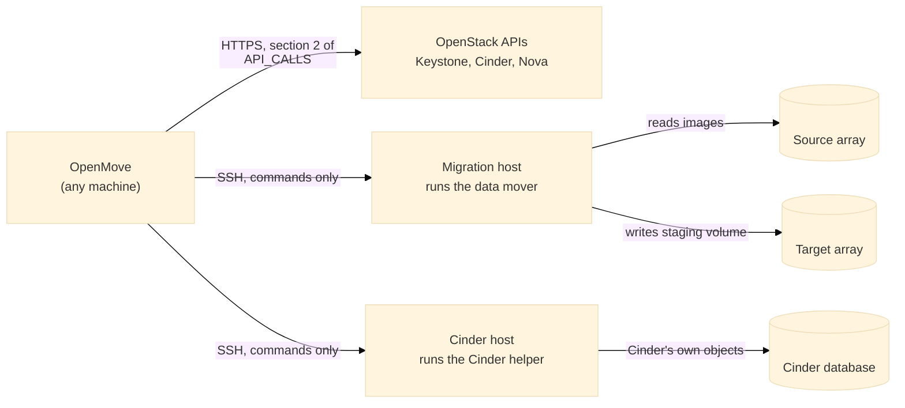
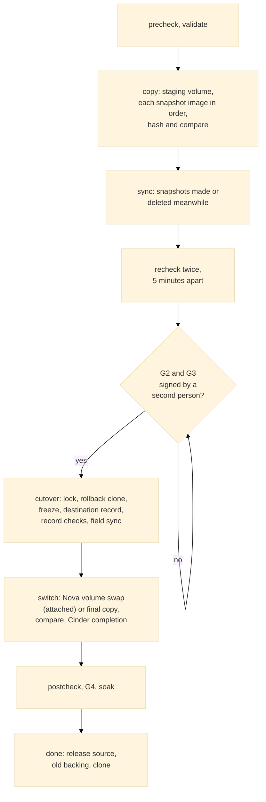

# The data mover, the Cinder helper and the hosts

Class C volumes (snapshots that stay) cannot be moved by a retype: Cinder will not migrate a volume that has snapshots. OpenMove moves them with the **staged method** (`MIGRATION_METHOD.md`): it rebuilds the volume and every snapshot on the target, proves each image identical, and switches the volume. The bulk copy cannot run inside OpenMove, because OpenMove often runs on an administrator's laptop and the data must go from array to array through a machine that sees both. This page describes the parts that do this work, how OpenMove reaches them, how they are installed and removed, and what each one is allowed to touch.

Everything here is operated from the screen (the **Hosts** tab). Nothing needs a terminal on the migration host.

## 1. The parts

| Part | Where it runs | What it is | What it does |
|---|---|---|---|
| **OpenMove** | Any machine (Windows, macOS, Linux) | The program | Decides what comes next, keeps the journal, signs nothing by itself. Sends commands; never carries volume data. |
| **Data mover** | The **migration host** (Linux) | `openmove/resources/mover/mover.py`, one file, Python 3.6 or later, standard library only | Lists, creates, snapshots, renames and removes the staging volumes it made; copies, hashes and compares images as background jobs; reports on the host. |
| **Cinder helper** | The **Cinder host** (the machine that runs `cinder-volume`), with Cinder's own Python | `openmove/resources/mover/cinder_helper.py`, Python 2 or 3 | The few things Cinder's REST API cannot do, through Cinder's own object layer: create and delete the destination record, freeze and unfreeze the source record, copy the fields a tenant can still change. |
| **Array adapter** | Inside OpenMove | `openmove/arrays/` | Turns the method's needs (find a volume, make a staging volume, snapshot it under the driver's name, compare) into data-mover calls for one family of back-ends. |

One host can have both roles. A host may also be **local** (OpenMove runs on the migration host itself); the same commands run without SSH.

### What exists today

| Back-end family | Adapter | Proven |
|---|---|---|
| LVM (the OpenStack lab, and any host that sees an array through LVM) | built (`arrays/lvm.py`) | In the lab (`LAB.md`) and with the fake fabric in the test suite |
| SolidFire | **not built** | Needs a SolidFire cluster to write and prove against |
| Pure Storage FlashArray | **not built** | Needs a FlashArray to write and prove against |

A back-end family without an adapter is recognised, but its class C volumes are held back with the cause "no adapter". The tool states this on the Helper servers tab and in the support matrix (`SUPPORT_MATRIX.md`); it is never assumed. The Queens target of the owner's playbook is covered by the release profile; the lab runs a newer release (`LAB.md`).

## 2. SSH

SSH is the one way in that exists on every migration host and is already approved on almost every site, so it needs no agent, no port and no package. OpenMove uses the **system's own OpenSSH client** (`ssh`, `ssh-keygen`, `ssh-keyscan`; present on Windows 10 and later, macOS and every Linux). It is started with an argument list, never through a shell, so nothing is executed twice. OpenMove stays standard-library only. Details of what is contacted are in `NETWORK.md`.

Rules that are not options (`connectors/ssh.py`):

| Rule | Effect |
|---|---|
| **Keys only** | Every call to a registered host runs with `BatchMode=yes` and `PasswordAuthentication=no`. OpenMove never stores a password. The one exception is the setup of a new host (`RootLogin`): a person types the administrator password on the Helper servers tab, it is used for that setup only and held in memory, and afterwards only the key is used. |
| **Its own key** | On first use OpenMove creates an `ed25519` key pair in its data folder (`ssh/`). The Helper servers tab shows the **public** key. The private key never leaves the folder and never goes into a bundle. |
| **The host key is pinned by a person** | Before the first login a person compares the fingerprint the screen shows with the host's own, and presses **Trust**. The key goes into OpenMove's own `known_hosts`. Later calls use `StrictHostKeyChecking=yes`: a changed key refuses the connection. If the host presents a different key at the moment of trusting, nothing is trusted. |
| **Bounded** | Every call has a timeout (10 s to connect; 60 s to 180 s to run) and keep-alives. |
| **No retry of a change** | A call that was cut off after it was sent is an unknown outcome (`outcome_unknown`). The engine halts and reads the state back before it does anything else (`SAFETY.md`). |
| **Complete output kept** | The command, its exit code, its time and its full output go into the call log (`DIAGNOSTICS.md`), never shortened. |
| **A jump host** | A `jump` entry (`user@bastion`) is passed to `ssh -J`. |

Dark sites: nothing here needs the internet. If the migration host is reachable only through a bastion, set the jump host; if sudo is needed, set `sudo` and give the account passwordless sudo for the commands below.

## 3. Registering a host

The quickest way is **Set up a new helper server from here** on the Helper servers tab: OpenMove logs in once with the administrator password, prepares the host, sets up its storage paths, registers it and runs the checks (`DEPLOYMENT.md`, section 4.1). That is the only use of a password; after it OpenMove has only its own key.

After the setup the host is managed through OpenMove only: **Read the host** and **Apply the configuration** (Helper servers tab, step 3) use OpenMove's key and the control program `openmove-hostctl` that `prepare_host.sh` installs on a migration host (`DEPLOYMENT.md`, section 5.2). A host prepared before this release needs the setup run once more.

A new host is prepared first with `prepare_host.sh` (account, packages, key, sudo rights, `sshd`); `DEPLOYMENT.md` explains it, section 4. The Helper servers tab shows the command with OpenMove's key filled in (**Prepare a host (script)**), and `python -m openmove --host-setup both` prints it.

Helper servers tab, step by step (screens are in `WALKTHROUGH.md`):

1. **Add the host** and press **Save host**: a name, the address and port, the login user, the roles (migration host, Cinder host or both), **use sudo**, **Cinder Python** (the interpreter that Cinder uses; empty means `python3`; in the lab it is `/opt/stack/data/venv/bin/python`) and **Cinder user** (the user that can read `cinder.conf`). Further options exist in the registry and are described in the table below the steps: `mover_python`, `mover_dir`, `jump`, `rate_mbps`, `log_paths`, `notes`.
2. **Copy the public key** shown at the top into `~/.ssh/authorized_keys` of that user on the host.
3. **Check host key** (button on the host row): the screen shows the fingerprint the host offers. Compare it with the one on the host (`ssh-keygen -lf /etc/ssh/ssh_host_ed25519_key.pub`), type the fingerprint you checked and your name. The key is pinned only if the host still offers exactly that key.
4. **Check the hosts**: the readiness checks run for the chosen pair of back-ends (section 4) and place the data mover. **Place the data mover** and **Remove the data mover** on a host row do this for one host.

The registry is the file `hosts.json` in the data folder. It holds no password and no key.

| Option (in `hosts.json`) | Meaning |
|---|---|
| `mover_python` | The Python that runs the data mover (default `python3`; 3.6 or later) |
| `mover_dir` | Where the mover keeps its file and jobs (default `~/.openmove-mover`) |
| `jump` | A bastion for `ssh -J` (`user@bastion`) |
| `rate_mbps` | Slows a copy to this rate, to leave room for production traffic |
| `log_paths` | Where the Cinder logs are, for the support bundle |
| `transport` | `ssh` (default) or `local` (OpenMove runs on that machine) |

## 4. Readiness checks

Run from the Helper servers tab, and again with every pre-flight run: the H-checks answer the pre-flight check **P8** (copy host), and the Cinder helper's C2 answers **P5** (name templates). Every check says what was seen and what to do.

| ID | Check | Fails when | What to do |
|---|---|---|---|
| H1 | Reached; host key pinned | The host does not answer, or its key is not pinned | Check the address and port; scan and trust the key |
| H2 | Key login works | `ssh` is refused | Add the public key to `authorized_keys` of that user |
| H3 | Data mover placed and checked | The file could not be written or its SHA-256 differs | Python 3.6 or later and a writable home are needed; set `mover_dir` |
| H4 | Python 3.6 or later | The host's Python is older | Install `python3` |
| H5 | Rights to manage volumes | Not root and no `sudo -n` | Use root, or give the user passwordless sudo |
| H6 | Room for the mover's folder | Less than 200 MiB free | Free space or set `mover_dir` |
| H7 | Tools | `lvm2` (LVM family) or `iscsiadm` and `multipath` (array families) are missing | Install them |
| H8 | Sees both back-ends' storage | The volume groups or devices of the source or the target are not visible | Present the storage to this host |
| H9 | Copy throughput measured | Slower than 5 MiB/s (a warning below what a window needs) | Only when asked: reads 64 MiB from a source device and reports MiB/s |

The Cinder host has two more: **C1** (the helper runs with the interpreter Cinder uses and finds a `cinder-volume` service for each back-end) and **C2** (the name templates are the defaults, `volume-%s` and `snapshot-%s`, which the method assumes; otherwise a warning). A host that fails a check keeps class C volumes out of a run. A warning is shown and recorded.

## 5. The data mover

### Contract

OpenMove sends the file once (its SHA-256 is checked on the host) to its own folder on the host, `~/.openmove-mover` by default (`mover_dir` to change). It runs `python3 mover-<hash>.py <verb>` with the arguments as one JSON object on standard input. The answer is one JSON line: `{"ok": true, ...}` or `{"ok": false, "error": "..."}`. An error text is never shortened.

| Verb | What it does | Changes |
|---|---|---|
| `probe` | Python, user, tools present, free space, volume groups | nothing |
| `lv.list` | Logical volumes (name, size, origin, tags, path) | nothing |
| `lv.create`, `lv.snapshot`, `lv.rename` | Create the staging volume, snapshot it under the driver's name, rename it to the destination record's name | the staging volumes OpenMove makes |
| `lv.extend` | Grow a staging volume OpenMove made, to the new size of the source (a tenant extended it during the copy). Idempotent. Never makes a volume smaller | only what carries the tag `openmove` |
| `lv.remove` | Remove one volume OpenMove made, with the snapshots OpenMove made of it. A snapshot it did not make stops the removal | only what carries the tag `openmove` |
| `lv.remove_source_snapshots` | After sign-off: remove named snapshots of one named origin | the only removal of something OpenMove did not create |
| `array.set`, `array.list`, `array.forget` | Store, list and remove the login of one array in a root-only file in the mover's folder. The list never shows the password | the mover's own folder |
| `sf.call` | One call of the Element API, from a fixed list (`ARRAY_API.md`, section 3). A clone must be read only and in the migration account; a delete, purge or access change is refused for a volume that is not in that account | clones in the migration account |
| `pure.cli` | One Purity CLI command over SSH with a key, from a fixed list (`ARRAY_API.md`, section 4). A change is refused for a volume the mover did not make; a ledger file records what it made | volumes it made on the array |
| `iscsi.login`, `iscsi.logout`, `dev.wait` | Log in to one target (discovery first), log out of a session the mover opened (never another), and wait for a device path under `/dev/disk` or `/dev/mapper` with a size check | sessions it opened |
| `vg.free` | Size and free space of a volume group | nothing |
| `job.start`, `job.status`, `job.cancel` | A background **copy**, **hash** or **compare** of two devices | writes only the destination device |
| `cleanup` | Remove finished job folders; with `all`, the whole mover folder (refused while a job runs) | the mover's own folder |
| `diag`, `bench` | Report on the host (section 6 of `DIAGNOSTICS.md`); measure read speed | nothing |

### What it never does

* It **writes only** to a logical volume that carries the tag `openmove` (one it created) or to a file inside its own folder. Any other target is refused: "is not a device OpenMove created: it is never written". It **reads** other devices (the source volume and its snapshots) and never writes to them.
* It **removes only** what it created. The single exception is `lv.remove_source_snapshots`, which removes named snapshots of one named origin.
* Names are checked (`[A-Za-z0-9_][A-Za-z0-9_.+-]*`); a path outside `/dev/` and its own folder is refused.
* It never runs a shell; every program is started with an argument list.
* It leaves nothing behind on removal: `cleanup` with `all` deletes its folder.

### Jobs

A copy or compare runs in the **background** and survives the loss of the SSH connection. It writes its progress to `status.json` in its job folder (done, total, pid, state), and its output to `log.txt`.

* **One id, one process.** The job id carries the volume, the snapshot, the generation and the try (`om-<volume 8>-c-<snapshot id>-g<gen>-t<try>`). Asking for the same id again returns the job as it is: never a second process.
* **Safe to repeat.** A copy compares each 4 MiB chunk first and writes only the chunks that differ, so a repeated copy writes nothing when nothing differs, and a half-finished one continues.
* **Dead jobs are told apart.** A job whose process is gone before it finished is reported `dead`, with the instruction to start it again. OpenMove starts it again up to three times, then gives up on the volume and rolls it back (`staged.py`, `MAX_TRIES`).
* **Rate limit.** `rate_mbps` on the host entry slows a copy to leave room for production traffic.

## 6. The Cinder helper

Sent on standard input at each call and run with the interpreter Cinder itself uses (`python` in the host entry; with `cinder_user` it runs as that user). It talks only to the Cinder database through Cinder's own objects, the way Cinder creates the temporary destination in a standard migration. It reads `cinder.conf` options by name and never returns a secret.

| Verb | Does |
|---|---|
| `show`, `find-host` | Read one volume, its snapshots, attachments and the host string of the target pools |
| `record-create` | Create the destination record (status `available`, `migration_status` `target:<source id>`) |
| `freeze`, `unfreeze` | The source record becomes `migrating` with one conditional update (or nothing); `unfreeze` puts it back exactly as it was |
| `sync-fields` | Copy the fields a tenant can still change (name, description, bootable, metadata) to the destination |
| `record-delete` | Remove the destination record without releasing quota (rollback R2); refused for a record that is not a destination |
| `conf`, `diag` | Read options; collect what a developer needs (`DIAGNOSTICS.md`) |

## 7. How the staged method uses them

One volume goes through the order of `PROCESS.md`; the staged method adds these steps inside it (`engine/staged.py`).

| Cutover step | Cloud or host call (`API_CALLS.md`) |
|---|---|
| lock | C1 `lock` the instance, if attached and not already locked |
| rollback clone, reconcile | mover `lv.snapshot`, a last copy of what changed |
| freeze, record | Cinder helper `freeze`, `record-create` |
| verify record, sync fields | Cinder helper `show`, `sync-fields` |
| switch (attached) | C4 `PUT os-volume_attachments` (Nova copies under the running instance, then calls Cinder's completion) |
| switch (detached) | mover final copy and `compare`, then C5 `os-migrate_volume_completion` |
| wait | B8 reads the volume until Cinder reports success; at most 6 hours, then the run halts for a person |
| release | C6 `os-force_delete` of the old record, mover `lv.remove`, `lv.remove_source_snapshots` after the soak |

### Rollbacks

| Rollback | When | What it does |
|---|---|---|
| **R1** (abort) | Before the destination record exists | Removes what the run created (staging volume, clones); the source was never changed |
| **R2** | Until the swap is accepted | Unfreezes the source record, deletes the destination record, removes the staging volume and clones, unlocks the instance |
| **R3** (reverse) | After the swap | The same method the other way round, with a safety copy of the target first. Possible until the soak ends. Asked from the Move tab (needs a name and a reason); a preview lists the calls |

Every change is a journal step with its undo, written before the call; every host operation is safe to repeat; an answer that is lost halts everything and is read back before anything else is done (`staged_settle`). The state of a volume that the phase does not hold (which image is copied, the destination record, what is frozen, the job ids, the error) is kept in the journal as events of kind `stage`, so a restart carries on from the journal.

### When something fails

Each failure is recorded in full: in the journal, in `logs/openmove.log`, and as `failed.json` in the volume's evidence. A halt or an unexpected error writes a light **support bundle** by itself (once per reason, at most eight), so the data is on the machine before anyone asks. See `DIAGNOSTICS.md`. The Move tab shows the last error of each volume in full, and what OpenMove did about it.

| Fault | What OpenMove does |
|---|---|
| A mover job fails or dies | Starts it again (same snapshot, new try), up to three times; then aborts the volume (R1 or R2 as the state requires) with the complete error |
| A host step is refused (`lv.create` and the like) | Counts the failure; three in a row abort the volume |
| An answer is lost | Halts all changes; reads the state back; carries on only when the state is clear |
| An image on the target differs from the one read | The volume is aborted: nothing is switched |
| A tenant changes the volume after the cutover started | The record checks and the freeze prevent it; a change before is copied by sync |
| The target is out of space | Refused before the copy: the pre-check compares the free space of the target with size × (1 + snapshots) |

## 8. Install, upgrade, remove

* **Install** is automatic: **Check** (or the first run) places `mover.py` on the migration host. The Cinder helper is never installed: it is sent at each call.
* **Upgrade**: a new OpenMove sends its own `mover.py`; the file name carries its hash, so an old and a new file never mix. The old one is removed with the folder.
* **Remove**: **Remove the data mover** on the host row runs `cleanup` with `all` (refused while a job runs). Nothing is left on the host. Remove the host entry to forget it.

## 9. What this does not prove

The staged method is proven against two LVM back-ends in the OpenStack lab and against the fake fabric (`tests/test_staged.py`, 42 tests for the order, every rollback, every failure injected, the reverse and the diagnostics). It is **not** proven on SolidFire, FlashArray, Queens or any customer cloud: those adapters and that proof need the real systems (`COVERAGE.md`). Tests T1 to T23 of the playbook are still done by people in a lab (`phase0`), and the recorded results are the gate G0 for a release.

**Known limit: a volume that was rolled back is finished.** After R1 or R2 the volume ends in `done` (result "rolled back") and the lifecycle accepts nothing more for it (`lifecycle.enter`: "nothing more can be done with it"). Everything is back as it was, and the journal keeps the reason. To try the volume again after the cause is fixed, start it in a new run with a new journal (the lab driver does this with `--home=NAME`). A retry inside the same journal is a decision for the owner: it would let a person start a volume again without the old record being kept apart.
