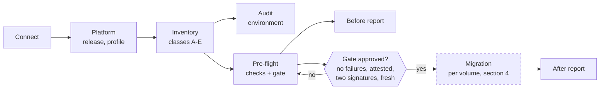
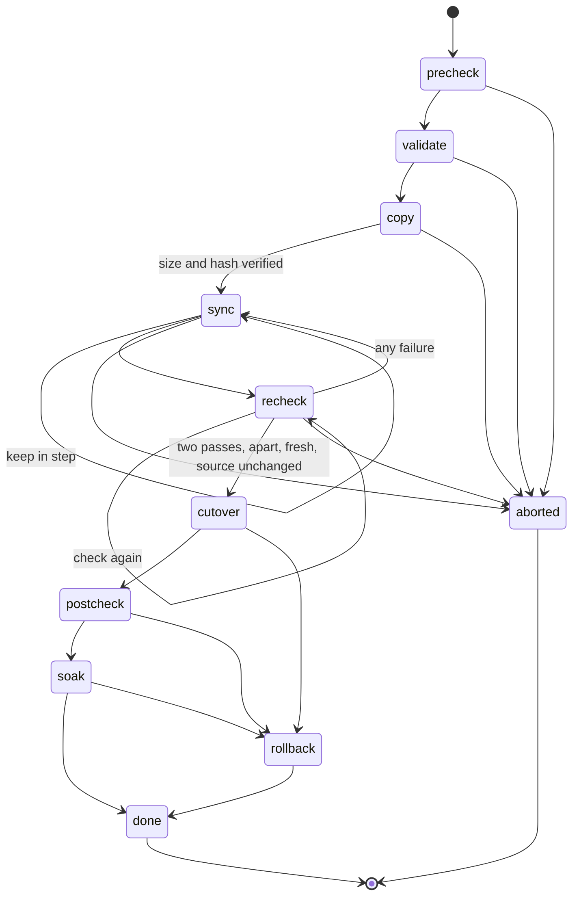

# The process OpenMove follows

This document describes, in the order they happen, what OpenMove does and what it will not do. It is written to be reviewed: every step names what it reads, what it changes (nothing, until the cutover) and what happens when it fails. `API_CALLS.md` lists every call. `SAFETY.md` lists the hazards and the control for each. `MIGRATION_METHOD.md` is the playbook summary the process is built on.

**Status of this document.** Sections 1 to 3 describe what the program does today (version 0.4.0: read, audit, check, report; nothing is changed in any cloud). Sections 4 to 6 describe the migration process the engine must follow. The order in section 4 is already enforced in code (`openmove/lifecycle.py`, with tests); the steps that move data are not built yet and are marked **planned**.

## The rule

> Pre-checks, then validation, then copy. Keep the target in step with the source until the cutover is possible. Then check, and check again. Only then start the cutover. It is a production environment: nothing may cause a failure.

Everything below follows from that rule. Until the cutover, the source volume is only read. Any failure before the cutover leaves production exactly as it was.

## 1. Overview

The dashed box is planned. Everything left of it exists and only reads.

## 2. Reading the environment (implemented)

| Step | Tab | What happens | Calls | Changes |
|---|---|---|---|---|
| 1 | Connect | The operator gives the Keystone address, user, password and project. OpenMove logs in, keeps the token in memory and the password only until disconnect. The password is never written anywhere. | K2 | nothing |
| 2 | Platform | OpenMove reads the version documents of Keystone, Cinder and Nova, the Cinder services, the back-end pools and the compute hosts. It infers the OpenStack release from the highest API versions and looks the release up in its profile table. A release without a recorded, passed lab validation is **read only**: every step that changes the cloud is refused. | K1, B0, N0, B1, B2, N1 | nothing |
| 3 | Inventory | OpenMove reads all volumes, snapshots and instances and classifies each volume (below). Facts only the Cinder database holds (the array's volume id, the history of deleted snapshots) can be supplied by importing the playbook's read-only database queries. Without them OpenMove says what it assumed and never guesses. | B3, B4, N2 | nothing |
| 4 | Audit | A full audit of the current environment: services, back-ends and capacity, compute hosts, volume types, volumes by project, type, back-end and state, snapshots by age, instances, backups, and 22 rules that turn them into findings (services down, stuck or inconsistent volumes, orphans, nearly full pools, and so on). It is a separate report part. | B1 to B7, K3 and step 3 | nothing |
| 5 | Pre-flight | Every check of the catalogue that can run is run (section 3). | none | nothing |
| 6 | Reports | A Word report is built from what was read: the pre-migration report, with the audit as a separate part, or the audit alone. | none | nothing |

### Volume classes

| Class | Meaning | Route |
|---|---|---|
| A | No snapshots. | Standard Cinder move. |
| B | Snapshots that rotate away within the window. | Wait, then the standard move. |
| C | Long-lived snapshots. | Staged migration. |
| D | Attached to an instance that is not `ACTIVE` or `PAUSED`. | Staged migration after the instance runs, or after an administrator locks and detaches it. |
| E | Encrypted, multiattach, in a group, replicated, in an unusable state, mid-migration, or with a bad array volume id. | Not handled. Listed for a separate plan. |

A volume with a failing per-volume check is held back. The report lists every one with the reason.

Each class takes its own path inside the order below and has its own rules: class D and E never enter it; classes A and B need no snapshot left at validation; class C must rebuild and compare every snapshot image and reconcile at each recheck. `CLASSES.md` states, class by class, what is enforced today and what the engine still has to do. The decision logic and the rules are built; the code that moves data is not.

## 3. Pre-flight: check, attest, sign, gate (implemented)

The pre-flight runs the whole catalogue (`MIGRATION_METHOD.md` section 8) and gives every check one of five results:

| Result | Meaning | Effect on the gate |
|---|---|---|
| Pass | Checked and fine. | none |
| Info | Noted. | none |
| Warn | Checked and worth a decision. | open until attested |
| Not checked | OpenMove has no way to see it with the access it has (for example the Cinder database, a host, an array). **It is never shown as passed.** | open until attested |
| Fail | Checked and wrong. | **blocks. Cannot be attested away. Fix it and run again.** |

An **attestation** is a person stating, with their name and at least eight characters of evidence, that an item is met or accepted. It goes in the journal and the report and carries over to a later run for the same source and target pair.

The **gate** has five states:

| State | Meaning |
|---|---|
| Blocked | A check failed, or no volume qualifies. |
| Open | Warn or not-checked items still need an attestation. |
| Awaiting sign-off | Everything is attested; two different people must sign, one as operator and one as reviewer. |
| Stale | The pre-flight is older than 24 hours. Run it again; sign-offs belong to one run and do not carry over. |
| Approved | Nothing blocks, nothing is open, two people signed, and the run is fresh. |

Only an approved gate lets a volume enter the migration (section 4), and it is asked again at every later step.

### Copy modes (requirement R12)

The pre-flight works out, from the Cinder services alone, how the data could be copied using the Cinder hosts that already exist:

* **Single host**: one cinder-volume host serves both back-ends and can reach both arrays.
* **Relay**: the host of the source back-end reads, the host of the target back-end writes, and the two exchange the data directly and encrypted.

No migration host is needed. By default nothing is installed on a production host. Whether each host really reaches its array is **not checked** until the engine can test it; that check stays open and needs an attestation.

## 4. The order of a migration (enforced in code, steps that move data are planned)

For each volume, in this order and no other (`openmove/lifecycle.py`, 14 tests):

| Phase | What happens | Source volume | Entry condition (refused otherwise) |
|---|---|---|---|
| precheck | The pre-flight gate is approved for this run. | read | Gate approved now. |
| validate | The plan for this volume is validated against the target: room, mapping, host reach, class. | read | The previous phase. |
| copy | The full copy is made to a staging volume on the target. The history of snapshots is rebuilt in order. | **read only** | Validation passed. |
| sync | The target is kept in step with the source until the cutover is possible. Tenant changes during this period are followed. | **read only** | Copy verified: same size and same hash. |
| recheck | Everything is checked again: sync lag is zero, nothing is waiting to be copied, the source has a fingerprint. | read | Lag zero, nothing pending, fingerprint present. A failure drops the volume back to sync and the count of passes starts again. |
| recheck (again) | The same checks, a second time, at least five minutes after the first. | read | As above. |
| cutover | The one step that touches the production path. | **switched** | See below. |
| postcheck | The volume is checked from the new path: attachment, instance health, snapshot chain, tenant-visible fields. | new path | Cutover done. |
| soak | The source is kept, untouched, for the agreed period. Rollback stays possible. | kept | Postcheck passed. |
| done | The source may now be released. | released | Soak ended. |

**What the cutover requires** (`cutover_ready`): all of these, at that moment, or it is refused with every reason listed:

1. The volume is in recheck.
2. At least **two passed rechecks in a row**, with no failure between them.
3. The last two are **at least five minutes apart**.
4. The newest is **no more than fifteen minutes old**. If it is older, check again.
5. **The source did not change** between the two rechecks (same fingerprint) and nothing was waiting to be copied at either.
6. The **gate is approved right now** (not at the start of the run).
7. **No halt** is in force.

Anything unexpected while deciding is a refusal. There is no override.

### One volume, step by step

This is what happens to one volume, and what the screen shows. The same list is on the volume detail panel (click a volume on the Select or Live tab). A test keeps this table in step with the code (`handling.STEP`).

| Step | What happens | What it touches |
|---|---|---|
| `precheck` | Confirms the pre-flight gate is approved right now and the volume's class is one the method moves (A, B or C). D and E stop here, with the reason. | reads only |
| `watch` | Class B only. Waits for the snapshots to rotate away. Nothing is copied while any snapshot exists. | reads only |
| `validate` | Checks the volume against the target: room, mapping, reach. Class A and B must have no snapshot at this moment. | reads only |
| `copy` | Makes a full copy on the target array. Class C also takes a rollback clone and rebuilds the snapshot history in order. | source read; staging volume written |
| `sync` | Keeps the copy in step with the source. Starts only when the copy verified (same size and hash; for class C every snapshot image identical and the ids equal to Cinder's). | source read; copy updated |
| `recheck` | Checks again, and again later. One pass is never enough. The source must be unchanged since the last pass. | reads only |
| `cutover` | The only step on the production path. Allowed only when every cutover condition holds and, if the setting is on or the volume was cleared from a risk, after a person's release. | source frozen and switched; target becomes the volume |
| `postcheck` | Checks the volume from its new path. If it fails, the volume is rolled back. | reads only |
| `soak` | Waits the agreed period (at least one day, default seven) with the source kept. | none |
| `done` | After the soak and a person's sign-off the source and its clones are released. The only deletion. | source released |
| `hold` | Class D and E. The volume never starts. The reason is shown. | none |

The cutover conditions, shown for each volume with the state of each: in the recheck or sync phase; no halt; gate approved; enough rechecks passed in a row; the rechecks far enough apart; the newest recheck recent; the source fingerprint unchanged; lag zero and no pending blocks.

### Choosing what moves

Before the run, the Select tab decides which admitted volumes take part. The default is every admitted volume except the high-risk ones. Volumes can be added or removed one by one or by group. The settings of the run (hold before the cutover, rechecks, gap, soak, concurrency, rate cap, stop after N failures) start at their defaults and can only be made stricter. Nothing about the selection changes while a run is in progress. Volumes admitted but not selected are reported as "not selected".

### Workload risk

Check V11 reads image properties, instance metadata, names and size. A high-risk volume fails the check and is not admitted. A medium-risk volume is shown with advice and is not blocked. A mark adds the customer's knowledge. Two different people clear a high-risk volume with evidence; the volume is then admitted but left out of the default selection, always held for a person's release before the cutover, and watched. The check cannot see inside a guest, and says so (`WORKLOAD_RISKS.md`).

### Holding, releasing and the automatic halt

With "hold before the cutover" on (the default), a volume that is ready waits in the sync phase until a named person releases it. A cleared high-risk volume is always held. If a run reaches the set number of failures, it halts itself, with the name "OpenMove (automatic)" and the count; a person must resume it with a name and a reason.

### Failure handling

| What goes wrong | Where | What OpenMove does | State of production |
|---|---|---|---|
| A pre-check fails | before copy | The volume does not start. The report says why. | unchanged |
| Validation fails | before copy | The volume does not start. | unchanged |
| Copy fails or the copy does not verify | copy | The staging volume is destroyed (rollback R1). The volume can be retried. | unchanged; source only read |
| The source changes while syncing | sync | The change is copied. If the source cannot be followed, the volume stays in sync. | unchanged |
| A recheck fails | recheck | Back to sync, passes reset. | unchanged |
| The pre-flight gets old, a sign-off is withdrawn, or someone presses Halt | any | The very next change is refused. Work in progress finishes only the step it is in and stops. | unchanged unless already past the cutover |
| The host, array or cloud stops answering | any | A change that may or may not have happened is reported as unknown and is read back before anything else is done. | unchanged until the cutover |
| The cutover fails or its outcome is unknown | cutover | The state is read back from the cloud and the array. Rollback R2 runs: the source record is restored and the instance unlocked. | restored to the source |
| The postcheck fails | postcheck | Rollback R3: a reverse migration, which keeps writes made since the cutover. | on the source again |
| OpenMove stops or the machine restarts | any | On start it reads the journal, finds the unresolved steps, and stays in the phase it was in. It cannot jump ahead. | as of the last completed step |
| A person decides to stop | before cutover | Abort, with a reason. | unchanged |

Until the cutover the answer to every failure is the same: stop, change nothing on the source, and leave the staging volume to be discarded.

### Volumes that are not migrated

Whatever the reason, a volume that is not migrated is written up: the cause in plain words, how it ended (the timeline from the journal, including every refused step), the state the source and the target were left in, the proposed steps to resolve it and who should act. This is the **not-migrated report** (Reports tab or Live tab, `GET /api/unmigrated`, `docs/CLASSES.md`). Held-back volumes (classes D and E, failed checks) appear as soon as the pre-flight has run; stopped and rolled-back volumes appear as they happen. A volume counts as migrated when its cutover has completed.

### Watching it: the Live tab

The Live tab shows, while migrations run: an overall progress meter (also shown as a thin bar under the header on every tab), the number of volumes in each phase of the order above, a row per volume with its phase and progress, the state of the gate and the halt, the seven cutover conditions, and a feed of the newest journal events in which every refusal is highlighted with its reasons. It reads the journal once a second and sends nothing to any system.

In demonstration mode the **Start the simulated migration** button drives this view with a simulated run: made-up evidence and a virtual clock, but the real order, gate and halt rules. It only starts when the gate is approved, pauses when Halt is pressed, stops if the gate stops being approved, and shows the cases the process exists for: a cutover attempted too early and refused, a source that changed and sent its volume back to sync, and a copy that did not verify and was aborted with the source untouched. Each class takes its own path: class B volumes wait for their snapshots to rotate away (and some never do), class C volumes rebuild and compare their snapshot history (and some do not match, or a tenant snapshot appears), and a swap that is refused is rolled back. The Live tab ends with the volumes not migrated, by cause, with the proposed steps.

## 5. Operator and reviewer

* One volume has one operator and one checklist. Volumes run in parallel; one volume never does.
* A gate is signed by a person other than the one who ran the steps.
* Anyone may press Halt; only a named person with a reason may resume.
* The tool never decides a human question. Where the playbook says a person decides, the tool stops and says so.

## 6. What is not built yet

* Everything that moves data: the data mover, the staging copy, the history rebuild, the sync, the cutover and the rollbacks. The order and the permit that guard them are built and tested.
* The checks that need an array, a Cinder host, a compute host or the Cinder database. They show as "not checked" and need an attestation, never a pass.
* Lab validation (playbook Phase 0). No release profile is marked validated; every real cloud is read only until a passed lab validation is recorded.
* Nothing in this release has been run against a real cloud. The demonstration uses a built-in mock cloud.
