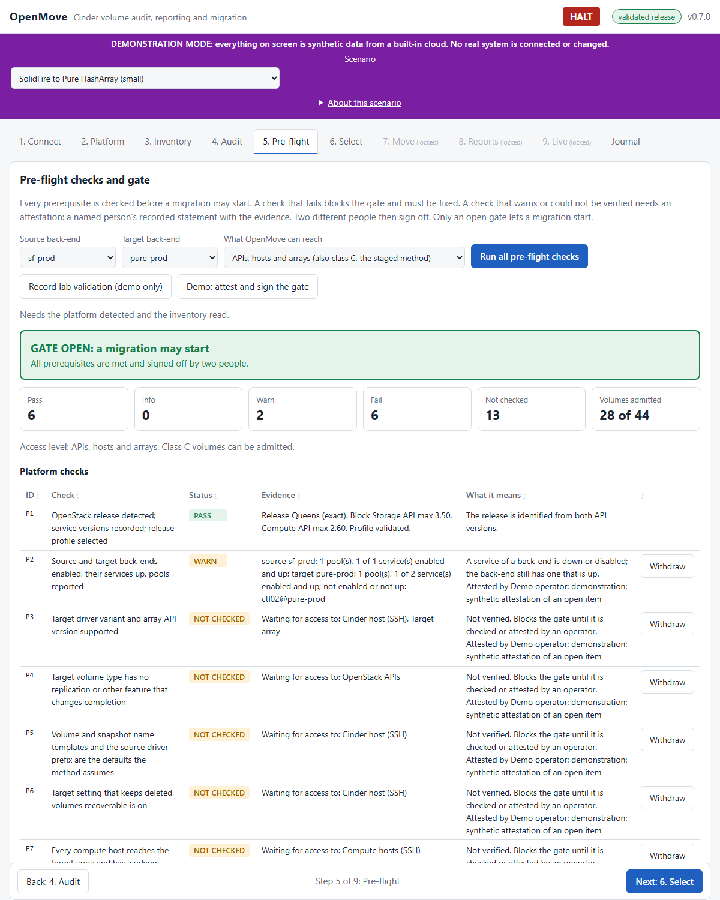

# User guide

How to start OpenMove, how to demonstrate it, and how to use every part of it. To install it, see `INSTALL.md`. To run a migration step by step, see `OPERATIONS.md`. For how it is built, see `ARCHITECTURE.md`. For the whole process with screenshots, see `WALKTHROUGH.md`; for every option and setting, `OPTIONS.md`. For what the tool does at each step and which calls it makes, see `PROCESS.md` and `API_CALLS.md`. For the safety rules, see `SAFETY.md`.

## Table of contents

1. [What you need](#1-what-you-need) (including [what access OpenMove needs](#what-access-openmove-needs))
2. [Start OpenMove](#2-start-openmove)
3. [Demonstration mode](#3-demonstration-mode)
4. [A tour of the screens](#4-a-tour-of-the-screens)
5. [The pre-flight and the gate](#5-the-pre-flight-and-the-gate)
6. [Reports](#6-reports)
7. [The Live tab](#7-the-live-tab)
8. [Halt](#8-halt)
9. [Sites with no migration host](#9-sites-with-no-migration-host)
10. [Where data is kept](#10-where-data-is-kept)
11. [Command-line options](#11-command-line-options)
12. [Troubleshooting](#12-troubleshooting)
13. [Words used in the screens](#13-words-used-in-the-screens)

## 1. What you need

| To run | You need |
|---|---|
| The packaged program (`OpenMove.exe`) | Nothing. No Python, no installer, no internet, no libraries. Copy the folder and double-click. |
| From source | Python 3.9 or later. Nothing else: OpenMove uses only the Python standard library. |
| A real cloud | The address of the Keystone (identity) service and an **administrator** account. Without administrator rights, OpenMove still starts but shows what it could not read. |

OpenMove runs on Windows, macOS and Linux. It contacts the OpenStack cloud you give it and nothing else.

### What access OpenMove needs

**To audit, take the inventory, run the pre-flight and build reports (everything in this version):** the address of the OpenStack **identity (Keystone) API**, for example `https://cloud.example:5000`, and an **administrator** account with its project and domains. That is all. Give the identity API address, not the Horizon dashboard address. OpenMove reads the Cinder and Nova addresses from the identity service's catalogue, so the machine running OpenMove must be able to reach those endpoints (public, internal or admin, as chosen on the Connect tab). The administrator role is needed because the all-projects volume, snapshot, instance and backup lists, the Cinder services, the back-end pools, the compute hosts and the project names are visible only to an administrator. With a lesser account OpenMove still works and shows what it could not read; the checks that depended on it say "not checked".

**To move class A and B volumes (this version):** the same administrator account is enough, with the APIs only. A change is allowed only when the release has a recorded lab validation (gate G0), the pre-flight gate is approved, and a second person has signed G2 and G3 for each volume. Nothing is installed on any host.

**To set up a migration host or a Cinder host:** give OpenMove the address and the administrator login of a plain Linux machine on the customer network (Helper servers tab, **Set up a new helper server from here**). OpenMove logs in once with the password, installs its own key, prepares the host, sets up the iSCSI or Fibre Channel paths you describe, registers the host and checks it (`DEPLOYMENT.md`, section 4.1). The password is not kept.

**To move class C volumes (Helper servers tab, `MOVER.md`):** the administrator account is not enough. That method also needs facts and actions that the OpenStack API does not offer:

| Needed | For |
|---|---|
| The Cinder database, or the playbook's read-only query results | The array volume id and the snapshot history (class B or C, and the array-id check). |
| SSH to the Cinder hosts | Running the copy with the hosts that already exist (section 9) and Cinder's own record tools. |
| Access to the compute hosts | Proving each reaches the target array. |
| Access to the arrays | A SolidFire account for clones; the Pure API for the target volume and snapshots. |
| A recorded, passed lab validation of the OpenStack release | Permission to change anything. Until then every cloud is read only. |

Until that access is given, the checks that need it show "not checked" and need a named person's attestation with evidence.

## 2. Start OpenMove

### Windows: double-click

| File | Starts |
|---|---|
| `OpenMove.bat` | The real tool. |
| `OpenMove-Demo.bat` | The demonstration (section 3). Nothing real is touched. |
| `OpenMove-Lab.bat` | OpenMove against the OpenStack lab on this machine, and the lab's dashboard in a second window (`LAB.md`). It starts the lab if needed. |
| `OpenMove-Lab-Stop.bat` | Stops the lab gracefully. Close OpenMove first. |

Each file opens a console window and, a moment later, your browser at the OpenMove address. If the browser does not open, copy the address printed in the console ("Open: http://127.0.0.1:...") into your browser. Close the console window, or press Ctrl+C, to stop OpenMove.

The launchers use `OpenMove.exe` if it sits in the same folder, and otherwise Python 3 and the source. Extra options can be added, for example `OpenMove.bat --port 9000`.

### macOS and Linux

```bash
./openmove.sh            # the real tool
./openmove.sh --demo     # the demonstration
```

### From source

```bash
python -m openmove            # the real tool
python -m openmove --demo     # the demonstration
```

### Build the standalone program

The packaged program is built once, on the operating system it is for. It needs PyInstaller on the build machine only.

```bash
python -m pip install pyinstaller
python tools/build/build_exe.py
```

The result is in `dist/`: `OpenMove.exe` (or `OpenMove` on macOS and Linux) and the launchers. Copy that folder to the customer machine. It contains everything: the Python runtime, the screens and the documentation links. The program is not code-signed, so some antivirus products may warn about it; sign it with your own certificate if the customer requires that.

### The access link

OpenMove prints a link that contains a one-time token, and opens it for you. The token changes each time OpenMove starts. Only this machine can reach the interface, and only with the token. If you reopen the page without the token you will see "Open the address that OpenMove printed when it started."

## 3. Demonstration mode

Demonstration mode shows the whole tool to a customer with no real cloud. It contains its own made-up cloud, uses a temporary data folder that is deleted on exit, and cannot connect to a real system. Every screen carries a purple banner, and every report carries a notice on its first page.

Start it with `OpenMove-Demo.bat`, `./openmove.sh --demo` or `python -m openmove --demo`. Add `--scenario <id>` to start on a given scenario, and `--list-scenarios` to list them.

### Scenarios

Choose one in the purple banner. Changing it resets the demonstration.

| Scenario | What it shows |
|---|---|
| **SolidFire to Pure FlashArray (small)** (`sf-to-pure`) | A small cloud: one SolidFire back-end as the source, one Pure Storage FlashArray as the destination. The simplest complete run. |
| **SolidFire to NetApp ONTAP (small)** (`sf-to-ontap`) | The same cloud with a NetApp ONTAP destination. |
| **Typical enterprise cloud (large)** (`enterprise`) | A large, busy cloud: two SolidFire clusters, Pure production and DR, NetApp ONTAP and Ceph; 14 projects; about 100 instances; over 300 volumes covering every volume class, rotating and long-lived snapshots, boot volumes, encrypted, replicated, grouped and shared volumes, stuck and inconsistent volumes, mixed compute versions, a nearly full DR pool and a standby service that is down. |

All three are described as running on a Mirantis Cloud Platform 2019.2 (OpenStack Queens) cloud. That is a label for the demonstration: OpenMove identifies the OpenStack release from the API versions and does not detect the distribution.

The enterprise scenario shows both copy modes: choosing `pure-prod` as the destination gives a single-host copy (the same Cinder hosts serve both back-ends), choosing `ontap-prod` or `pure-dr` gives a relay (different hosts). Choosing `pure-dr` also fails the capacity check, because that pool is too small.

### A suggested demonstration, about ten minutes

1. **2. Platform**: press *Detect version and back-ends*. Point out the release, the read-only banner ("no passed lab validation is recorded"), the back-ends with their vendors, and the Cinder services.
2. **3. Inventory**: press *Read from the cloud* with back-end `sf-prod`. Point out the classes. Then press *Load the demonstration database export*: classes B and the array-id checks now appear, as they would with database access.
3. **4. Audit**: press *Run the audit*. Open a few findings: services down, stuck volumes, orphans, a nearly full pool.
4. **5. Pre-flight**: the source and target are pre-selected. Press *Run the pre-flight*. The gate is **blocked** because no lab validation exists. Press *Record lab validation (demo only)* and run it again: the remaining items are warnings and "not checked" items that need a person. Press *Demo: attest and sign the gate*. The gate opens. (In real use each attestation needs a person's name and evidence, and two different people sign. A failed check can never be waived.)
5. **6. Reports**: build the *Pre-migration report (Word)* and the *Environment audit (Word)*. Open them in Word.
6. **7. Live**: press *Start the simulated migration*. Watch the overall progress, the pipeline, the per-volume progress and the event feed. Point out a refused early cutover, a volume sent back to sync because its source changed, and a copy that failed verification and was aborted with the source untouched. Press **HALT** to show everything pause, and *Resume* to continue.

The simulated migration uses made-up evidence and a virtual clock, but the real order, gate and halt rules. It sends nothing to any system. The real engine is on the Move tab (section 4).

## 4. A tour of the screens

**The screens use plain words.** Seven steps replace the nine technical ones. The process, the checks and the signatures have not changed: the server still holds every step closed until the one before it is done. Only the names and the way the work is shown changed.

| On the screen | Technical name (used in the other documents) |
|---|---|
| 1. Connect | Connect |
| 2. Scan | Platform, Inventory and Audit, run together by one button |
| 3. Safety checks | Pre-flight and the gate; *attest* is *Confirm*; *sign-off* is *Approve* (first and second approver) |
| 4. Choose | Select |
| 5. Move | Move; *dry run* is *Rehearse*; *cutover* is *Switch*; *soak* is *Wait period*; *reverse* is *Put back* |
| 6. Progress | Live |
| 7. Reports | Reports |
| History, Helper servers, Support | Journal, Hosts, Diagnostics |

The volume classes keep their letters in the documents. On the screen each has a name: A *Standard*, B *Waits for snapshots*, C *Staged copy*, D *Instance is off*, E *Not moved by this tool*.

**The tree.** Step 2 shows the cloud as a tree: project, instance, the volumes attached to it, and under each project the volumes that are *Not attached*. Every volume shows its size, its snapshots and how it will be handled. Once the safety checks have run, each volume also says *Will be moved*, *Not chosen* or *Held back*, with the reason. Step 4 shows the same tree with a box beside every project, instance and volume. A box on a project or an instance chooses every volume below it that can be moved. A volume that was held back cannot be ticked; the reason is shown instead. Nothing in the tree bypasses a rule: the box sends the same selection request as the table under *Choose from a table, by group, and change the settings*, and the server refuses what the pre-flight did not admit.

**Messages and boxes.** A message is fixed at the top of the window, so it is seen wherever the page is scrolled; a good one fades after nine seconds, a problem stays until it is closed. Every question (confirm a check, approve, release, start, put back, emergency stop) opens one box with its fields. If the server refuses, the reason is shown inside the box and the box stays open. The **Help** button explains the steps and the words.

**What to do next.** A panel at the top of every step says what the step is for and what to do. When the step is done it says so.

**The board and the open actions.** Once a move exists, a board at the top of every page shows three things: *Status* (what OpenMove is doing, in one line), *Progress* (the volumes finished, copying, waiting, in their safety period, stopped) and *Open actions*. An open action is something only a person can do, for example "12 volumes wait for approval before switching". Each has its own button: **Approve before switching**, **Release**, **Approve the result**, and, before the move, **Approve as first approver**, **Approve as second approver** and **Confirm**. A button that needs a name or a reason opens one box with those fields; the box lists the volumes it covers, with size, project and instance. Back and Next are also at the top, under the tabs.

**Copy places and volumes in progress.** Two settings decide how much runs at once. *Copies at the same time* (default 10) is the number of copy places: how many volumes are copied, synchronised or switched at the same moment. *Volumes in progress at once* (default 30) is how many volumes OpenMove works on at all. A volume that is only waiting (for approval, for the release, for the time window, for its snapshots to rotate away, or in its safety period) does not take a copy place. The queue therefore never stops because volumes are waiting: when a copy place is free, the next volume starts at once. Volumes of class B (waiting for snapshots) are queued last.

**Tooltips.** Every field, button, tab and approval has a short explanation. Hold the pointer on it.

**Before a real move can start.** The Move step opens with a checklist: the lab tests for this OpenStack release are recorded, the safety checks are approved by two people, the emergency stop is not pressed. A line that is not ticked has a button to the place where it is done. Volumes with long-lived snapshots also need a helper server that is ready.

**The approvals, in plain words.** The technical gates G2, G3 and G4 are three approvals by a second person: *the copy is correct* (the copy was built on the new storage and compared with the original), *ready to switch* (the new record exists, the original is frozen and a way back is prepared) and *the switch worked* (the volume was checked on the new storage). The first two are given with one button, **Approve before switching**; then **Release** allows the switch. The third is **Approve the result**. The person who started the move cannot approve. The panel "What do the stages and the approvals mean?" on the Progress step explains each stage.

**Helper servers.** The tab sets up and manages the servers that copy volumes with long-lived snapshots. Step 2 sets up a new server from its address and administrator login; step 3 reads and changes a server that is already set up. **Read the host** shows the iSCSI initiator name and the Fibre Channel port names (to register on the arrays, each with a Copy button), the network interfaces (the management interface is locked), the iSCSI sessions, the Fibre Channel target ports seen and the multipath devices. The form sets the iSCSI portals, target names, CHAP, the interfaces to bind, session settings, the address and MTU of the storage interfaces, the Fibre Channel target ports and the multipath settings. **Check only** changes nothing. Once a server is set up it is managed through OpenMove only, with OpenMove's key; the password is needed once, for the setup (`DEPLOYMENT.md` sections 4.1 and 5.2).

The table below describes each step in the technical names.

| Tab | What you do | What OpenMove does |
|---|---|---|
| **1. Connect** | Enter the Keystone address, an administrator account, the project, domains, region and interface. Choose whether to verify TLS (on by default) or give a CA file. | Logs in. The password stays in memory and is never written to disk, the journal or a report. |
| **2. Platform** | Press *Detect version and back-ends*. | Reads the version documents, the Cinder services, the back-end pools and the compute hosts, infers the OpenStack release and shows whether the release is validated. An unvalidated release is **read only**. |
| **3. Inventory** | Choose a back-end and the rotation window (days), then *Read from the cloud*. Optionally import the playbook's database query results. | Reads all volumes, snapshots and instances and classifies each volume A to E, with the reason. |
| **4. Audit** | Press *Run the audit*. | A full audit of the environment, with findings ranked by severity. |
| **5. Pre-flight** | Choose the source and target back-end and press *Run all pre-flight checks*. Attest open items and sign. | Runs every check, shows the gate and the copy plan. |
| **6. Select** | Choose which volumes migrate, by volume or by group, and look at the settings. Clear or mark workloads that may break. | Shows what is selected and why anything is not. Refuses what is not allowed. |
| **7. Move** | Run the dry run, then the real run (optionally inside a run window); sign G2, G3 and G4 as a second person; reverse a volume, or preview and reverse the whole run; work through the **Phase 0 lab tests** and record gate G0 from them. | Moves class A and B volumes with Cinder's retype. Nothing is sent before the dry run is looked at, the release has a recorded lab validation (gate G0), the gate is approved and a second person has signed G2 and G3. |
| **8. Reports** | Enter the customer and your name, choose what to include, press a button. | Builds a Word report (pre-migration, audit, volumes not migrated, **update report and after report** that compare every moved volume with its before-state) or the **volume list as Excel or CSV**, and your browser saves it. |
| **9. Live** | Watch. | Shows progress, the order, the gate, the halt, the events and the volumes not migrated. |
| **Journal** | Read. | Lists what OpenMove recorded. |

**The steps are gated.** A step opens only when every step before it is done. A locked step is greyed out and says "(locked)"; clicking it tells you what is missing; Next stays off until the current step is done. The server decides, so a reload or a link such as `/#move` cannot skip a step. Running the pre-flight again, or changing the selection, closes the later steps again; a real run needs a dry run that covered the same volumes. The whole process, with a screenshot of every step, is in `WALKTHROUGH.md`; every option is in `OPTIONS.md`.



**Back and Next.** A bar at the top of every screen, under the tabs, walks through the numbered steps in order (Back and Next name the step they lead to). The tabs at the top still work for jumping. The Journal is not a step; Back returns from it to the last step.

The header shows the connection state, the version and the **HALT** button. A thin progress bar appears under the header on every tab once a migration has started.

### Volume classes

| Class | Meaning | Route |
|---|---|---|
| A | No snapshots. | Cinder's retype (OpenMove moves it). |
| B | Snapshots that rotate away within the window. | Wait for them to rotate, then Cinder's retype. Needs the snapshot history from the database. |
| C | Long-lived snapshots, or snapshots whose rotation is not known (no database access). | Staged migration through a migration host and a Cinder host (built; proven on LVM only). Without them: held back with the cause "No data mover" and steps to resolve it. |
| D | Attached to an instance that is not `ACTIVE` or `PAUSED`. | After the instance runs, or after an administrator locks and detaches it. |
| E | Cinder's own image-cache volume, encrypted, multiattach, in a group, replicated, in an unusable state, mid-migration, or with a bad array volume id. | Not handled by this method. Listed for a separate plan. |

Class B and the array volume id (`provider_id`) need facts that only the Cinder database holds. Without database access, import the playbook's read-only queries (A1, A2, A4 and the attached-instances list) in the Inventory tab. OpenMove says what it assumed when it did not have them; it never guesses.

### The Select tab: choose what moves

Nothing migrates all at once. After the pre-flight, open **6. Select**.

* **Default.** Every admitted volume is selected, except the high-risk ones. The default is already in place; you only change what you want to change.
* **Groups.** Pick a kind of group (class, project, attachment, size, snapshots, Cinder host, instance, workload risk) and *add*, *remove* or *set* the whole group.
* **Volumes.** Tick single volumes. A volume that is not admitted cannot be ticked; the screen says which check stopped it.
* **Settings.** Hold before the cutover (on), rechecks (2), gap between rechecks (5 minutes), soak days (7), concurrency, rate cap, stop after N failures. Each shows its default and its floor. A value below the floor is refused. *Reset* returns to the defaults.
* **Locked during a run.** The selection and settings cannot change while a run is in progress.
* **Release.** With hold before the cutover on, a ready volume waits. Enter your name and release one volume, a few, or all. The cutover conditions still apply after the release.

### Workload risk

The *Workload risk* panel lists volumes that may host something that breaks, for example a legacy Windows server. OpenMove cannot see inside a guest. It reads hints, and it says so. A high-risk volume is not moved. To move it, an operator and a different reviewer each enter a name and evidence (what was tested, what the owner agreed, the way back). To flag a volume the cloud does not show as risky, *mark* it with a name and a reason. See `WORKLOAD_RISKS.md` for what can break and a list of questions for the customer.

### Second-person sign-offs: G2, G3 and G4

The playbook has a second person sign three points for each volume. On the Live tab:

* **Sign G2 and G3** appears when volumes are in sync and checked. G2: the copy is verified. G3: the volume is ready to cut over. The volumes cannot be cut over without both.
* **Sign G4** appears when volumes passed the post-check. Without G4 the soak does not start.
* The signer must not be the operator of the run (the person who signed the pre-flight gate as operator). You enter your name and what you checked; it is kept in the journal. Volumes that are not yet at that point are skipped.
* In demonstration mode a button lets a made-up second person sign for you.

### The Move tab: run the engine

The Move step moves the selected class A and B volumes with Cinder's retype. It is a path of four numbered steps; a green line at the top says which one to do now.

1. *Where the volumes go*: the volume types bound to the target back-end. One fitting type is chosen by itself; with several you choose; with none the page says what to fix. OpenMove never guesses.
2. *Ready to start*: the lab tests for the release are recorded, the safety checks are approved by two people, the emergency stop is not pressed. Each line is ticked or says what is missing.
3. *Rehearse (changes nothing)*: reads the cloud and lists the exact calls (a lock, one retype with on-demand migration, an unlock), changing nothing. Read it.
4. *Start moving*: enter your name. Each volume is validated and waits for a second person.

The rest happens on the Progress step, which names every action:

* *Approve before switching* (second person: G2 and G3), then *Release all volumes that are ready to switch* (you).
* The engine locks the instance, sends the retype, follows it, checks the result against the before-state and unlocks.
* *Approve the result* (second person: G4) after the owner has checked the application. The safety period starts.
* *Put back* returns a volume with a retype back.

The times of day when moving may happen, and the list of every volume the move touched, are in the two closed panels under the path.

A real run needs a recorded lab validation of the release (*Record lab validation (G0)*), an approved gate and no halt. Every step, every note and every checklist is in `OPERATIONS.md`.

### One volume in detail

Click a volume on the Select or Live tab; the panel opens on the Live tab. It shows its class, the steps of its path with the status of each, what is happening now, the cutover conditions, its journal events and, if it was not migrated, why and what to do.

## 5. The pre-flight and the gate

The pre-flight runs the whole check catalogue for a source and target back-end. Each check has a result:

| Result | Meaning | What you do |
|---|---|---|
| Pass | Checked and fine. | Nothing. |
| Info | Noted. | Nothing. |
| Warn | Checked; worth a decision. | Attest it, or fix it and run again. |
| Not checked | OpenMove cannot see this with the access it has (a host, an array, the Cinder database). It is **never** shown as passed. | Attest it with evidence, or give OpenMove the access. |
| Fail | Checked and wrong. | Fix it and run again. **A failure cannot be attested away.** |

**To attest**, press *Attest* beside a check, enter your name and the evidence (at least eight characters: what you checked, where, and what you saw) and record it. Your name and evidence are kept in the journal and printed in the report. An attestation carries over to a later run for the same source and target.

**The gate** shows one of five states:

| State | Meaning | Next step |
|---|---|---|
| Blocked | A check failed, or no volume qualifies. | Fix and run again. |
| Open | Warnings or not-checked items need an attestation. | Attest them. |
| Awaiting sign-off | Everything is attested. | Two different people sign: one as *operator*, one as *reviewer*. |
| Stale | The pre-flight is more than 24 hours old. | Run it again. Sign-offs do not carry over to a new run. |
| Approved | Nothing blocks, nothing is open, two people signed, the run is fresh. | A migration may start. |

Volumes that fail a per-volume check are held back and listed with the reason; the others are *admitted*.

## 6. Reports

Reports are Word documents (A4) built from what was read.

| Report | Contents |
|---|---|
| **Pre-migration report** | Summary; scope and plan; the platform; every pre-flight check (platform, per-volume, gate, attestations); the volumes to be moved; the volumes held back and why; the checks that run later; assumptions; sign-off. With *Include the environment audit in the pre-migration report* ticked, it ends with the audit as a **separate part**. |
| **Environment audit** | The audit alone: services, back-ends and capacity, compute hosts, volume types, volumes by project, type, back-end and state, snapshots by age, instances, backups, and the findings with the action for each. |

Your browser saves the file; OpenMove keeps no copy. Reports built in demonstration mode say so on the first page. A report never states a result it did not obtain: "not checked" stays "not checked".

## 7. The Live tab

The Live tab shows what is happening, refreshed about once a second:

* **One sentence on top** says how many volumes are moved and ready to use, how many are in the safety period, how many were NOT moved, and whether a person must act.
* **Where every volume stands**: five tiles, and every volume is in exactly one of them. *Needs you* (a person must act), *Not moved* (stopped or put back, where it was, data intact; the line says why, in plain words, and what to do first), *Being moved* (OpenMove is working), *Waiting to start*, *Moved* (on the new storage and ready to use: *Moved and ready* during the safety period, *Completed* once the old copy is released). Click a tile to list only those volumes.
* **What you need to do**: one card for each kind of action that waits: **Approval by a second person**, **Release by you** or **Your decision**, with the number of volumes and the button that does it. When nothing waits it says so.
* **One approval for every volume** (step 4, Choose, Options; off by default, with a warning): the two approvers of the safety checks sign once, and the system signs the second person's approvals (G2, G3, G4) for every volume in the second approver's name. The release by you still happens (unless you also switch off the hold). The history marks each such signature *standing approval*, and the Progress page shows a warning while it is on.
* **Every volume**: one line each: the place it is in, one sentence on what happens next, and what you must do (a label, or *Nothing to do*). Click a row for the detail panel.
* The same five places, as small buttons, are on the board at the top of every page.
* **How it works** (closed): the pipeline, the gate, the halt, unresolved steps in the journal, the conditions that must hold before a cutover, and the event feed with every refusal.
* **Volumes left out of this move**: volumes that were never part of it or were held back, with the cause, how it ended and the proposed steps to resolve it. *Volumes not migrated (Word)* on the Reports tab builds the same as a report.

On a real cloud the tab shows the volumes the engine has taken, with the real phases. In demonstration mode it can run a simulated migration (section 3); the real engine is on the Move tab.

## 8. Halt

The red **HALT** button, always in the header, stops all changes at once. It asks for your name and a reason. From that moment the next change is refused, whatever else is true. Anyone can press it. To continue, press *Resume* in the red banner; that also needs a name and a reason, and should only be done when the reason for the halt is resolved. Halt and resume are written to the journal.

## 9. Sites with no migration host

Some customers cannot provide a migration host. OpenMove is designed to work with the Cinder hosts that already exist. From the Cinder services it works out, for the chosen source and target back-end, which mode is possible:

* **Single host**: one cinder-volume host serves both back-ends and can reach both arrays.
* **Relay**: the host of the source back-end reads, the host of the target back-end writes, and the two exchange the data directly.

By default nothing is installed on a production host; anything that would change a host is a plan step that needs approval, and a site can forbid it. Whether each host really reaches its array is *not checked* until the engine can test it, and stays an open item for you to attest.

### The access level: OpenStack APIs only

On the Pre-flight tab, "What OpenMove can reach" says how much OpenMove has:

* **The OpenStack APIs only** (default). This is enough for class A and class B volumes: Cinder moves them itself, with a retype that uses Nova's live block copy. OpenMove needs only the Keystone, Cinder and Nova endpoints and an administrator account. Class C volumes (long-lived snapshots) are **not admitted**: they appear in the unmigrated report with the cause "No data mover" and the steps to resolve it. The checks that only the staged method needs (P12, P14, P15) show as "not needed".
* **APIs, hosts and arrays.** Also admits class C, which needs a Linux host that reaches both arrays, SSH access to it, and the array accounts.

The level changes nothing in the cloud; it only decides which volumes the pre-flight admits.

## 10. Where data is kept

| What | Where |
|---|---|
| The journal | `journal.db` in the data folder: on Windows `%APPDATA%\OpenMove`, on macOS `~/Library/Application Support/OpenMove`, on Linux `~/.local/share/OpenMove`; or the folder given with `--home`. In demonstration mode a temporary folder that is deleted on exit. |
| Reports | Where your browser saves downloads. OpenMove keeps no copy. |
| Passwords and tokens | Memory only. |

Everything OpenMove reads about a customer's cloud stays on the machine it runs on. Do not commit reports, exports or journals to a repository.

## 11. Command-line options

| Option | Meaning |
|---|---|
| `--demo` | Demonstration mode. Always uses a temporary data folder (`--home` is ignored). |
| `--scenario <id>` | With `--demo`: the scenario to start on. |
| `--list-scenarios` | List the scenarios and exit. |
| `--port <n>` | Port to listen on (default 8765). |
| `--host <address>` | Address to listen on (default `127.0.0.1`: this machine only). Listening on another address lets anyone who can reach it and has the token use OpenMove; a warning is printed. |
| `--allow-host <name>` | An extra `Host` header value to accept, for example behind a container port mapping. |
| `--home <folder>` | Where the journal is kept. |
| `--no-browser` | Print the link; do not open the browser. |
| `--lab` | Lab mode: connect to the OpenStack lab on this machine and use the real engine (`LAB.md`). Uses `C:\OpenMoveLab\openmove-home`. |
| `--lab-reset` | With `--lab`: forget the lab's journal and evidence first. |

## 12. Troubleshooting

| Problem | Cause and fix |
|---|---|
| The browser opened "Open the address that OpenMove printed when it started." | The token is missing or old. Use the link printed in the console window of the running OpenMove. |
| The browser did not open. | Copy the "Open:" address from the console into your browser. |
| "Port already in use". | Another OpenMove (or program) holds the port. Close it, or use `--port`. |
| `OpenMove.bat` says Python was not found. | Use the packaged `OpenMove.exe` next to the launcher, or install Python 3 and tick "Add python.exe to PATH". |
| Windows or antivirus warns about `OpenMove.exe`. | The program is not code-signed. Sign it with your certificate, or allow it. |
| Connect fails with a certificate error. | Give the cloud's CA file, or (knowing the risk) turn off TLS verification. The report states the setting. |
| Platform shows no back-ends, services or compute hosts. | The account is not an administrator, or the policy hides them. The affected checks say "not checked". |
| Everything says "Read only". | The OpenStack release has no recorded, passed lab validation. That is intended. |
| The gate is **stale**. | The pre-flight is older than 24 hours. Run it again and sign again. |
| The gate is **blocked** and a check cannot be attested. | A failed check cannot be waived. Fix the cause and run the pre-flight again. |
| "all changes are halted". | Someone pressed HALT. Read the reason in the red banner; resume only when it is resolved. |
| A volume says *Not moved*. | The Progress page says why in plain words (for example *Not enough room on the target*, *OpenMove could not tell which volume type to move to*), what happened to the source and the target, and the first thing to do. The volume is where it was, with its data intact. Fix the cause and start it again, or leave it. If the page says *Stopped for another reason*, the quoted text under it is what OpenMove stopped on: send it with the support bundle. |
| The Move step says no volume type is bound to the target. | Make a Cinder volume type whose `volume_backend_name` is the target back-end, then rehearse again. |
| A volume on the Move tab says "waiting for a second person to sign G2 and G3". | That is the rule. A person who is not the operator signs on the Move tab after checking the volume. |
| The dry run says a volume is blocked. | Read the failed check beside it. The tool is refusing something unsafe (wrong back-end, a snapshot left, encrypted, a busy instance, a lock state it cannot see). |
| "the lab validation needs two different people". | Record lab validation (G0) needs two names, and a description of at least 40 characters. |
| A volume on the Move tab says "the post-check failed: halted". | The result differs from the before-state. Look at the volume and the instance; reverse it, or fix it by hand, then resume. |
| The engine seems stopped after a restart. | Sign in again when the page asks (the lab does it by itself). OpenMove puts the saved work back and carries on the move; nothing needs to be signed again. If the page says it could not, press *Try again* (`RECOVERY.md`). |
| The top of every page shows Status, Progress and Open actions. | Status says in a few words how the move is (green: moving or finished; amber: waiting for a person or trying again; red: stopped; grey: no move running). Progress is the bar and the count of volumes switched. Open actions lists what only a person can do, and each item has its own button (approve as first or second approver, approve before switching, release, approve the result); the button opens the same dialog as the one further down the page. The tab that holds the work shows a number. Nothing waits for you when it says "No action required". |
| A bar at the top says "OpenMove is not answering". | OpenMove stopped or the computer slept. Your work is saved. The page carries on by itself when OpenMove is back; start `OpenMove-Lab.bat` or `OpenMove.bat` if it stays like this for more than a minute. |
| "OpenMove is already running with this data folder". | Another OpenMove holds the same data folder. Use that one (the address is in its window) or close it first. Two programs on one journal would each move the same volumes. |
| The Progress page says volumes wait for a second person. (Look at the amber card *Approval by a second person*.) | The copy is finished and checked; G2 and G3 (or G4) need a person who is not the operator. Use the Approve button on the page. It is not stuck. |

## 13. Words used in the screens

| Word | Meaning |
|---|---|
| **Pre-flight** | The set of checks run before anything is moved. |
| **Gate** | The stop that must be open before a migration starts: no failed check, every open item attested, two people signed, run fresh. |
| **Attestation** | A named person's written statement, with evidence, that an item is met or accepted. |
| **Admitted** | A volume that passed every per-volume check and may be moved. |
| **Class** | A to E: how a volume is moved, or why it is not. |
| **Copy** | The full copy of a volume to a staging volume on the target array. The source is only read. |
| **Sync** | Keeping the target in step with the source until the cutover is possible. |
| **Recheck** | Checking everything again. Two passes, at least five minutes apart, are needed before a cutover. |
| **Cutover** | The one step that touches the production path: the instance is switched to the new volume. |
| **Post-check** | Checking the volume from its new path. |
| **Soak** | The waiting period after the cutover. The original source volume is kept untouched so a rollback is still possible. It is released only after the period ends and a person signs off. The length is a setting. |
| **Rollback** | Going back to the source: R1 before the destination record exists, R2 before or during a failed cutover, R3 after the cutover (a reverse migration that keeps writes made since). |
| **Abort** | Stopping a volume before the cutover, with a reason. The source was only read and is as it was. |
| **Halt** | Stopping all changes at once. |
| **Read only** | A cloud whose OpenStack release has no recorded, passed lab validation: OpenMove reads and reports but changes nothing. |
| **Single host / relay** | The two ways the existing Cinder hosts can do the copy (section 9). |
| **Journal** | The local, append-only record of everything OpenMove did. |
| **Retype** | Cinder's own way to move a volume to another volume type, and so to another back-end, with on-demand migration. OpenMove asks for one retype per volume and follows it. |
| **Dry run** | The Move tab's preview: the checks and the exact calls a run would make. It sends nothing. |
| **G0** | The recorded lab validation of an OpenStack release. Without it the cloud is read only. |
| **G1** | The pre-flight gate. |
| **G2, G3, G4** | Per-volume sign-offs by a second person: the move is ready (G2, G3) and the result is verified (G4). |
| **Lab** | A real OpenStack on this machine (`LAB.md`) used to test the engine. It is not a customer cloud. |
