# The process, step by step

This is the document to hand to a person who has never seen OpenMove. It follows the process from the first click to the last: what OpenMove does at each step, what the person does, which options exist and what must be true before the next step opens. Every screenshot is the real interface in the demonstration mode (made-up data, nothing real is connected). Where the real engine behaves differently from the demonstration, the text says so.

Other documents go deeper: `INSTALL.md` (install), `DEPLOYMENT.md` (helper servers and their storage paths), `OPERATIONS.md` (the procedure for a real migration, with checklists), `OPTIONS.md` (every option and setting in one place), `SAFETY.md` (why each control exists), `RECOVERY.md` (what survives a restart), `ARCHITECTURE.md` (how it is built).

## 1. What OpenMove does, in one paragraph

OpenMove reads an OpenStack cloud, reports on it, and moves Cinder volumes from one storage back-end to another (for example SolidFire to a FlashArray). It works through a local web page with seven steps in a fixed order. The first four steps only read. The Move step changes the cloud, and it is protected by a recorded lab validation, an approved set of safety checks, approval by two different people, and an emergency stop. Everything OpenMove does is written to a journal. Volumes with long-lived snapshots are copied by a small program on a **helper server** that OpenMove itself sets up and manages (section 12).

## 2. The seven steps and what unlocks each

The steps are **gated**. A step opens only when every step before it is done. A locked step is greyed out with "(locked)", clicking it says what is missing, and Next stays off until the current step is done. The server decides which step is open, not the page, so a reload or a link such as `/#move` cannot skip a step.

```mermaid
%%{init: {"theme": "base", "fontFamily": "Arial, Helvetica, sans-serif", "themeVariables": {"fontSize": "15px"}, "flowchart": {"htmlLabels": false, "padding": 32, "nodeSpacing": 40, "rankSpacing": 50}}}%%
flowchart LR
    S1["1 Connect<br/>sign in to the cloud"] --> S2["2 Scan<br/>platform, volumes, audit"]
    S2 --> S3["3 Safety checks<br/>checks and approval"]
    S3 -->|approved by two people| S4["4 Choose<br/>what to move"]
    S4 -->|choice confirmed| S5["5 Move<br/>rehearse, then start"]
    S5 -->|rehearsal read| S6["6 Progress<br/>watch and approve"]
    S6 --> S7["7 Reports"]
    classDef read fill:#e6eefb,stroke:#1f5fbf,color:#0c1319
    classDef change fill:#fde7e5,stroke:#b3261e,color:#0c1319
    class S1,S2,S3,S4,S7 read
    class S5,S6 change
```

| Step | Opens when | What it does | It is done when | Changes the cloud? |
|---|---|---|---|---|
| 1 Connect | always | Signs in to the identity service (Keystone) as an administrator | the sign-in worked | No (one sign-in call) |
| 2 Scan | connected | One button runs three reads: the platform (release, back-ends, services), the volumes (each gets a class) and the audit | all three have run | No |
| 3 Safety checks | scan done | Runs every check, collects the confirmations and two approvals | **the checks are approved** | No |
| 4 Choose | checks approved | Chooses the volumes and the settings | **the choice is confirmed** | No |
| 5 Move | choice confirmed | Rehearsal, then the real start | **a rehearsal was read** for these volumes (or a move already exists) | **Yes**, from here |
| 6 Progress | step 5 done | Shows every volume, the open actions and the approvals | n/a | Yes (releases and approvals act on the move) |
| 7 Reports | step 5 done | Word, Excel and CSV reports | n/a | No |
| History | always | The record of everything | n/a | No |
| Helper servers | always | Sets up, reads and configures the servers that copy volumes with long-lived snapshots | n/a | Changes those servers only |
| Support | always | Support bundle, log, settings | n/a | No |

The other documents use the technical names: Platform, Inventory and Audit for step 2, Pre-flight and the gate for step 3, Select for step 4, Live for step 6, Journal for History and Hosts for Helper servers.

Things that close a step again, on purpose:

* Disconnecting closes everything after step 1.
* Running the safety checks again makes a new run. The earlier approvals belong to the old run, so the checks are open again and steps 4 to 7 close.
* Changing the choice, or the safety checks changing under it, voids the confirmation: step 5 closes until the choice is confirmed again.
* A real start is refused unless a rehearsal covering the same volumes was read for the current safety checks. A restart that resumes volumes already in the journal is the one exception.

### What stays on screen: the top of the page

Everything that needs a person is at the top of the page, so it is never lost in a long list.

* **Back and Next** sit under the tabs and name the step they lead to.
* **The board** (Status, Progress, Open actions) is shown on every step once a move exists. Status says in one line what OpenMove is doing. Progress counts the volumes. **Open actions** lists what waits for a person, for example "12 volumes wait for approval before switching", each with the button that does it: Approve, Release, Confirm. A button that needs a name or a reason opens one box with those fields.
* **Messages** are fixed at the top of the window. A good message fades; a problem stays until it is closed.
* **Tooltips**: every field, button and tab has a short explanation. Hold the pointer on it.

## 3. Who does what

Two different people are needed for a real migration. OpenMove checks the names; it cannot check identity, so the second person must really be a second person.

| Role | Does | Cannot do |
|---|---|---|
| **Operator** | Connects, runs the steps, confirms open items, approves the checks as first approver, starts the move, releases volumes | Approve the copy, the readiness or the result of a volume the operator started |
| **Second person** (reviewer) | Approves the checks as second approver; approves each volume before the switch and after it | Be the same name as the operator |
| **Application owner** | Checks that the application works after a switch, before the last approval | n/a (outside the tool) |

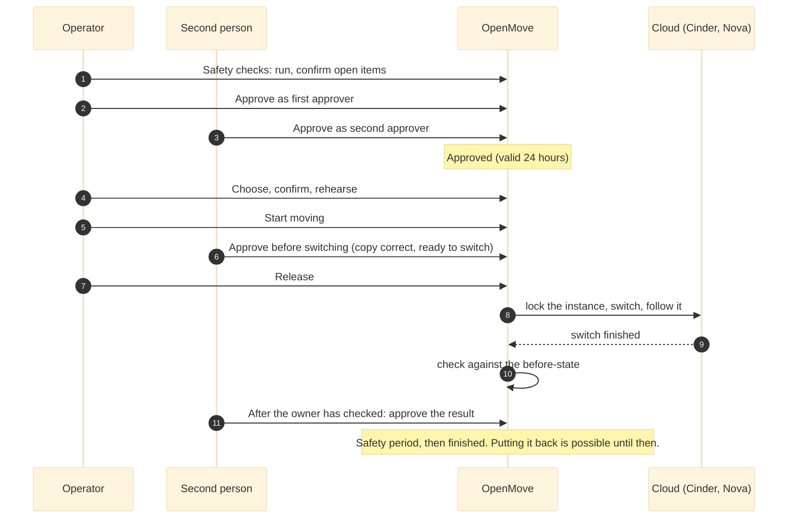

## 4. Step 1: Connect

**Purpose.** Sign in to the cloud with an administrator account. Only an administrator sees volumes, instances and services of all projects.

**What OpenMove does.** One sign-in call to Keystone. The password stays in memory for this session; it is never written to disk, the journal or a report. TLS certificates are verified unless you turn that off.

**What you do.** Fill in the form and press **Connect**. The roles of the account are shown; a warning appears if it has no admin role.

**Options.** Identity (Keystone) address, user name, password, project, user domain, project domain, region, endpoint interface (public, internal or admin), CA certificate file, verify TLS. See `OPTIONS.md` section 3. In the demonstration and in lab mode the form is already filled in.

**Done when.** The sign-in worked.

**If it goes wrong.** "Connection refused": the address is wrong or the cloud is down. A certificate error: give the CA file. "Not an administrator": the lists will be incomplete.

## 5. Step 2: Scan

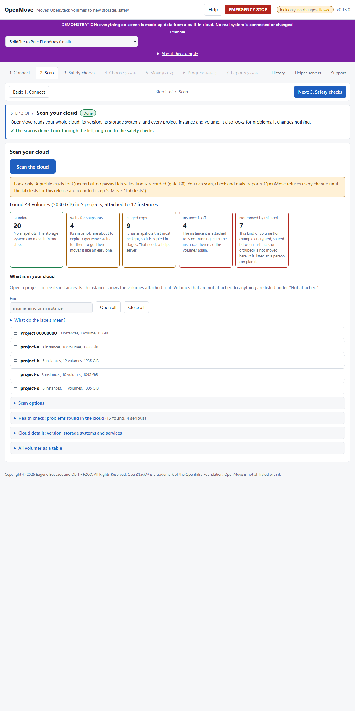

**Purpose.** Know exactly what you are talking to, and what each volume needs. OpenMove acts differently for each OpenStack release (a release it has never been validated on stays read only), and each volume is handled by a method that depends on its snapshots and its attachment.

**What OpenMove does.** One button, **Scan the cloud**, runs three read-only parts in order:

1. **Platform.** Reads the version documents of the Block Storage and Compute APIs and the service lists, works out the release, chooses the matching release profile and lists the Cinder services and the back-ends with their capacity.
2. **Volumes.** Reads every volume, snapshot and instance and shows the cloud as a tree: project, instance, the volumes attached to it, and under each project the volumes that are not attached. Each volume gets a **class**, shown on the screen with a name:

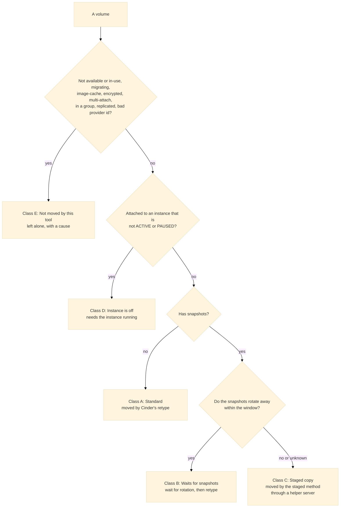

`CLASSES.md` has the exact rules and the cause shown for each held-back volume.

3. **Audit.** Builds the environment audit: projects, volume types, quotas, QoS, backups, where capacity is used and what could get in the way, with findings ranked by severity.

**What you do.** Press the button and read the three results. If you have no database access, load the playbook's query results under "Import" so that snapshot history and provider ids are known. Optionally set a back-end filter and the rotation window (default 14 days).

**Good to know.** Without database access OpenMove cannot see how often snapshots change, so a volume with snapshots becomes class C ("rotation unknown") by design, and it is moved only when a helper server is registered and passes its checks.

**Done when.** All three parts have run.

## 6. Step 3: Safety checks

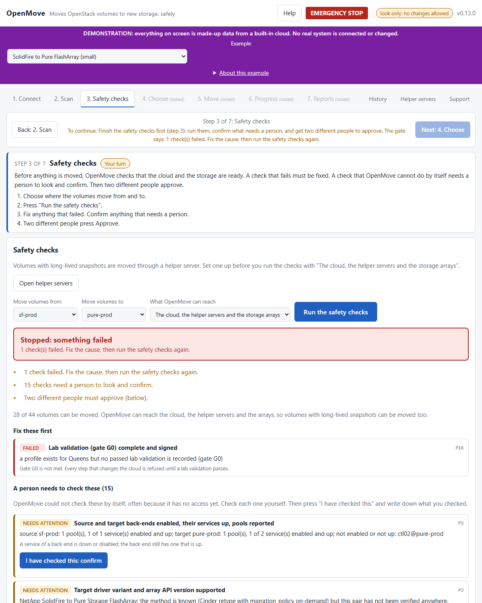

**Purpose.** Prove that it is safe to start, and record who agreed.

**What OpenMove does.** Runs the whole catalogue of checks against the source and target back-end you choose. Every check ends as **pass**, **info**, **warn**, **fail** or **not checked**:

| Result | Meaning | What the approval does |
|---|---|---|
| Pass | Verified | Nothing |
| Info | For your attention | Nothing |
| Warn | Verified, but a person must accept it | Needs a confirmation |
| Fail | Not safe | **Blocks the approval** until fixed and the checks are run again |
| Not checked | OpenMove has no access to verify it (database, hosts, arrays) | Needs a confirmation: a named person states it was checked, with the evidence |

Then two different people approve (first and second approver). The checks are **approved** only when none has failed, every open item is confirmed, both approvals are in, and the run is less than 24 hours old.

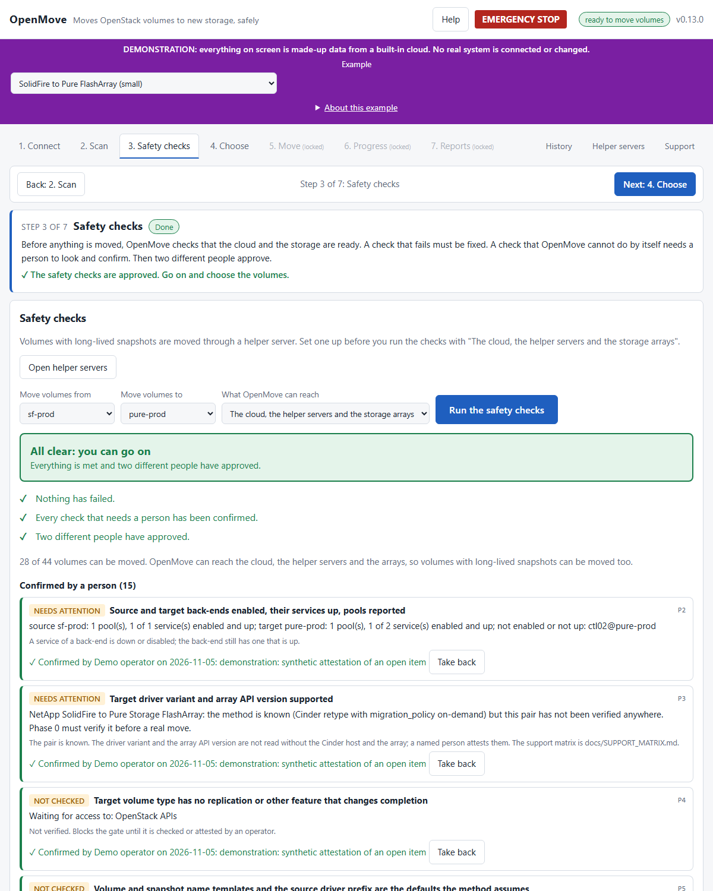

**What you do.**

1. Choose the source and target back-ends and what OpenMove can reach (the OpenStack APIs only, or APIs, helper servers and arrays).
2. Press **Run the safety checks**.
3. Fix every failed check outside OpenMove and run the checks again.
4. For each warning or "not checked" item press **Confirm**, enter your name and the evidence.
5. The first approver approves, then a different person approves as second approver.
6. If the release has no lab validation (gate G0), record it first (step 5, "Lab tests for this OpenStack release").

In the demonstration one button confirms and approves for made-up people. In lab mode a similar button exists for the lab only. A failed check still blocks in both.

**Done when.** The checks are **approved**.

## 7. Step 4: Choose

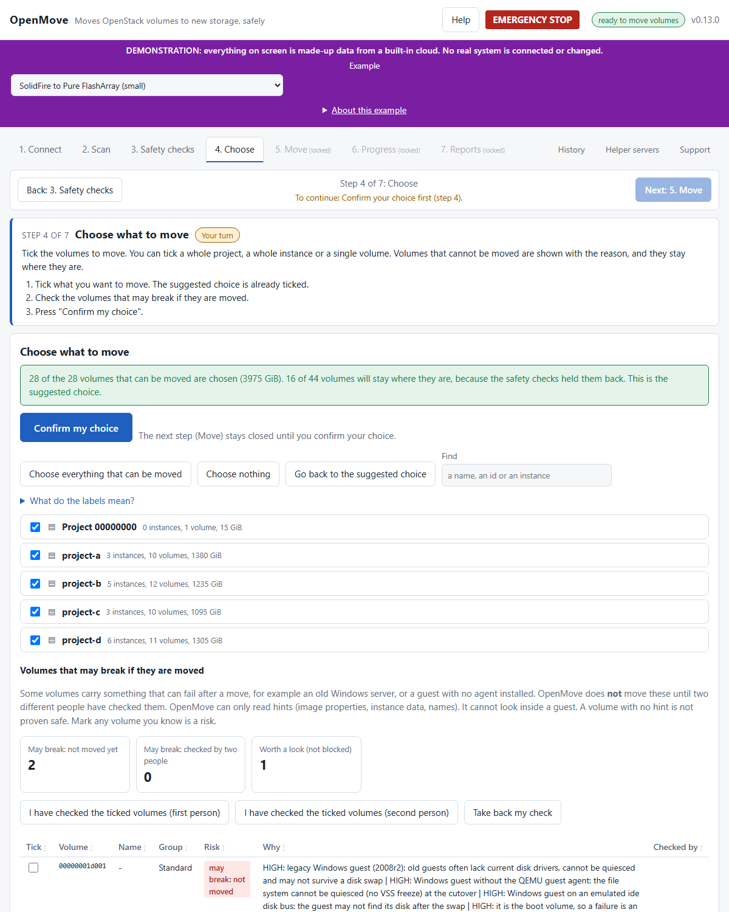

**Purpose.** Decide exactly what moves, how many volumes at once and how carefully. Nothing is all or nothing.

**What OpenMove does.** Shows the tree of step 2 with a box beside every project, instance and volume. A box on a project or an instance chooses every volume below it that can be moved. By default every admitted volume is chosen, except those that need a workload-risk clearance. A held-back volume cannot be ticked; the reason is shown instead. The server refuses what the safety checks did not admit, whatever the page sends.

**What you do.**

* Tick volumes, instances or projects, or use the table below the tree to choose by group (class, project, attachment, size, snapshots, Cinder host, instance, workload risk).
* Adjust the **settings**. They start at safe defaults and can only be made stricter than the process minimum, never looser. A value below the floor is refused, never quietly changed. Two settings set the size of the move:
  * **Copies at the same time** (copy places, default 10): how many volumes are being copied, synchronised or switched at the same moment. This is what loads the storage and the network.
  * **Volumes in progress at once (copying or waiting)** (default 30): how many volumes OpenMove works on at all. It bounds the space used on the new storage and the number of approvals open at one time. A volume that is only waiting (for a person, for a snapshot to rotate away, or in its safety period) does not take a copy place, so a long wait cannot block the queue. When a copy place is free, the next volume in the queue starts at once. Volumes in progress must be at least the copy places.
* Clear **workload risks** (a legacy Windows server, no guest agent, a database): such volumes are not moved until two different people clear them.
* Press **Confirm my choice**.

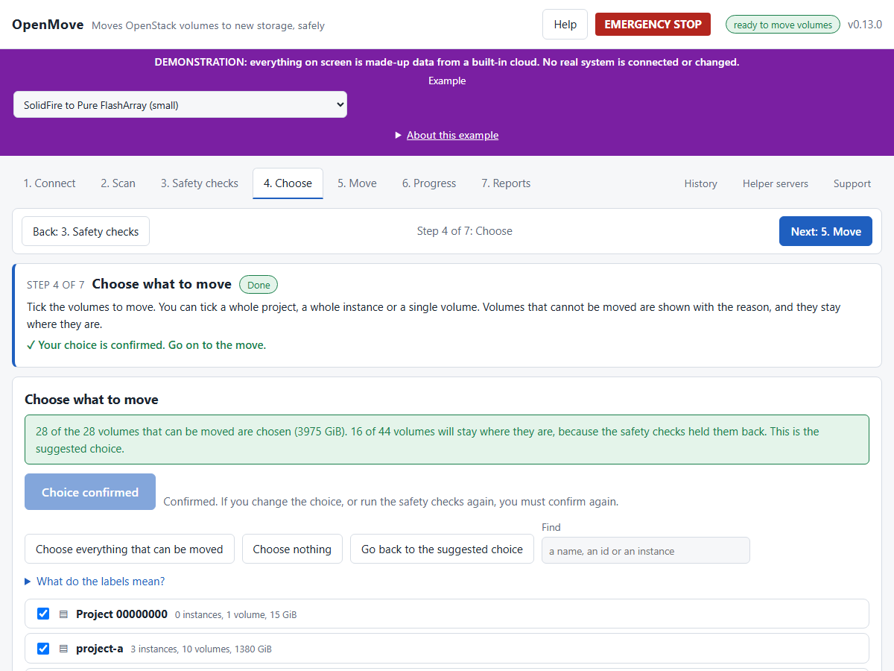

**Options.** See `OPTIONS.md` section 6 for every setting, its default and its limits.

**Done when.** The choice is confirmed. Any later change, or a new run of the safety checks, voids the confirmation.

## 8. Step 5: Move

This is the step that changes the cloud. Class A and B volumes move with **Cinder's own retype** and need only the OpenStack APIs. Class C volumes move by the staged method when a migration host and a Cinder host are registered and pass their checks (`MOVER.md`); otherwise they are held back with a cause.

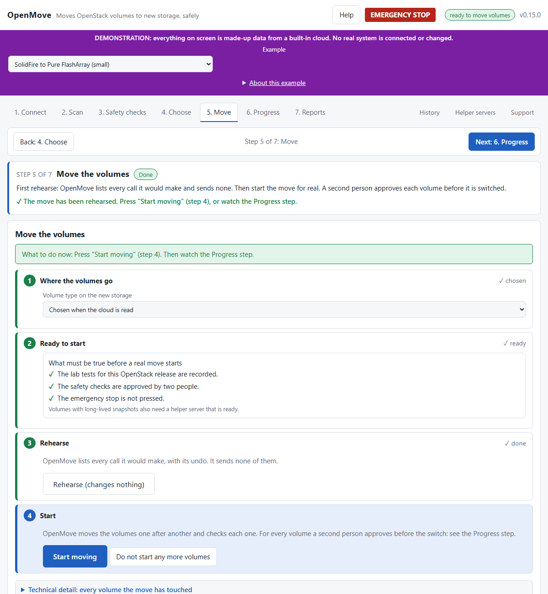

A checklist, **Before a real move can start**, is shown first. Each line is ticked or has a button to the place where it is done: the lab tests for this OpenStack release are recorded, the safety checks are approved by two people, the emergency stop is not pressed. A note adds that volumes with long-lived snapshots also need a helper server that is ready. The start button stays off until a rehearsal has been read.

### What happens to each volume

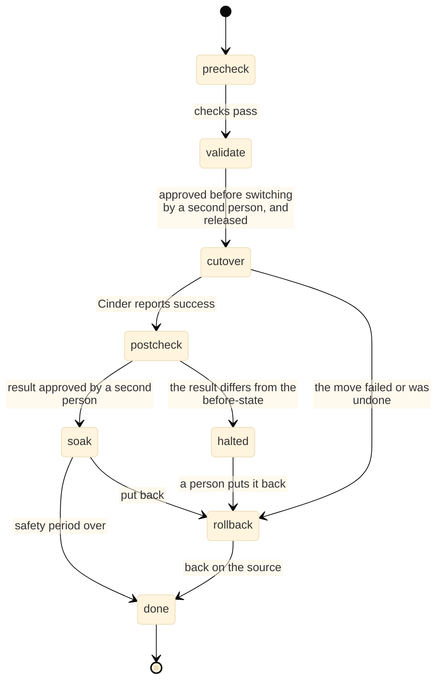

The stages as the screen names them: *Waiting to start*, *Being copied and checked*, *Being switched*, *Switched, being verified*, *In the safety period*, *Finished*, *Stopped or put back*. The panel "What do the stages and the approvals mean?" on the Progress step explains each one.

The calls for an attached volume, in order:

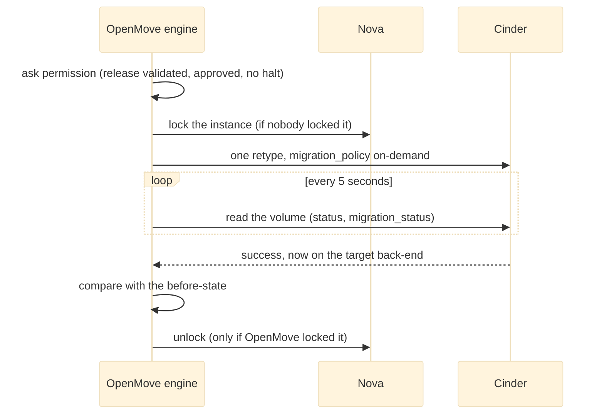

A detached volume has no instance, so there is no lock. Cinder itself marks it `retyping` for the whole move, so nobody can attach it in the middle (seen in the lab).

### What you do

The page is a path of four numbered steps, and a green line at the top says which one to do now (*What to do now: ...*). Every step shows a mark: done, ready, or what is missing.

1. **Where the volumes go.** A list of the volume types that are bound to the target back-end. If exactly one fits, OpenMove chooses it ("Chosen when the cloud is read"). If several fit, you choose; OpenMove never guesses. If none fits, the page says so and what to do, before anything is started.
2. **Ready to start.** What must be true: the lab tests for this release are recorded, the safety checks are approved by two people, the emergency stop is not pressed. Each is ticked or says what is missing.
3. **Rehearse (changes nothing).** Reads the cloud again and lists the exact calls each volume would get, with the undo for each. A volume that would be refused shows the failed check. A real start is **refused** until a rehearsal was read for the same volumes.
   If the release has no recorded lab validation, work through **Lab tests for this OpenStack release (gate G0)**: the playbook's tests (T1 to T23) and four that OpenMove adds (M1 to M4), each with what it proves, what passing looks like and how to do it. OpenMove cannot run them (they need real hosts and people); a person does each one and records the result with a name and what was seen. **Record gate G0 from these results** works only when every test of the retype path has passed for this release, and needs two different people.
4. **Start moving**, with your name. Nothing is sent for a volume yet. Under **Run only at certain times (optional)** you can set **Do not start before** and **Stop starting new volumes after** (UTC). Outside that window no new volume is taken and no retype is sent; what is already moving carries on and is watched. The list of every volume the move has touched is under **Technical detail**.

Then, on the Progress step:

5. Open actions appear at the top of the page. A second person presses **Approve before switching** after checking the volume and the target. That one button gives two approvals: the copy is correct, and the volume is ready to switch. The dialog lists every volume it covers, with its size, project, instance and what was compared.
6. The operator presses **Release**. The engine switches the volumes, with at most as many copying at a time as the copy places allow, and starts the next volume at once when a place is free.
7. After the application owner has checked the application, a second person presses **Approve the result**. The safety period starts. A volume in its safety period does not hold a copy place.
8. **Put back** returns a volume to the source with a retype back, at any time before it is finished. **Preview: put the whole move back** lists, for every switched volume, the calls a put-back would make and their undo, changing nothing; **Put the whole move back** then does it for all of them (name and reason needed).

### Safety on this step

* **EMERGENCY STOP** (the red button, always visible) stops all changes at once. It needs a name and a reason. A retype already sent carries on inside the cloud, but OpenMove sends nothing more, and the instance stays locked until a person resumes.
* A call whose outcome is unknown (for example the connection dropped after sending) is never repeated. Everything halts, and a person reads the cloud.
* The engine halts by itself after a number of failed volumes (setting), when a move runs longer than 6 hours, and when the check after the switch differs from the before-state.
* An instance that someone else locked is left locked and is not unlocked afterwards.
* The check after the switch compares what the tenant sees and must not change: id, size, creation time, project, user, snapshot origin, source volume, availability zone, multi-attach flag, bootable flag, status, attachments. A rename or a metadata edit made by the tenant during the move does not fail it.
* If OpenMove or the computer stops, nothing is lost: the journal is the record, the move resumes, and the page returns to where you were (`RECOVERY.md`).

**Done when.** A rehearsal was read for these volumes (or a move already exists). Steps 6 and 7 then open. The move carries on in the background and is followed on step 6.

## 9. Step 6: Progress

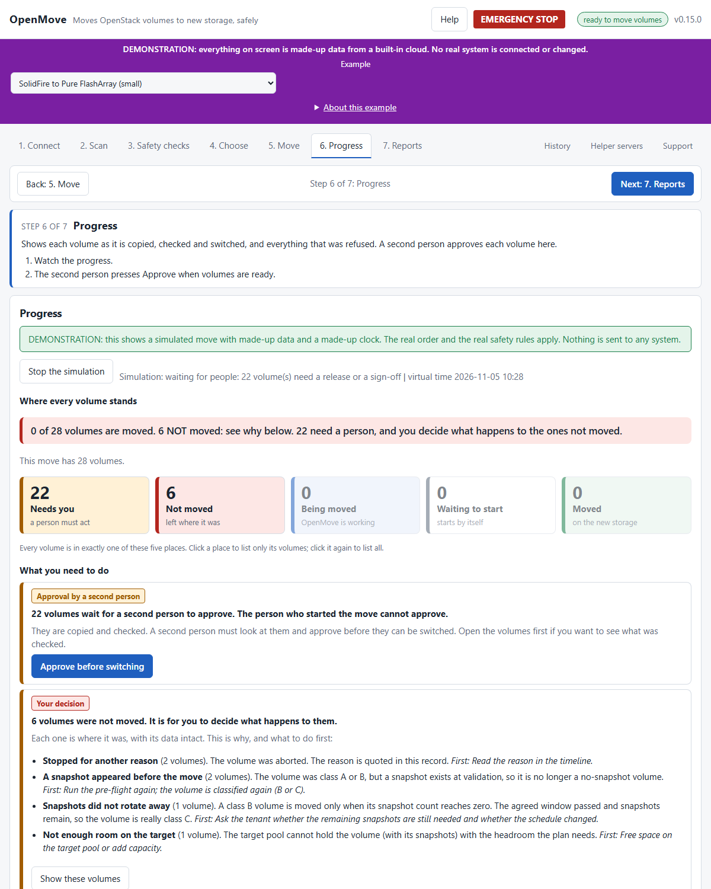

**Purpose.** Watch the move, and give the approvals.

**What it shows.** One answer for every volume: where it is, what happens next, and whether a person has to do something.

* **Where every volume stands.** Five tiles count the volumes of the move. Every volume is in exactly one of them. Click a tile to list only its volumes; click it again to list all.

| Place | Meaning | What you do |
|---|---|---|
| **Needs you** (amber) | A person has to act before the volume can go on. | The page says what, and which kind of action it is (below). |
| **Not moved** (red) | The volume was stopped or put back. It is where it was, with its data intact. Its line says **why in plain words**, what happened to the source and the target, and the first thing to do. | **Your decision**: fix the cause and move it again, or leave it. |
| **Being moved** (blue) | OpenMove is working on it: copying, checking, switching or verifying. | Nothing. |
| **Waiting to start** (grey) | Chosen, but no free place yet. | Nothing. It starts by itself. |
| **Moved** (green) | On the new storage and checked: the volume is **ready to use**. Each volume says whether it is *Moved and ready* (the old copy is kept for the safety period) or *Completed* (the old copy is released). | Nothing. |

A sentence at the top answers the three questions at once, for example: *21 of 28 volumes are moved and ready to use on the new storage. 21 in the safety period (the old copy is kept). 7 NOT moved: see why below.* The decision card lists each cause once, with the number of volumes, so seven failures with two causes read as two lines. A volume's own line adds the detail OpenMove stopped on, quoted, for the support bundle. When a reason is one OpenMove does not know, the card says *Stopped for another reason* and still shows the quoted text; it never hides it.

Three kinds of action exist, and every action on the page carries its kind as a label: **Approval by a second person** (the copy is right and ready to switch, or the switch worked), **Release by you** (you say that the switch may happen) and **Your decision** (a volume was not moved).

* **What you need to do.** One card for each kind of action that is waiting, with the number of volumes, the label of the kind, and the button that does it (**Approve before switching**, **Release all volumes that are ready to switch**, **Approve the result**, **Show these volumes** for the decisions). When nothing waits, the page says so: *Nothing. No volume is waiting for a person.*
* **Every volume**: one line each, with the volume, the place it is in, one sentence about what happens next, and what you must do (a label, or *Nothing to do*). The volumes that need a person come first, then the ones that were not moved, then the rest. Click a volume to see exactly what is being done to it.
* The **board** at the top of every page shows the same five places as small buttons next to the percentage, and the **Open actions** with their buttons.
* **What do the words on this page mean?** The five places and the three approvals, in plain words.
* The **Safety** panel and the event feed (under "How it works") with every refusal.
* **Volumes left out of this move**: volumes that were never part of it or were held back by the safety checks, with the reason and the steps to fix them; the same list is a Word report.

In the demonstration this view shows a simulated move (made-up evidence and a virtual clock). With a real move it follows the real engine.

## 10. Step 7: Reports

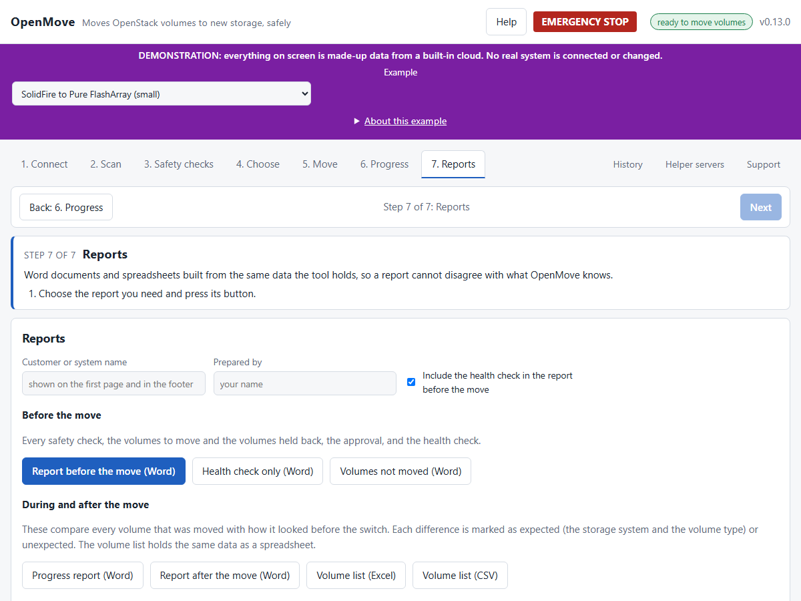

**Purpose.** Documents for the customer and for the file, built from the same data the tool holds, so a report cannot disagree with the tool.

**What you do.** Enter the customer or system name and who prepared it, then download one of the reports (Word, or Excel and CSV for the volume list):

| Report | Needs | Contains |
|---|---|---|
| Pre-migration report | safety checks run | Every check, the volumes to move and those held back, the approval and who gave it, optionally the audit |
| Environment audit | audit | The audit alone |
| Volumes not migrated | safety checks run | Every volume that is not moved, the cause, the state it is left in and the steps to resolve it |
| Update report | a move | During the move: every volume touched, compared with the state recorded before its switch |
| After report | a move | When the move is over: the same comparison, with every difference marked **expected** (back-end and volume type) or **unexpected** (anything else), the check of each volume and a sign-off block. A volume that was put back must match its baseline in every field |
| Volume list (Excel, CSV) | scan | Every volume with its class, size, type, back-end, state, whether it was chosen, its stage, outcome and cause |

## 11. History

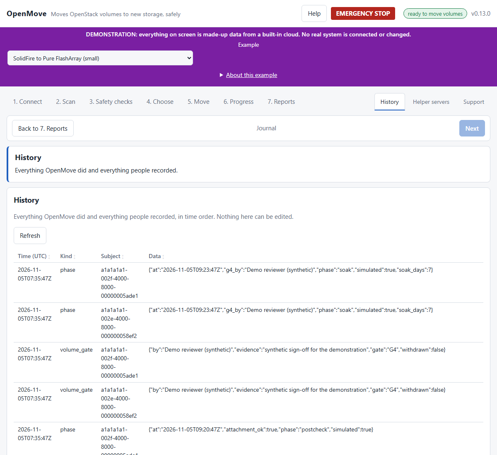

Always open. Every connection, check, confirmation, approval, choice, call that changes the cloud, change to a helper server and emergency stop is written here, in order, with who and when. It is stored in a local SQLite file (`INSTALL.md` section 6). Back it up before and after a move: it is the record of what was done and who agreed. Secrets (passwords, CHAP secrets, tokens) are never in it.

## 12. Helper servers: set up, read and configure

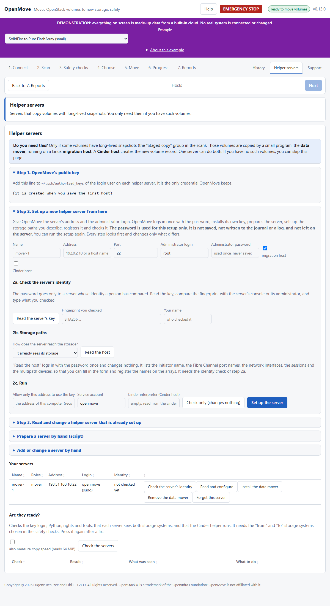

You need helper servers only when some volumes have long-lived snapshots (class C, "Staged copy"). Those volumes are copied by the **data mover** on a Linux **migration host**; a **Cinder host** creates the new volume record. One server can do both. The whole life of a helper server is handled from this tab. **Once a server is set up, it is managed through OpenMove only**: there is no need to log in to it again.

The tab has three steps.

**Step 1. OpenMove's public key.** The only credential OpenMove keeps for a server. It is added to the server's service account during the setup.

**Step 2. Set up a new helper server from here.** Give the address and the administrator login (root, or a user with passwordless sudo) and the password.

1. **2a. Check the server's identity.** Read the server's key, compare the fingerprint with the one the server's administrator gives you, and type what you checked with your name. The password is sent only after that.
2. **2b. Storage paths.** Choose how the server reaches the storage: *iSCSI*, *Fibre Channel* or *it already sees its storage*. **Read the host** logs in once and shows what the server is and what it sees, so the form can be filled in from facts (below). The form:

| Group | Fields |
|---|---|
| iSCSI | array portals; target IQNs to log in to (empty: every target the portals report); initiator IQN (empty: keep the server's); CHAP user and secret; the interfaces to bind sessions to; the replacement timeout; session settings (login timeout, ping interval and timeout, commands per session, queue depth, sessions per portal) |
| Fibre Channel | the array target ports to expect (WWPN); a scan for new devices after the change |
| Storage network | per interface: IPv4 address as ADDRESS/PREFIX and MTU; the ARP and return-path rules for several storage interfaces |
| Multipath | Pure FlashArray and SolidFire settings; extra text for the drop-in file |

3. **2c. Run.** *Check only* lists what would change and changes nothing. *Set up the server* logs in once with the password, installs OpenMove's key and a **control program**, prepares the server, configures the storage paths, registers it and checks it. The password is used for this and then dropped: it is not saved, not in the journal or a log, and not left on the server. Every step of the result says what happened, with the complete output.

**What "Read the host" shows.** The host (name, system, memory, clock, firewall, free space); **the names to register on the arrays**, each with a Copy button: the iSCSI initiator name and the Fibre Channel port names (WWPN); the network interfaces (type, state, addresses, MTU, speed, and which one is the management interface); the iSCSI sessions (portal, target, interface, state); the Fibre Channel target ports seen; the multipath devices with their working and total paths.

**What OpenMove cannot do.** It cannot register the initiator name or the Fibre Channel ports on the arrays, and it cannot zone a Fibre Channel fabric: that is done on the arrays and the switches, and the names to use are shown by "Read the host". It never changes the management interface (the one OpenMove connects through): that interface is shown locked. NIC addresses are IPv4 only.

**Step 3. Read and change a helper server that is already set up.**

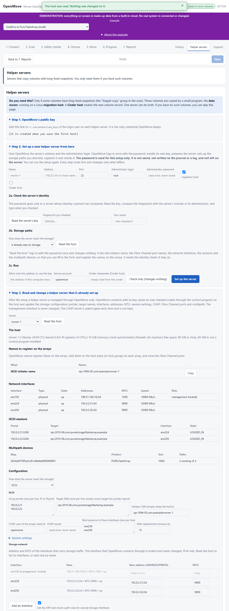

Choose the server (or press **Read and configure** in the table of servers). **Read the host** uses OpenMove's key only, no password. The form is filled in from the configuration saved for that server, and the interface table is filled in from the reading. Change what is needed, enter your name, and press:

* **Check only (changes nothing)**: the script runs in check mode and says what would change.
* **Apply the configuration**: OpenMove sends its own script to the server's control program, which checks it by its hash before running it, and applies it: portals, target names, interface binding, session settings, CHAP, addresses and MTU, ARP rules, Fibre Channel scan, multipath. The CHAP secret is asked again each time and is not kept. The result lists every step. The saved configuration is updated only when the change succeeded.

A server that was set up before the control program existed shows "run the setup of this host once more": run step 2 again with the administrator password once; after that the key is enough.

Below the three steps are the table of registered servers (check the identity, install or remove the data mover, forget, **Read and configure**), the checks of the servers (H1 to H9, C1, C2), and two manual routes: a script to prepare a server by hand, and a form to add a server that was prepared by hand. `DEPLOYMENT.md` explains everything on the server, section by section.

## 13. Support

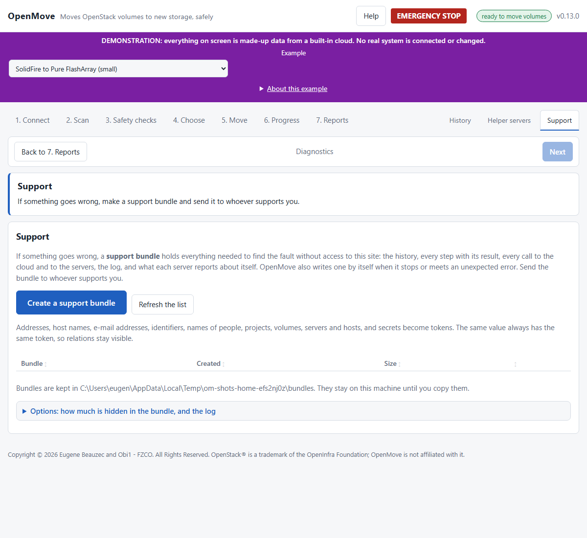

The support bundle, the log and the call trace, with a choice of how much each hides (names, addresses, secrets). The bundle can be sent to whoever supports you and read there without exposing the customer's names. `DIAGNOSTICS.md` has the details.

## 14. If something goes wrong

| Situation | What to do |
|---|---|
| A step is locked | Read the message: it names the step to finish first |
| A check failed | Fix it outside OpenMove, run the safety checks again |
| The approval expired (older than 24 hours) | Run the safety checks again and approve again |
| Volumes wait and nothing moves | Look at **Open actions** at the top: usually a second person must approve, or you must release |
| A volume shows "the check after the switch failed: halted" | Look at the volume and the instance. Put the volume back, or fix it by hand, then resume |
| An unknown outcome halted everything | Read the cloud. Resume only when you know what state the volume is in |
| You need everything to stop now | Press EMERGENCY STOP |
| OpenMove or the computer was closed during a move | Start OpenMove again with the same data folder and open the address it prints; the move resumes from the journal and the page returns to where you were (`RECOVERY.md`) |
| A helper server shows "run the setup once more" | Run step 2 with the administrator password once; the control program is installed and the key is enough from then on |
| The host reading shows no iSCSI sessions | Check the portals, the target names, the CHAP secret and that the initiator name is registered on the array |

More in `OPERATIONS.md` (restart, the notes and their meaning) and `USER_GUIDE.md` (troubleshooting).

## 15. Regenerating the screenshots

The screenshots are made by a script from the real interface, not drawn by hand: `python tools/dev/screenshots.py` (the demonstration steps and the Helper servers tab, with a made-up host reading), and `python tools/dev/screenshots.py --lab` adds the Move step from the OpenStack lab (images 14 to 16). Run it again after a change to the interface. Never save a screenshot of a real cloud under these names.
