# The process, step by step

This is the document to hand to a person who has never seen OpenMove. It shows the whole process from the first click to the last, what OpenMove does at each step, what the person does, which options exist and what must be true before the next step opens. Every screenshot is the real interface. Steps 1 to 6, 8 and 9 are shown in the demonstration mode (made-up data, nothing real is connected). The Move step is shown against the OpenStack lab, where the real engine runs.

Other documents go deeper: `INSTALL.md` (install), `OPERATIONS.md` (the procedure for a real migration, with checklists), `OPTIONS.md` (every option and setting in one place), `SAFETY.md` (why each control exists), `ARCHITECTURE.md` (how it is built).

## 1. What OpenMove does, in one paragraph

OpenMove reads an OpenStack cloud, reports on it, and moves Cinder volumes from one storage back-end to another (for example SolidFire to a FlashArray). It works through a local web page that walks the person through nine steps in a fixed order. The first five steps only read. The last changing step, Move, is protected by a recorded lab validation, an approved gate, two different people, and a halt button. Everything it does is written to a journal.

## 2. The nine steps and what unlocks each

The wizard is **gated**. A step opens only when every step before it is done. A locked step is greyed out with "(locked)", clicking it says what is missing, and the Next button stays off until the current step is done. The server decides which step is open, not the page, so reloading the page or opening a link such as `/#preflight` cannot skip a step.

```mermaid
%%{init: {"theme": "base", "fontFamily": "Arial, Helvetica, sans-serif", "themeVariables": {"fontSize": "15px"}, "flowchart": {"htmlLabels": false, "padding": 32, "nodeSpacing": 40, "rankSpacing": 50}}}%%
flowchart LR
    S1["1 Connect<br/>log in to the cloud"] --> S2["2 Platform<br/>release and back-ends"]
    S2 --> S3["3 Inventory<br/>volumes and classes"]
    S3 --> S4["4 Audit<br/>environment report"]
    S4 --> S5["5 Pre-flight<br/>checks and gate"]
    S5 -->|gate approved by two people| S6["6 Select<br/>what to move"]
    S6 -->|selection confirmed| S7["7 Move<br/>dry run, then the run"]
    S7 -->|dry run read| S8["8 Reports"]
    S8 --> S9["9 Live<br/>watch and the journal"]
    classDef read fill:#e6eefb,stroke:#1f5fbf,color:#0c1319
    classDef change fill:#fde7e5,stroke:#b3261e,color:#0c1319
    class S1,S2,S3,S4,S5,S6,S8,S9 read
    class S7 change
```

| Step | Opens when | What it does | It is done when | Changes the cloud? |
|---|---|---|---|---|
| 1 Connect | always | Logs in to Keystone as an administrator | the login worked | No (one login call) |
| 2 Platform | connected | Finds the OpenStack release, the back-ends and the Cinder services | the platform is detected | No |
| 3 Inventory | platform detected | Reads every volume, snapshot and instance and gives each volume a class | the inventory is read | No |
| 4 Audit | inventory read | Builds the environment audit | the audit has run | No |
| 5 Pre-flight | audit run | Runs every check, collects attestations and two sign-offs | **the gate is approved** | No |
| 6 Select | gate approved | Chooses the volumes and the settings | **the selection is confirmed** | No |
| 7 Move | selection confirmed | Dry run, then the real run with Cinder's retype | **a dry run was read** for these volumes (or a run already exists) | **Yes**, only here |
| 8 Reports | step 7 done | Word reports | n/a | No |
| 9 Live | step 7 done | Progress, safety panel, event feed | n/a | No |
| Journal | always | The record of everything | n/a | No |

Things that close a step again, on purpose:

* Disconnecting closes everything after step 1.
* Running the pre-flight again makes a new run: the earlier sign-offs belong to the old run, so the gate is open again and steps 6 to 9 close.
* Changing the selection, or the pre-flight run changing under it, voids the confirmation: step 7 closes until it is confirmed again.
* A real run is refused unless a dry run covering the same volumes was read for the current pre-flight run. A restart that resumes volumes already in the journal is the one exception.

## 3. Who does what

Two different people are needed for a real migration. OpenMove checks the names; it cannot check identity, so the second person must really be a second person.

| Role | Does | Cannot do |
|---|---|---|
| **Operator** | Connects, runs the steps, attests open items, signs the gate as operator, starts the run, releases volumes | Sign G2, G3 or G4 for a volume the operator started |
| **Second person** (reviewer) | Signs the gate as reviewer, signs G2 and G3 before a volume moves and G4 after it has been verified | Be the same name as the operator |
| **Application owner** | Checks that the application works after a move, before G4 | n/a (outside the tool) |

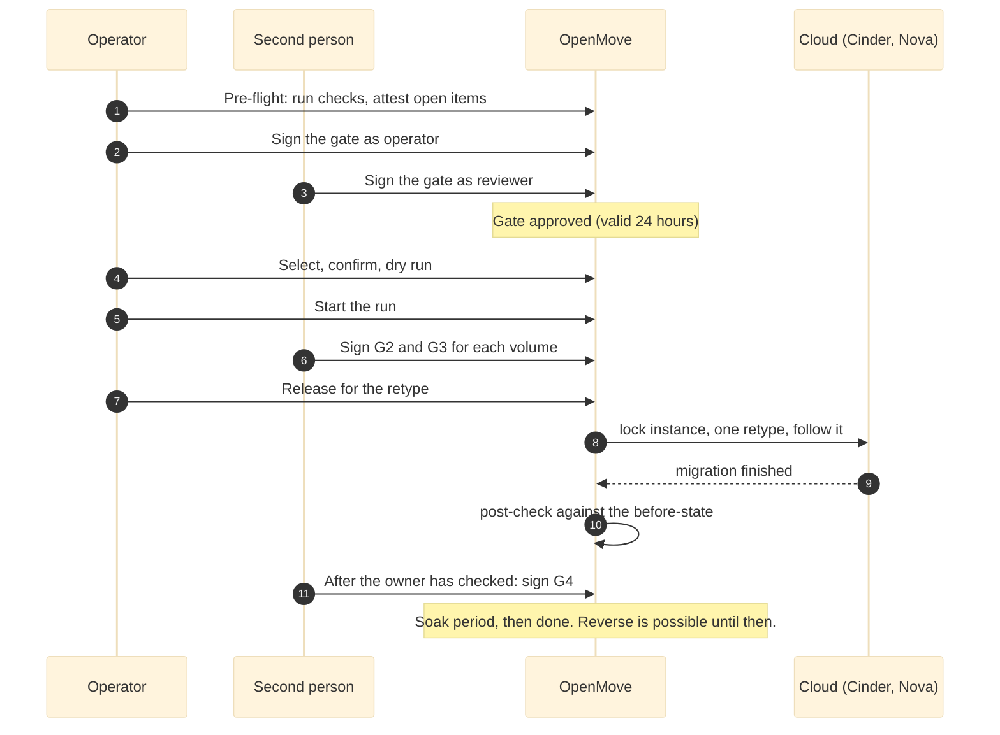

## 4. Step 1: Connect

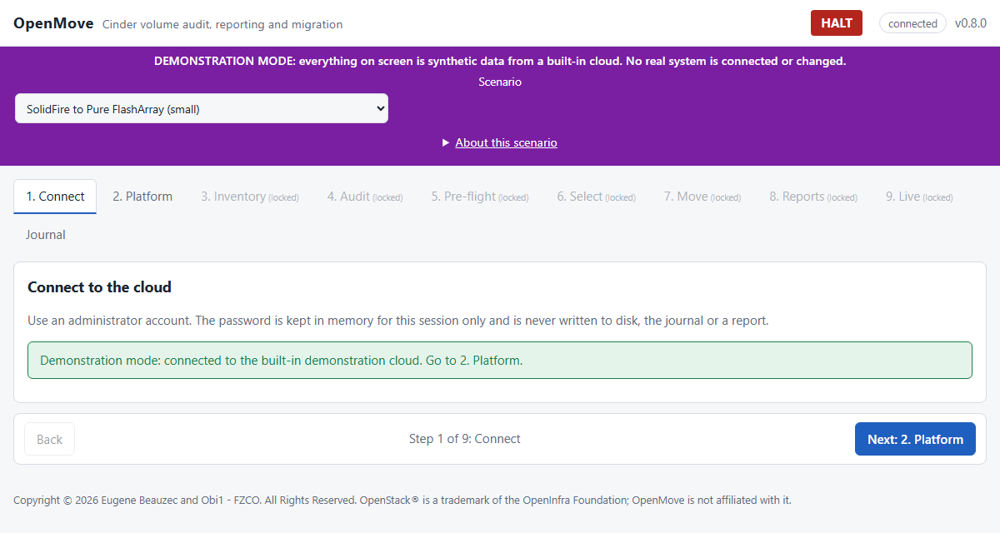

**Purpose.** Log in to the cloud with an administrator account. Only an administrator sees volumes, instances and services of all projects.

**What OpenMove does.** One login call to Keystone. The password stays in memory for this session; it is never written to disk, the journal or a report. TLS certificates are verified unless you turn that off.

**What you do.** Fill in the form and press **Connect**. The roles of the account are shown; a warning appears if it has no admin role.

**Options.** Identity (Keystone) URL, user name, password, project, user domain, project domain, region, endpoint interface (public, internal or admin), CA certificate file, verify TLS. See `OPTIONS.md` section 3. In the demonstration and in lab mode the form is already connected or filled in (lab mode needs no password).

**Done when.** The login worked.

**If it goes wrong.** "Connection refused": the address is wrong or the cloud is down. A certificate error: give the CA file. "Not an administrator": the lists will be incomplete.

## 5. Step 2: Platform

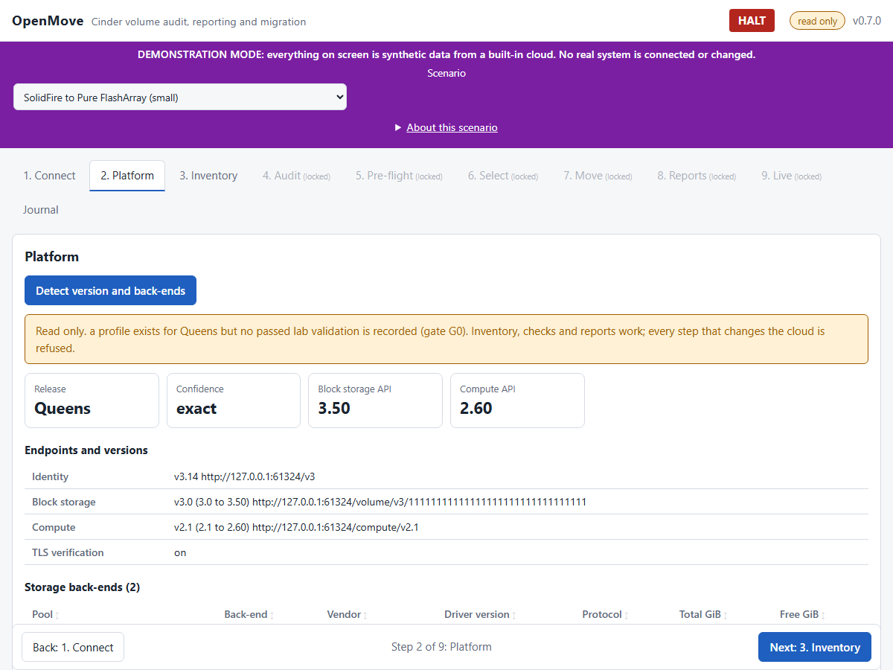

**Purpose.** Know exactly what you are talking to. OpenMove acts differently for each OpenStack release, and a release it has never been validated on stays read only.

**What OpenMove does.** Reads the version documents of the Block Storage and Compute APIs and the service lists. It works out the release from the API versions, chooses the matching **release profile**, and lists the Cinder services and the back-ends (pools) with their capacity.

**What you do.** Press **Detect version and back-ends** and read the result.

**What to look for.** The release and how sure the detection is; the profile status (**untested** means read only until a lab validation is recorded, gate G0); the back-ends, which you pick as source and target in step 5.

**Done when.** The platform is detected.

## 6. Step 3: Inventory

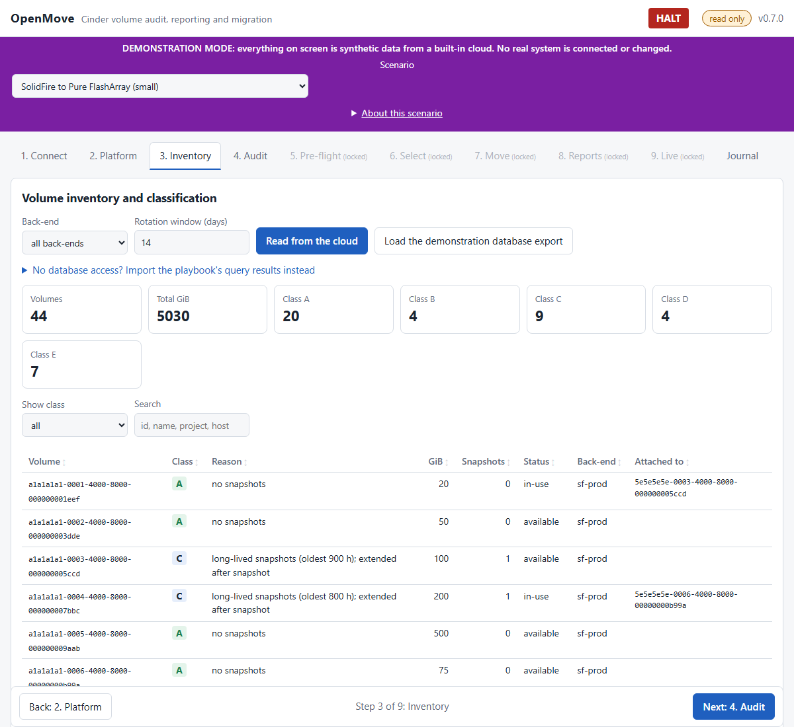

**Purpose.** A list of every volume, and a decision for each: can it be moved by Cinder's retype, must it wait, or must it be left alone?

**What OpenMove does.** Reads volumes, snapshots and instance states with read calls only. Each volume gets a **class**:

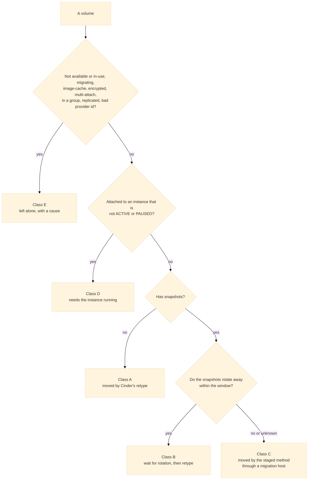

`CLASSES.md` has the exact rules and the cause shown for each held-back volume.

**What you do.** Choose a back-end filter and a rotation window if you want to (options below), press **Read from the cloud**, then read the table. Click a column heading to sort. If you have no database access, paste or load the playbook's query results under "Import" so that snapshot history and provider ids are known.

**Options.** Back-end (all or one), rotation window in days (default 14), import of the playbook exports (A1, A2, A4, instances).

**Done when.** The inventory is read.

**Good to know.** Without database access OpenMove cannot see how often snapshots change, so a volume with snapshots becomes class C ("rotation unknown") by design, and the engine does not move it.

## 7. Step 4: Audit

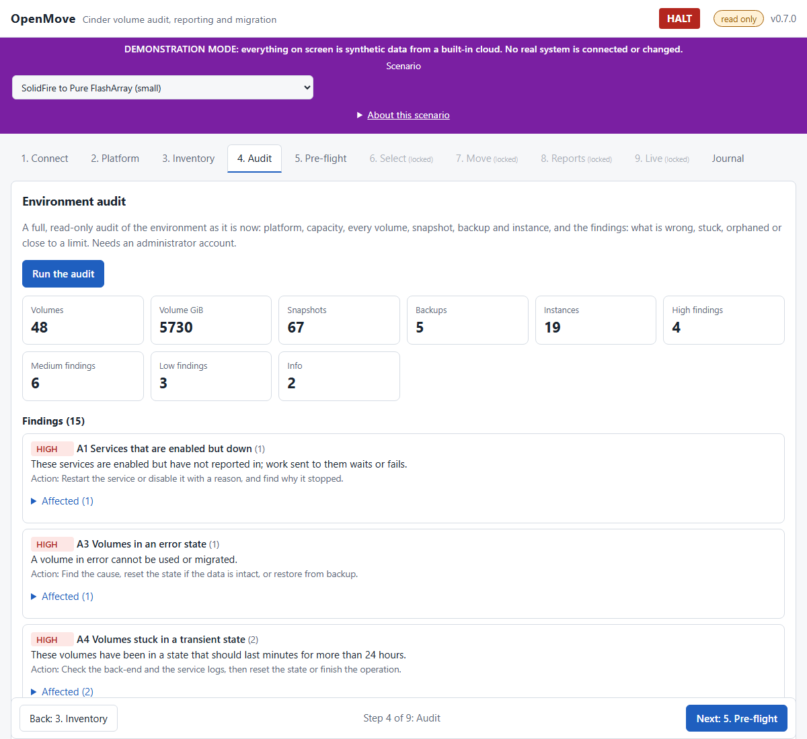

**Purpose.** A picture of the whole environment before anything is planned: projects, volume types, quotas, QoS, backups, where capacity is used, and what could get in the way.

**What OpenMove does.** Reads types, QoS, backups, projects and quotas, and builds findings with a severity. Read only.

**What you do.** Press **Run the audit** and read the findings. The same data is the Word audit report in step 8.

**Done when.** The audit has run.

## 8. Step 5: Pre-flight and the gate

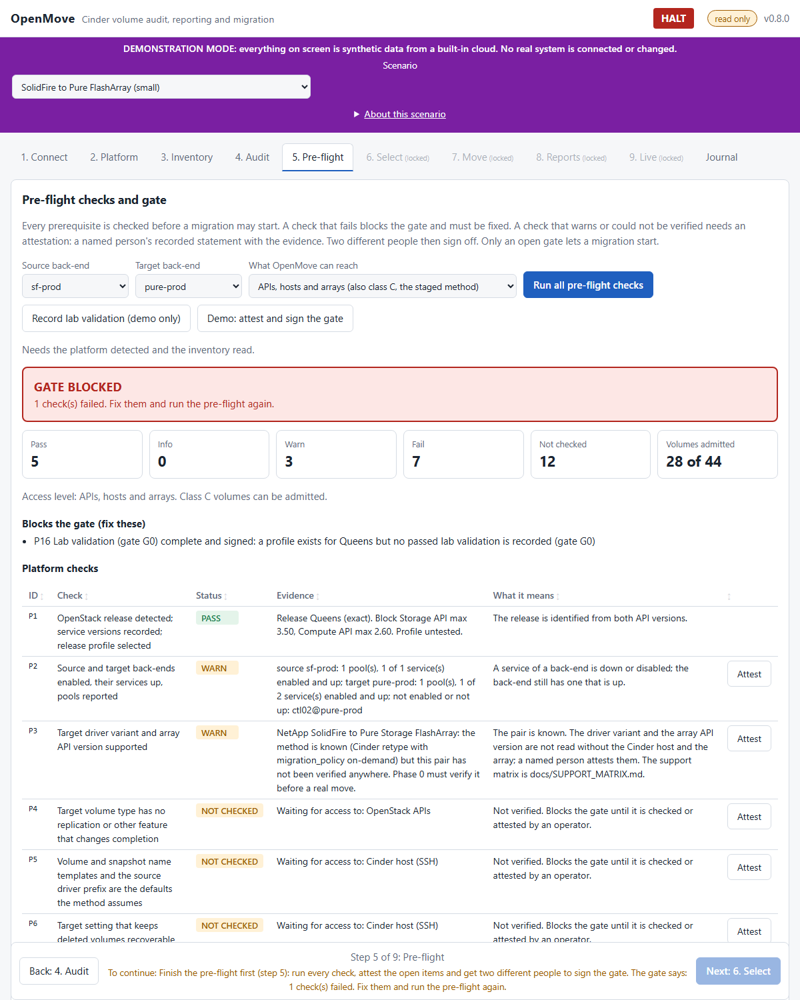

**Purpose.** Prove that it is safe to start, and record who agreed.

**What OpenMove does.** Runs the whole catalogue of checks against the source and target back-end you choose. Every check ends as **pass**, **info**, **warn**, **fail** or **not checked**:

| Result | Meaning | What the gate does |
|---|---|---|
| Pass | Verified | Nothing |
| Info | For your attention | Nothing |
| Warn | Verified, but a person must accept it | Needs an attestation |
| Fail | Not safe | **Blocks the gate** until fixed and the pre-flight is run again |
| Not checked | OpenMove has no access to verify it (database, hosts, arrays) | Needs an attestation: a named person states it was checked, with the evidence |

Then two different people sign off (operator and reviewer). The gate is **approved** only when no check has failed, every open item is attested, both signatures are in, and the run is less than 24 hours old.

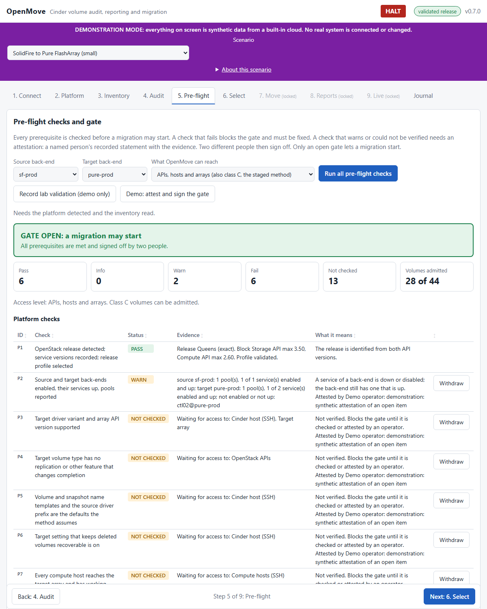

**What you do.**

1. Choose the source and target back-ends and what OpenMove can reach (the OpenStack APIs only, or APIs, hosts and arrays).
2. Press **Run all pre-flight checks**.
3. Fix every failed check outside OpenMove and run it again.
4. For each warning or not-checked item press **Attest**, enter your name and the evidence.
5. The operator signs, then a different person signs as reviewer.
6. If the release has no lab validation (gate G0), record it first: two different people and a description of at least 40 characters.

In the demonstration, one button attests and signs for made-up people. In lab mode a similar button exists for the lab only. A failed check still blocks in both.

**Done when.** The gate is **approved**. The bar at the bottom says what is still missing.

## 9. Step 6: Select

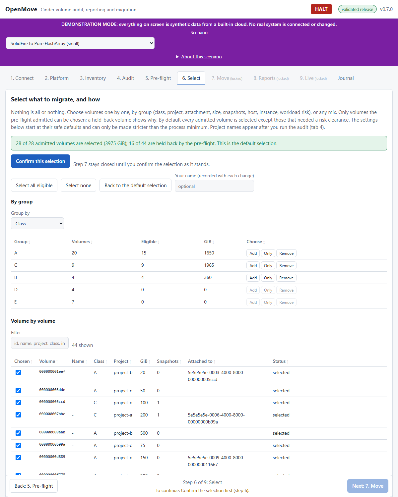

**Purpose.** Decide exactly what moves, in what amount and how carefully. Nothing is all or nothing.

**What OpenMove does.** Lists every volume with its class and whether it is eligible. By default every admitted volume is selected, except those that need a workload-risk clearance. A held-back volume cannot be forced in; the reason it is held back is shown.

**What you do.**

* Choose volumes one by one, or by group (class, project, attachment, size, snapshots, Cinder host, instance, workload risk) with **Add**, **Only** and **Remove**.
* Adjust the **settings** (concurrency, rechecks, soak and so on). They start at safe defaults and can only be made stricter than the process minimum, never looser. A value below the floor is refused, never quietly changed.
* Clear **workload risks** (a legacy Windows server, no guest agent, a database): such volumes are not moved until two different people clear them.
* Press **Confirm this selection**.

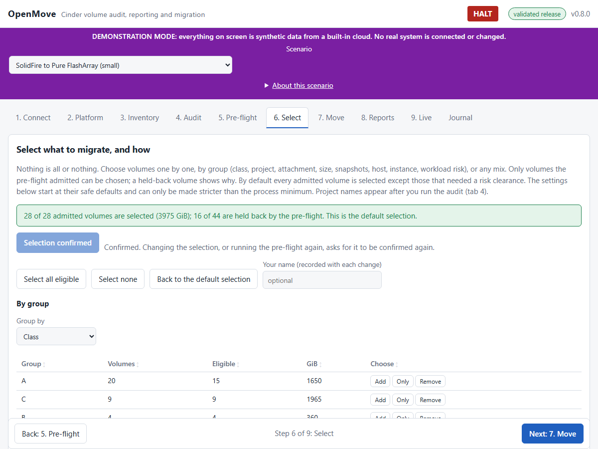

**Options.** See `OPTIONS.md` section 6 for every setting, its default and its limits.

**Done when.** The selection is confirmed. Any later change, or a new pre-flight run, voids the confirmation.

## 10. Step 7: Move

This is the only step that changes the cloud. It moves class A and B volumes with **Cinder's own retype** and needs only the OpenStack APIs. (Class C volumes are moved by the staged method when a migration host and a Cinder host are registered and pass their checks, `MOVER.md`; otherwise they are held back with a cause.)

### What happens to each volume

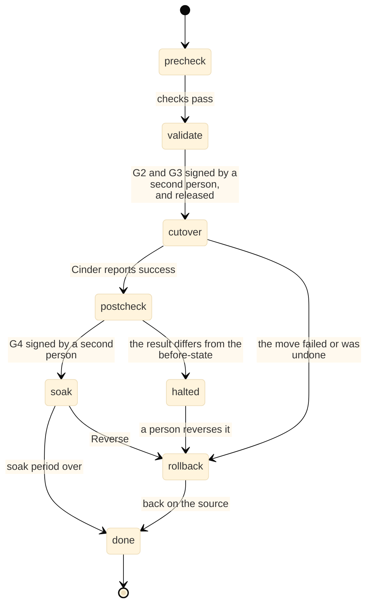

The calls for an attached volume, in order:

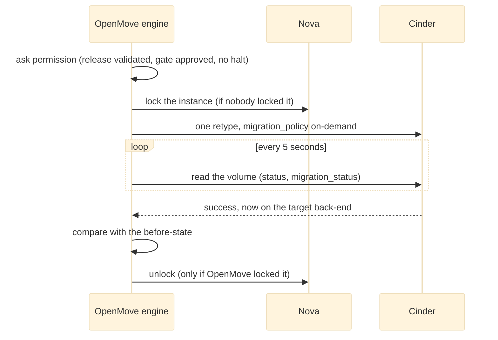

A detached volume has no instance, so there is no lock. Cinder itself marks it `retyping` for the whole move, so nobody can attach it in the middle (seen in the lab).

### What you do

1. **Dry run (changes nothing).** Reads the cloud again and lists the exact calls each volume would get, with the undo for each. A volume that would be refused shows the failed check. A real run is **refused** until a dry run was read for the same volumes.
2. If the release has no recorded lab validation, **Record lab validation (G0)** (two people). The **Phase 0: the lab tests** panel lists the playbook's tests (T1 to T22) and four that OpenMove adds (M1 to M4): what each proves, what passing looks like and how to do it. OpenMove cannot run them (they need real hosts and people); a person does each one and records the result with a name and what was seen. **Record gate G0 from these results** works only when every test of the retype path has passed for this release.
3. Choose the target volume type (empty means the only type that fits). Optionally set the **run window** (UTC times): outside it no new volume is taken and no retype is sent, and what is already moving carries on and is watched. Then **Start the run** with your name. Nothing is sent for a volume yet.
4. A second person presses **Sign G2 and G3** after checking the volume and the target.
5. **Release all for the retype** (volumes are held for release unless the setting says otherwise).
6. The engine moves the volumes, at most as many at a time as the setting allows. Read **What is happening** for each volume.

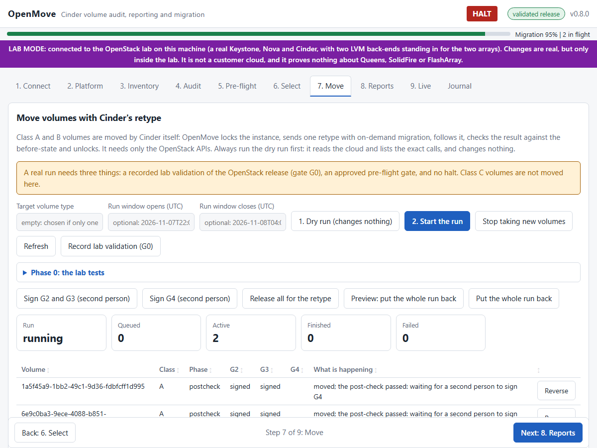

7. After the application owner has checked the application, a second person presses **Sign G4**. The soak period starts.

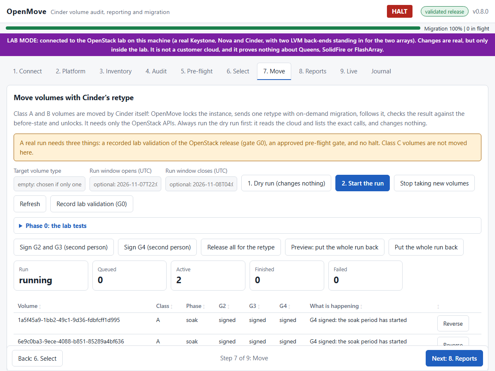

8. **Reverse** puts a volume back with a retype back, at any time before it is done (see `OPERATIONS.md`). **Preview: put the whole run back** reads the cloud and lists, for every cut-over volume, the calls a reverse would make and their undo, changing nothing; **Put the whole run back** then does it for all of them (name and reason needed).

### Safety on this step

* **HALT** (the red button, always visible) stops all changes at once. It needs a name and a reason. A retype already sent carries on inside the cloud, but OpenMove sends nothing more, and the instance stays locked until a person resumes.
* A call whose outcome is unknown (for example the connection dropped after sending) is never repeated. Everything halts, and a person reads the cloud.
* The engine halts by itself after a number of failed volumes (setting), when a move runs longer than 6 hours, and when the post-check differs from the before-state.
* An instance that someone else locked is left locked and is not unlocked afterwards.
* The post-check compares what the tenant sees and must not change: id, size, creation time, project, user, snapshot origin, source volume, availability zone, multi-attach flag, bootable flag, status, attachments. A rename or a metadata edit made by the tenant during the move does not fail it.

**Done when.** A dry run was read for these volumes (or a run already exists). Steps 8 and 9 then open. The run itself carries on in the background and can be followed on step 9.

## 11. Step 8: Reports

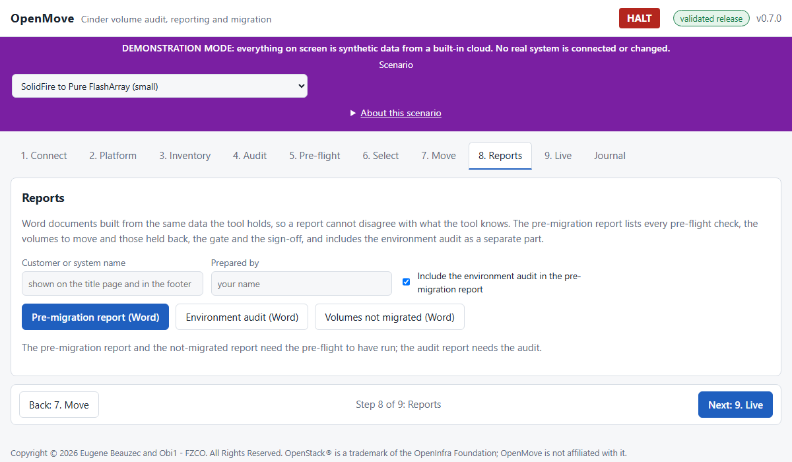

**Purpose.** Documents for the customer and for the file, built from the same data the tool holds, so a report cannot disagree with the tool.

**What you do.** Enter the customer or system name and who prepared it, then download one of the reports (Word, or Excel and CSV for the volume list):

| Report | Needs | Contains |
|---|---|---|
| Pre-migration report | pre-flight run | Every check, the volumes to move and those held back, the gate and its sign-offs, optionally the audit |
| Environment audit | audit | The audit alone |
| Volumes not migrated | pre-flight run | Every volume that is not moved, the cause, the state it is left in and the steps to resolve it |
| Update report | a run | During the run: every volume the run touched, compared with the state recorded before its cutover |
| After report | a run | When the run is over: the same comparison, with every difference marked **expected** (back-end and volume type) or **unexpected** (anything else), the post-check of each volume and a sign-off block. A volume that was put back must match its baseline in every field |
| Volume list (Excel, CSV) | inventory | Every volume with its class, size, type, back-end, state, whether it was admitted and selected, its phase, outcome and cause: the same data as a spreadsheet |

## 12. Step 9: Live

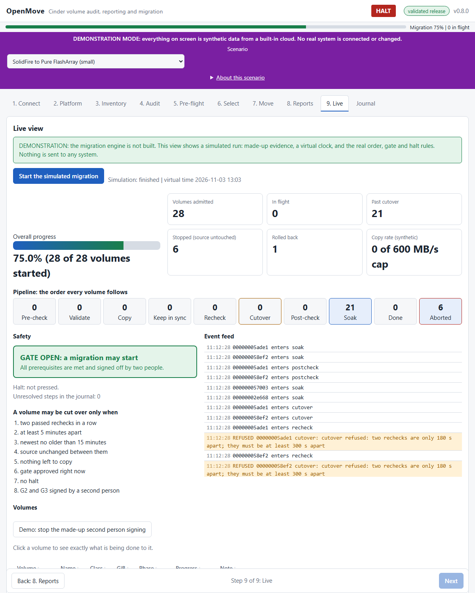

**Purpose.** Watch the run and the safety state.

**What it shows.** Overall progress; counts of volumes in each phase of the pipeline; the **Safety** panel (gate, halt, unresolved steps, the conditions every cutover must meet); the event feed with every refusal; a table of volumes (click one to see exactly what is being done to it); and the not-migrated list with its report.

In the demonstration this view shows a simulated run of the staged method (made-up evidence and a virtual clock). With a real run it follows the real engine.

## 13. The Journal

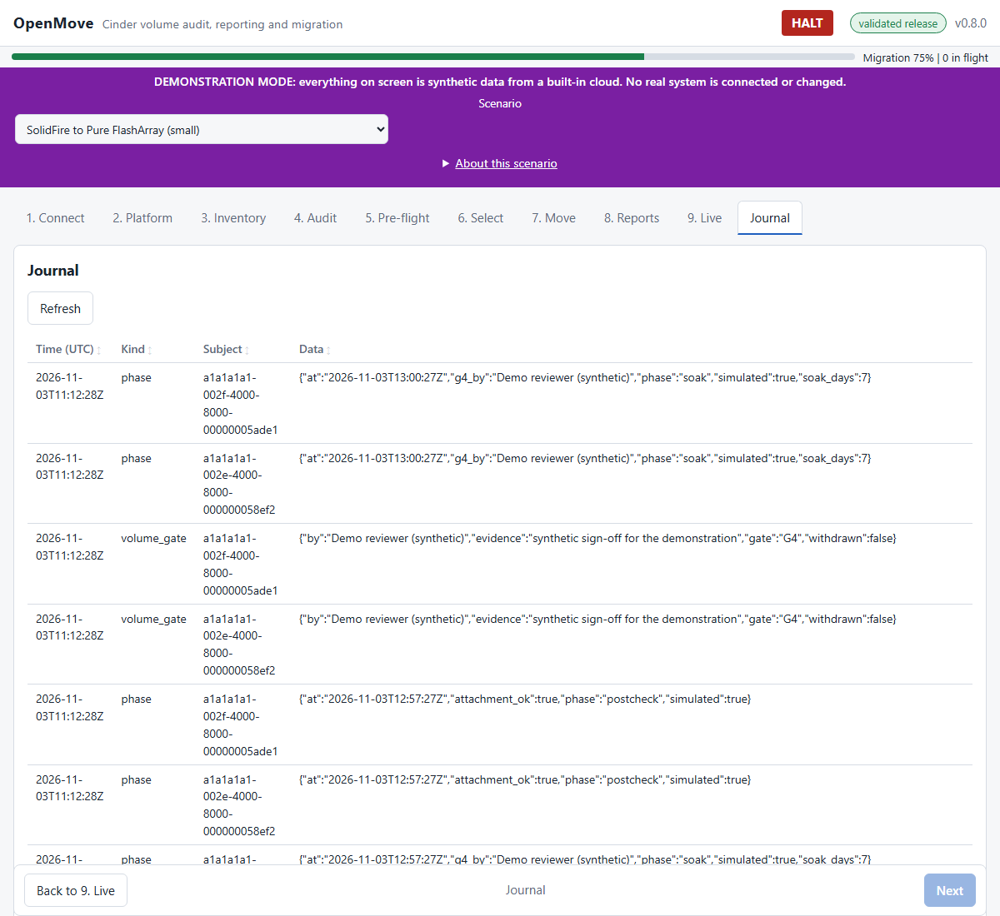

Always open. Every connection, check, attestation, signature, selection, call to change the cloud and halt is written here, in order, with who and when. It is stored in a local SQLite file (see `INSTALL.md` section 6). Back it up before and after a run: it is the record of what was done and who agreed.

## 14. If something goes wrong

| Situation | What to do |
|---|---|
| A step is locked | Read the message: it names the step to finish first |
| A check failed | Fix it outside OpenMove, run the pre-flight again |
| The gate expired (older than 24 hours) | Run the pre-flight again and sign again |
| A volume shows "the post-check failed: halted" | Look at the volume and the instance. Reverse the volume, or fix it by hand, then resume |
| An unknown outcome halted everything | Read the cloud. Resume only when you know what state the volume is in |
| You need everything to stop now | Press HALT |
| OpenMove was closed during a run | Start it again, connect, run the steps and start the run with the same target type: it resumes from the journal |

More in `OPERATIONS.md` (restart, the notes and their meaning) and `USER_GUIDE.md` (troubleshooting).

## 15. Regenerating the screenshots

The screenshots are made by a script from the real interface, not drawn by hand: `python tools/dev/screenshots.py` (the demonstration steps), and `python tools/dev/screenshots.py --lab` adds the Move step from the OpenStack lab. Run it again after a change to the interface.
